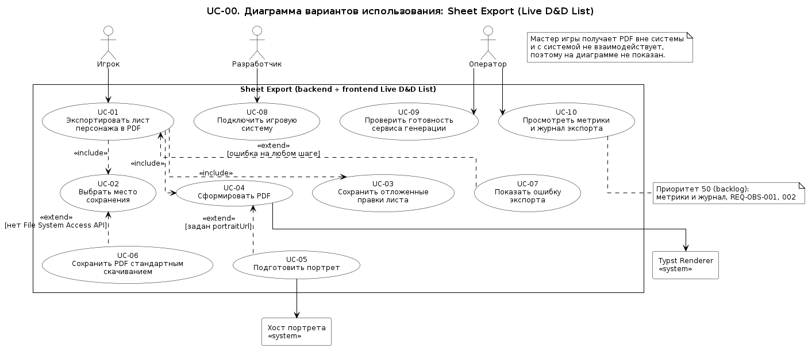
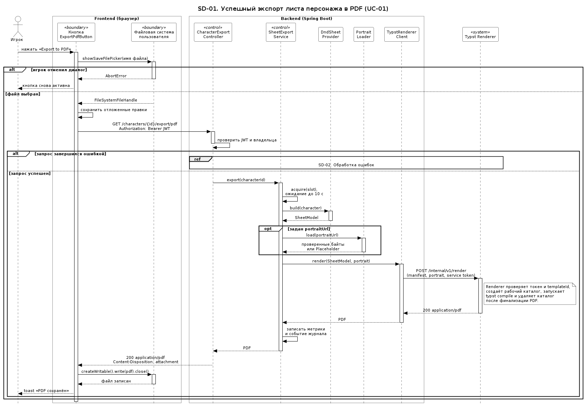
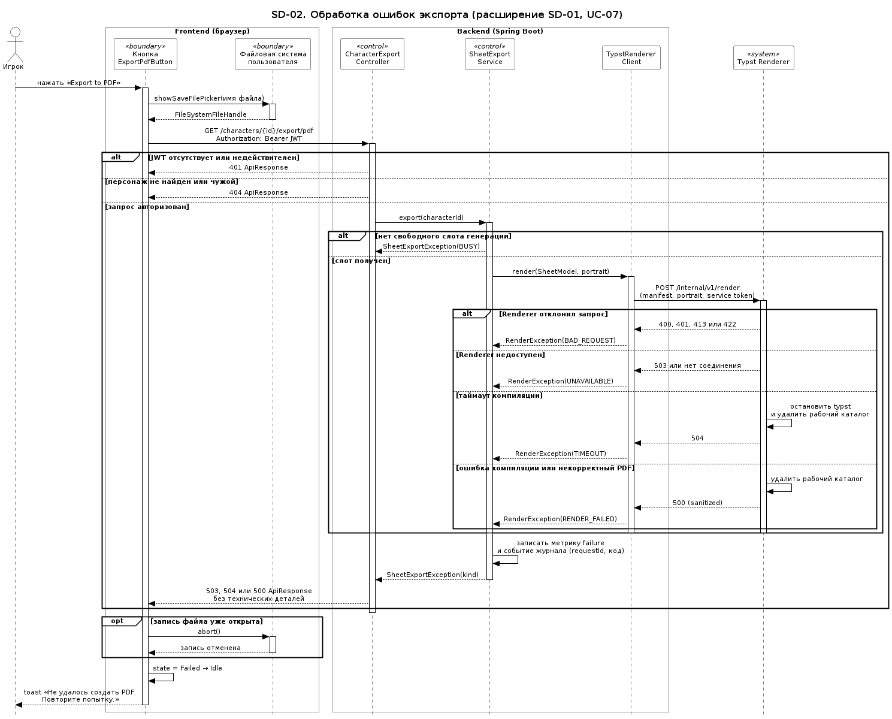
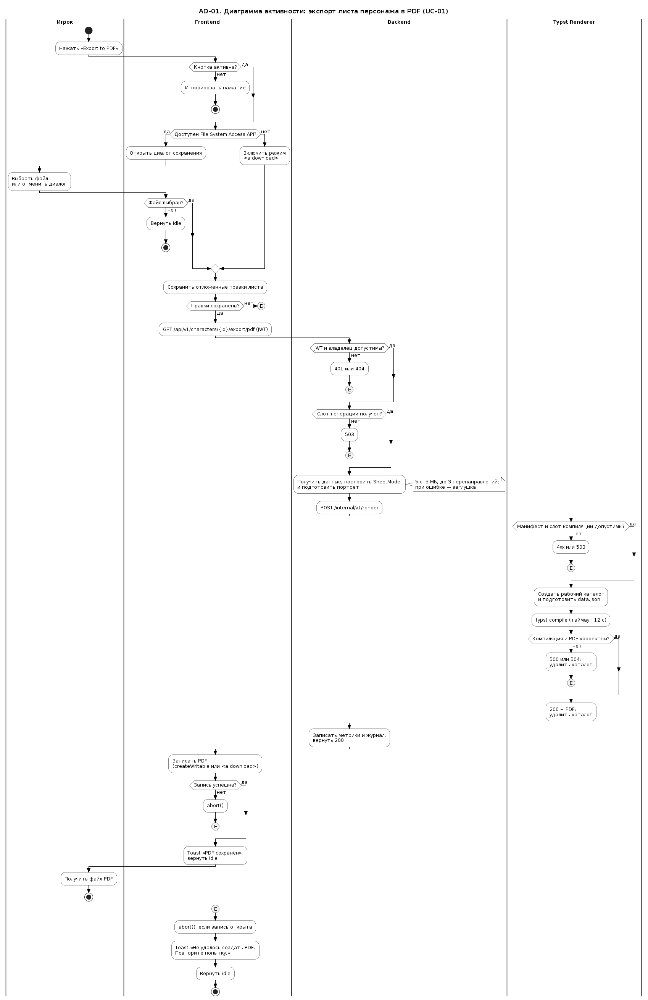
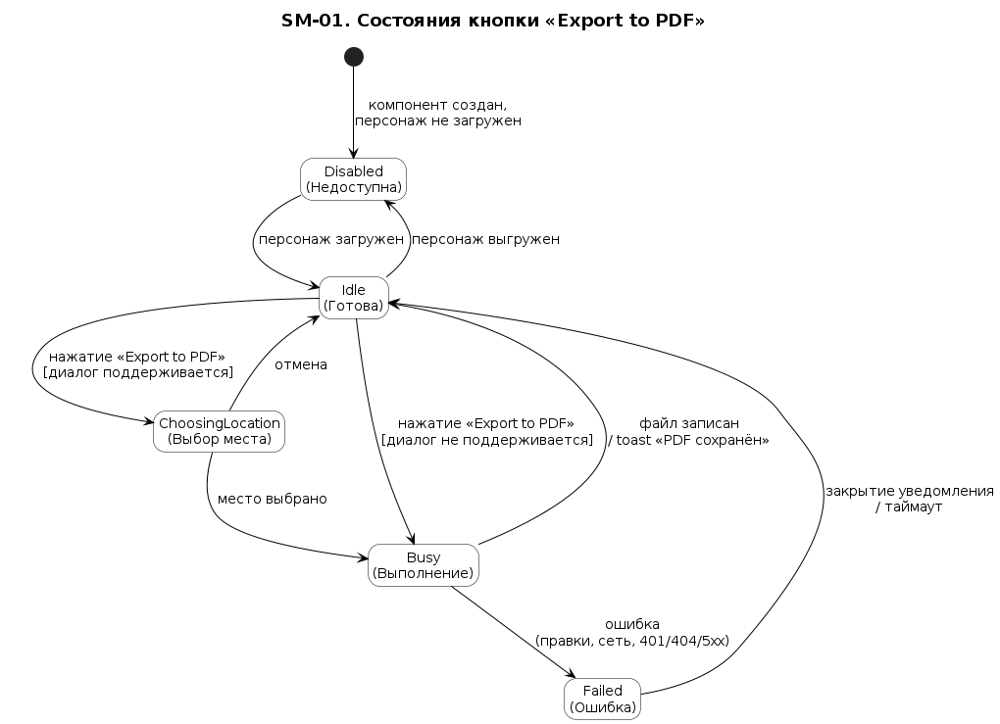
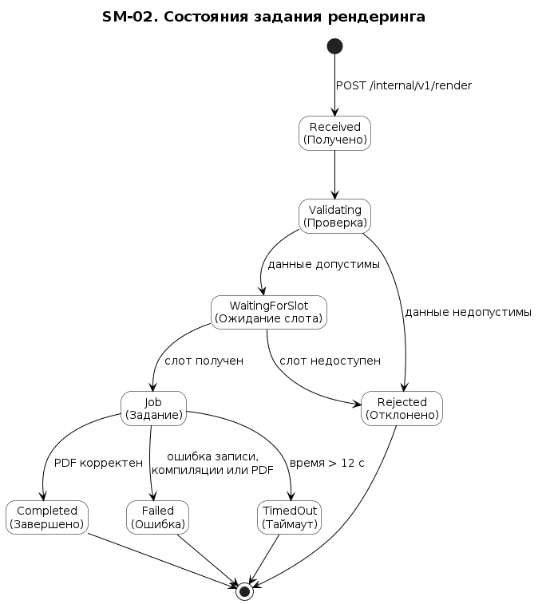

# Описание дизайна программного обеспечения

Для модуля «Генератор отчётов листов персонажей» (Sheet Export) проекта Live D&D List

Версия 0.4

Подготовил(а) А.П. Якуш

БГУИР, кафедра электронных вычислительных машин

17.11.2026

## Оглавление

<!-- TOC -->
* [1. Введение](#1-introduction)
  * [1.1 Назначение документа](#11-document-purpose)
  * [1.2 Область применения](#12-subject-scope)
  * [1.3 Определения, акронимы и сокращения](#13-definitions-acronyms-and-abbreviations)
  * [1.4 Ссылки](#14-references)
  * [1.5 Обзор документа](#15-document-overview)
* [2. Обзор дизайна](#2-design-overview)
  * [2.1 Задачи стейкхолдеров](#21-stakeholder-concerns)
  * [2.2 Выбранные точки зрения](#22-selected-viewpoints)
* [3. Проектные представления](#3-design-views)
* [4. Решения](#4-decisions)
* [5. Приложения](#5-appendixes)
<!-- TOC -->

## История изменений

| Name | Date | Reason For Changes | Version |
|------|------|--------------------|---------|
| А.П. Якуш | 07.11.2026 | Первая редакция на основе SRS v0.1 и ADR-0001 … 0006 | 0.1 |
| А.П. Якуш | 15.11.2026 | Замена PDFBox на локальный Typst Renderer; синхронизация с SRS v0.2, уточнение внутреннего API, безопасности и проверки | 0.2 |
| А.П. Якуш | 15.11.2026 | Согласование SDD с SRS v0.2; добавлены требования REQ-INT-011 и REQ-SEC-006, уточнены тесты и контракт Renderer | 0.3 |
| А.П. Якуш | 17.11.2026 | Добавлена UML-модель динамического поведения (варианты использования, активность, состояния, последовательности), глоссарий и дополнительные спецификации; синхронизированы ADR-0001 … ADR-0007 | 0.4 |

---

## 1. Введение {#1-introduction}

Документ описывает проектное устройство модуля экспорта листа персонажа в PDF внутри Live D&D List: компоненты, интерфейсы, потоки данных, алгоритмы, развёртывание и принятые архитектурные решения. В редакции 0.2 исходная архитектура на PDFBox заменена отдельным локальным сервисом Typst Renderer; редакция 0.3 уточняет проектные представления и синхронизирует их с SRS v0.2; редакция 0.4 добавляет UML-модель динамического поведения, глоссарий и дополнительные спецификации.

### 1.1 Назначение документа {#11-document-purpose}

SDD определяет структуру реализации и служит руководством для разработчиков. Разработчик использует его при реализации компонентов и интеграций; тестировщик — для подготовки проверок, связанных с требованиями SRS; Заказчик и преподаватель — для оценки того, что проектное решение удовлетворяет согласованным требованиям. Связанные документы: SRS v0.2 (`srs/srs.md`), архитектурные решения (`sdd/`), план реализации (`plan/plan.md`).

### 1.2 Область применения {#12-subject-scope}

Проектируется модуль Sheet Export версии продукта 0.1; настоящая редакция SDD — 0.4. Модуль интегрируется в Live D&D List (backend Java 21 / Spring Boot 4.0.2, frontend React / TypeScript). Backend получает и проверяет данные персонажа, преобразует их в нейтральную структуру, а затем передаёт её локальному Typst Renderer. Renderer компилирует фиксированный Typst-шаблон в PDF. Frontend сохраняет полученный файл в каталог, выбранный пользователем.

**Входит:** пакет `dev.ushki.sheetexport` в backend; адаптер D&D 5e и REST-контроллер в проекте; HTTP-клиент Typst Renderer; отдельный контейнер Typst Renderer с HTTP-адаптером и Typst Compiler; шаблоны `.typ`, шрифты и ресурсы подписей; кнопка и логика сохранения во frontend.

**Не входит:** облачный `typst.app` и внешние API генерации; хранение PDF на сервере; изменение схемы БД; редактирование PDF как заполняемой формы; печать; адаптеры других игровых систем в текущем релизе.

Бизнес-цели BO-1 … BO-4 и ограничения CON-1 … CON-8 определяются SRS v0.2. BO-3 и REQ-REUSE-003 уточнены: для новой системы добавляются провайдер данных и соответствующий набор шаблонов/ресурсов Typst без изменения общего Java-ядра и механизма Renderer.

### 1.3 Определения, акронимы и сокращения {#13-definitions-acronyms-and-abbreviations}

| Term | Definition |
|------|------------|
| ADR | Architectural Decision Record — запись архитектурного решения |
| API | Application Programming Interface — интерфейс программного взаимодействия |
| CLI | Command Line Interface — интерфейс командной строки |
| Frame (рамка) | Прямоугольная область макета, предназначенная для определённого блока листа |
| JSON | JavaScript Object Notation — формат передачи структурированных данных |
| SDD | Software Design Document — описание проектного устройства ПО |
| SheetModel | Нейтральная структура данных листа, не содержащая сущностей и DTO конкретной игровой системы |
| SRS | Software Requirements Specification — спецификация требований к ПО |
| SSRF | Server-Side Request Forgery — атака, заставляющая сервер обращаться к нежелательным адресам |
| Typst Compiler | Компилятор Typst, преобразующий исходный `.typ`-документ в PDF |
| Typst Renderer | Локальный HTTP-сервис, принимающий данные документа и запускающий Typst Compiler в изолированном рабочем каталоге |
| Typst template | Версионируемый набор `.typ`-файлов, определяющий структуру и оформление документа для конкретной системы |
| WP | Work Package — пакет работ плана реализации |
| Провайдер листа | Реализация `SheetDefinitionProvider`, преобразующая данные конкретной игровой системы в `SheetModel` |

### 1.4 Ссылки {#14-references}

| № | Источник | Тип | Расположение |
|---|----------|-----|--------------|
| 1 | SRS модуля Sheet Export, версия 0.2 | Нормативная | `srs/srs.md` |
| 2 | Протоколы архитектурных решений ADR-0001 … ADR-0007 | Нормативная | `sdd/` |
| 3 | План реализации и переписка с Заказчиком | Справочная | `plan/plan.md`, `correspondence/` |
| 4 | Репозиторий Live D&D List | Нормативная для ограничений существующего проекта | https://github.com/Margit-The-Fell-Omen/liveDndList |
| 5 | Typst Compiler, репозиторий и CLI | Нормативная для выбранной версии | https://github.com/typst/typst |
| 6 | Официальный Docker-образ Typst | Нормативная для версии образа | https://github.com/typst/typst/pkgs/container/typst |
| 7 | Typst: загрузка JSON | Справочная | https://typst.app/docs/reference/data-loading/json/ |
| 8 | Typst: ограничение корня проекта и доступ к файлам | Справочная | https://typst.app/docs/reference/foundations/path/ |
| 9 | Typst: параметры шрифтов | Справочная | https://typst.app/docs/reference/text/text/ |
| 10 | Typst: экспорт PDF | Справочная | https://typst.app/docs/reference/pdf/ |
| 11 | pikepdf: работа с XMP и Document Information metadata | Справочная | https://pikepdf.readthedocs.io/en/latest/topics/metadata.html |
| 12 | File System Access API | Справочная | https://developer.mozilla.org/docs/Web/API/File_System_API |
| 13 | RFC 6266, RFC 5987 (Content-Disposition) | Справочная | IETF |
| 14 | SIL Open Font License 1.1 | Справочная | https://openfontlicense.org |
| 15 | Лабораторная работа №4, БГУИР | Нормативная | `Лабораторная_работа_4.pdf` |
| 16 | Лабораторная работа №5, БГУИР | Нормативная | `Лабораторная_работа_5.pdf` |
| 17 | Модель вариантов использования, глоссарий и дополнительные спецификации | Нормативная | `uml/` |
| 18 | UML-диаграммы динамического поведения (PlantUML) | Нормативная | `uml/diagrams/` |
| 19 | PlantUML | Справочная | https://plantuml.com/ |

### 1.5 Обзор документа {#15-document-overview}

Раздел 2 описывает общую архитектуру, стейкхолдеров и выбранные точки зрения. Раздел 3 содержит проектные представления с ID `DV-XXX-NN`, связи с требованиями SRS и решениями ADR. Раздел 4 кратко перечисляет принятые решения, полные обоснования находятся в `sdd/`. Раздел 5 содержит приоритеты, трассировку, соответствие данных полям листа, конфигурацию и риски. Диаграммы контекста и архитектуры описывают интеграцию с Typst Renderer; их исходники SysML v2 хранятся в `srs/diagrams/`. UML-модель динамического поведения (варианты использования, активность, состояния, последовательности) хранится в `uml/`; исходники PlantUML и PNG находятся в `uml/diagrams/`, описания актёров и прецедентов — в `uml/use-cases.md`.

---

## 2. Обзор дизайна {#2-design-overview}

Решение состоит из двух основных технических частей. Java-модуль `dev.ushki.sheetexport` изолирует приложение от деталей генерации и предоставляет единый фасад. Отдельный контейнер Typst Renderer получает JSON-данные и, при наличии, файл портрета, подготавливает временный проект и запускает Typst Compiler. Шаблоны Typst отвечают за компоновку, типографику, таблицы и разбиение документа на страницы; Java не реализует собственный движок раскладки и не зависит от PDFBox.

Поток экспорта: frontend открывает диалог сохранения → отправляет отложенные изменения → backend проверяет владельца и получает данные → D&D-провайдер формирует `SheetModel` → backend передаёт JSON и проверенные ресурсы Typst Renderer → Renderer компилирует PDF → backend возвращает PDF → frontend завершает запись файла.

### 2.1 Задачи стейкхолдеров {#21-stakeholder-concerns}

| Стейкхолдер | Задачи | Адресующие точки зрения |
|-------------|--------|-------------------------|
| Игрок | Получить корректный PDF, быстро сохранить его в выбранное место и получить понятную ошибку при сбое | Interface, Interaction, State dynamics |
| Мастер игры | Открыть PDF в стандартном просмотрщике; видеть кириллицу и полное содержимое | Template, Resources, Verification |
| Заказчик | Интеграция без сбоев; изоляция и расширяемость; контроль сроков и стоимости | Context, Composition, Dependency, Decisions |
| Разработчик | Понятные границы Java-модуля, HTTP-контракт Renderer, возможность добавления игровой системы | Logical, Structure, Interface, Template |
| Тестировщик | Проверять данные, PDF, вёрстку, производительность, безопасность и ошибки | Information, Algorithm, Interface, Concurrency |
| Сопровождающий / оператор | Разворачивать сервис вместе с проектом без внешних облачных зависимостей; контролировать ресурсы | Deployment, Resources, Concurrency |

### 2.2 Выбранные точки зрения {#22-selected-viewpoints}

| Точка зрения | Применимость | Что адресует | Язык | Представления |
|--------------|--------------|--------------|------|---------------|
| Контекст | Используется | Границы, акторы, Typst Renderer и файловая система | Диаграмма SysML v2 | DV-CTX-01 |
| Варианты использования | Используется | Актёры, прецеденты, связи `include`/`extend` | Диаграмма вариантов использования UML | DV-UC-01 |
| Композиция | Используется | Состав backend, frontend и отдельного Renderer | Диаграмма компонентов / таблица | DV-CMP-01 |
| Логическое | Используется | Основные классы Java и части Renderer | UML / описание | DV-LOG-01 |
| Физическое | Не применяется | Новое аппаратное оборудование отсутствует | — | — |
| Структура | Используется | Пакеты Java и каталоги Renderer | Таблица пакетов | DV-STR-01 |
| Зависимости | Используется | Направление зависимостей и границы контейнеров | Диаграмма SysML v2 / таблица | DV-DEP-01 |
| Информация | Используется | `SheetModel`, JSON-контракт и ресурсы | Словарь данных | DV-INF-01 |
| Интерфейс | Используется | REST backend, внутренний API Renderer, SPI, UI | Спецификация API | DV-IFC-01 … 03 |
| Взаимодействие | Используется | Последовательность синхронного экспорта и обработка ошибок | Диаграммы последовательности UML | DV-INT-01 |
| Алгоритм | Используется | Поток экспорта, подготовка данных, запуск Typst, портреты и производные значения | Диаграмма активности и псевдокод | DV-ACT-01, DV-ALG-01 … 03 |
| Динамика состояний | Используется | Состояния кнопки, диалога сохранения и задания Renderer | Диаграммы состояний UML | DV-STA-01, DV-STA-02 |
| Параллелизм | Используется | Ограничение одновременных компиляций | Описание | DV-CON-01 |
| Паттерны | Используется | Ports and Adapters, Strategy, Facade, Template | Таблица | DV-PAT-01 |
| Развёртывание | Используется | Docker Compose, сети, контейнеры и ограничения | Диаграмма развёртывания / описание | DV-DPL-01 |
| Ресурсы | Используется | CPU, память, временные файлы, шрифты и сеть | Таблица лимитов | DV-RES-01 |

---

## 3. Проектные представления {#3-design-views}

### DV-UC-01-use-cases

- **ID**: DV-UC-01-use-cases
- **Title**: Модель вариантов использования
- **Viewpoint**: Варианты использования
- **Representation**:



*Рисунок 9 — диаграмма вариантов использования Sheet Export. Исходник: `uml/diagrams/uc-01-use-case.puml`.*

Модель содержит 5 актёров и 10 прецедентов. Люди (Игрок, Разработчик, Оператор) показаны в нотации UML как актёры-«человечки»; внешние системы (Typst Renderer, Хост портрета) — прямоугольниками со стереотипом `<<system>>`.

| ID | Прецедент | Актёр / связь |
|----|-----------|---------------|
| UC-01 | Экспортировать лист персонажа в PDF | Игрок; включает UC-02, UC-03, UC-04; расширяется UC-07 |
| UC-02 | Выбрать место сохранения | Игрок; включается в UC-01; расширяется UC-06 |
| UC-03 | Сохранить отложенные правки листа | Frontend; включается в UC-01 |
| UC-04 | Сформировать PDF | Backend, Typst Renderer; включается в UC-01; расширяется UC-05 |
| UC-05 | Подготовить портрет | Backend, Хост портрета; расширяет UC-04 |
| UC-06 | Сохранить PDF стандартным скачиванием | Игрок, Frontend; расширяет UC-02 |
| UC-07 | Показать ошибку экспорта | Игрок, Frontend; расширяет UC-01 |
| UC-08 | Подключить игровую систему | Разработчик |
| UC-09 | Проверить готовность сервиса генерации | Оператор |
| UC-10 | Просмотреть метрики и журнал экспорта | Оператор |

Описания актёров и каждого прецедента (пояснение, предусловия, основной и альтернативные потоки, потоки ошибок, постусловия) приведены в `uml/use-cases.md`. Связи `include` применены для обязательных шагов экспорта (выбор места, сохранение правок, формирование PDF), `extend` — для необязательных расширений (портрет, стандартное скачивание, сообщение об ошибке). Мастер игры в модели отсутствует: он получает готовый PDF вне системы и с приложением не взаимодействует.
- **More Information**: SRS REQ-FUNC-001 … 008, 021; REQ-INT-004, 009; REQ-SEC-001; REQ-REL-001, 003; `uml/use-cases.md`; DEC-007.

### DV-CTX-01-context

- **ID**: DV-CTX-01-context
- **Title**: Контекст модуля
- **Viewpoint**: Контекст
- **Representation**: Live D&D List состоит из frontend и backend. Frontend взаимодействует с `CharacterExportController`. Backend использует `DndSheetProvider`, Java-модуль Sheet Export и `TypstRendererClient`. Последний обращается к Typst Renderer по внутренней Docker-сети. Renderer — инфраструктурный компонент проекта, а не облачный сервис. Портрет загружается backend из внешнего хоста после проверки URL. Готовый PDF передаётся frontend для сохранения через браузер. Исходник контекстной диаграммы: `srs/diagrams/01-context.sysml`; визуальное представление: `srs/diagrams/01-context.png`.
- **More Information**: SRS 2.1, 2.2; REQ-INT-004, REQ-INT-010; DEC-001, DEC-002, DEC-004.

### DV-CMP-01-composition

- **ID**: DV-CMP-01-composition
- **Title**: Композиция: frontend, backend и Typst Renderer
- **Viewpoint**: Композиция
- **Representation**:

| Компонент | Расположение | Ответственность | Новое / существующее |
|-----------|--------------|-----------------|----------------------|
| `ExportPdfButton`, `pdfExport.ts` | `frontend/src/components/character/`, `frontend/src/services/` | Кнопка, диалог сохранения, запрос, запись файла, уведомления | Новое; интеграция в `CharacterHeader.tsx` |
| `CharacterExportController` | `dev.ushki.livedndlist.controller` | Публичный `GET /api/v1/characters/{id}/export/pdf`, авторизация и HTTP-ответ | Новое |
| `DndSheetProvider` | `dev.ushki.livedndlist.export` | Преобразование `CharacterResponse` и связанных данных в `SheetModel` | Новое |
| `dev.ushki.sheetexport` | Тот же Maven-модуль, отдельный корневой пакет | Фасад, SPI, модель данных, вызов Renderer, проверка результата | Новое |
| `TypstRendererClient` | `dev.ushki.sheetexport.client` | Вызов внутреннего API Renderer, передача JSON и локальных ресурсов, обработка ошибок | Новое |
| `typst-renderer` | Отдельный сервис Docker Compose | HTTP-адаптер, временное рабочее окружение, Typst CLI, шаблоны, шрифты и финализация метаданных PDF | Новый контейнер |
| `CharacterService`, `GlobalExceptionHandler`, JWT-фильтр | Проект | Получение данных с проверкой владельца, формат ошибок и авторизация | Существующее |

  Внутри Renderer выделяются HTTP API, `WorkspaceManager`, `TypstProcessRunner`, `PdfMetadataFinalizer`, набор шаблонов Typst и каталог шрифтов. Диаграмма изоляции: исходник `srs/diagrams/03-module-architecture.sysml`, визуальное представление `srs/diagrams/03-module-architecture.png`.
- **More Information**: REQ-REUSE-001, REQ-REUSE-003, REQ-INT-001 … 004; DEC-001, DEC-002, DEC-004.

### DV-LOG-01-logical

- **ID**: DV-LOG-01-logical
- **Title**: Логическая модель решения
- **Viewpoint**: Логическое
- **Representation**:

Java-сторона:

- `SheetExportService` — фасад сценария экспорта.
- `SheetDefinitionProvider` — порт получения данных конкретной игровой системы.
- `ProviderRegistry` — выбор провайдера по `systemId`.
- `SheetModel` — нейтральная структура данных для шаблона.
- `TypstRendererClient` — транспортный адаптер к внутреннему HTTP API.
- `PortraitLoader` / `UrlGuard` — безопасная загрузка и подготовка изображения до передачи Renderer.

Typst Renderer:

- `RenderApi` — внутренние HTTP endpoints.
- `WorkspaceManager` — создание и удаление изолированного временного каталога для каждого запроса.
- `TypstProcessRunner` — запуск фиксированной команды `typst compile` с ограничением времени.
- `PdfMetadataFinalizer` — проверка версии и структуры PDF, установка Title и Creator в Document Information и XMP-метаданных.
- `TemplateRegistry` — соответствие разрешённого `templateId` каталогу шаблона.
- `TemplateBundle` — `main.typ`, компоненты, стили и ресурсы подписей.
- `FontBundle` — шрифты, доступные компилятору.

Компоновка документа, переносы, таблицы, страницы продолжения и оформление реализуются в Typst-шаблонах. В Java отсутствуют `LayoutEngine`, `PdfRenderer`, `PDDocument` и другие классы PDFBox. Постобработка PDF ограничена проверкой результата и метаданных; pikepdf используется только внутри Renderer.
- **More Information**: REQ-REUSE-002, REQ-FUNC-014 … 020; DEC-001, DEC-002, DEC-006.

### DV-STR-01-structure

- **ID**: DV-STR-01-structure
- **Title**: Структура Java-пакетов и Renderer
- **Viewpoint**: Структура
- **Representation**:

| Пакет Java | Содержимое | Может зависеть от |
|------------|------------|-------------------|
| `api` | `SheetExportService`, `ExportRequest`, `RenderedDocument`, `SheetExportException` | `model`, `spi`, `client`, `image` |
| `model` | `SheetModel`, типизированные структуры данных листа, метаданные шаблона | JDK |
| `spi` | `SheetDefinitionProvider`, `ProviderRegistry`, конфигурация подключения | `api`, `model` |
| `client` | `TypstRendererClient`, DTO внутреннего API, сериализация JSON / multipart | `api`, `model`, HTTP-клиент Spring |
| `image` | `PortraitLoader`, `UrlGuard`, проверка сигнатуры, декодирование и масштабирование | JDK, `httpclient5` |
| `config` | URL Renderer, таймауты, размер запроса, лимит параллелизма | Spring Boot |

| Каталог Renderer | Содержимое | Назначение |
|------------------|------------|------------|
| `renderer/api/` | HTTP-маршруты и схемы входа/ошибок | Внутренний HTTP API |
| `renderer/compile/` | `WorkspaceManager`, `TypstProcessRunner` | Запуск компиляции и очистка временных файлов |
| `renderer/pdf/` | `PdfMetadataFinalizer` (pikepdf) | Проверка PDF, установка Title/Creator и сохранение метаданных |
| `renderer/templates/dnd5e/` | `main.typ`, `pages/`, `components/`, `styles/`, `labels/` | Шаблон D&D 5e |
| `renderer/fonts/` | Noto Sans Regular/Bold/Italic и лицензия | Детерминированный набор шрифтов |
| `renderer/tests/` | fixtures, контрактные и визуальные тесты | Проверка шаблонов и HTTP API |

Провайдеры регистрируются в Spring как бины. Для новой системы требуется новый провайдер и соответствующий комплект Typst-шаблонов/ресурсов; общее Java-ядро и общий механизм Renderer не изменяются. Это соответствует формулировкам BO-3 и REQ-REUSE-003 в SRS v0.2.
- **More Information**: REQ-REUSE-001 … 004; DEC-002.

### DV-DEP-01-dependencies

- **ID**: DV-DEP-01-dependencies
- **Title**: Направление зависимостей и границы изоляции
- **Viewpoint**: Зависимости
- **Representation**:

| Правило | Проверка |
|---------|----------|
| `dev.ushki.sheetexport..` не зависит от `dev.ushki.livedndlist..` | ArchUnit `IsolationTest` |
| Java-пакеты не импортируют классы PDFBox и Typst runtime | ArchUnit / проверка зависимостей Maven |
| Только `TypstRendererClient` обращается к внутреннему адресу Renderer | ArchUnit и интеграционный тест |
| Renderer не имеет зависимости от JPA, PostgreSQL, Redis и API проекта | Проверка `pom.xml`/образа и состава контейнера |
| Renderer принимает только известные `templateId`, JSON и ограниченный набор файлов; произвольный `.typ` от клиента запрещён | Контрактные и security-тесты |
| Renderer не имеет исходящего доступа в Интернет; пакеты Typst и шрифты поставляются локально | Проверка Docker-сети и offline-тест |
| Зависимости Renderer: Typst CLI 0.15.1, HTTP-адаптер (первичная реализация: Python 3.13 + FastAPI/Uvicorn), шаблоны и шрифты | Dockerfile, lock-файл зависимостей, `docs/licenses.md` |
| Java-side dependency: HTTP client Spring и `httpclient5` для загрузки портретов | `pom.xml`, `docs/licenses.md` |

  Направление взаимодействия: проект → Java-модуль → внутренний HTTP API Typst Renderer. Renderer не вызывает backend и не обращается к БД. Между Java и Renderer передаются только подготовленные данные документа и проверенные локальные ресурсы.
- **More Information**: REQ-REUSE-001, REQ-COMP-002; DEC-001, DEC-002, DEC-005.

### DV-INF-01-information

- **ID**: DV-INF-01-information
- **Title**: Нейтральная модель и JSON-контракт
- **Viewpoint**: Информация
- **Representation**:

`SheetModel` содержит идентификатор шаблона, локаль, структурированные данные и сведения о наличии вложенных ресурсов. Он сериализуется в JSON. Пользовательские строки остаются значениями JSON и не конкатенируются в исходный Typst-код.

Внутренний манифест Renderer имеет логическую структуру:

```json
{
  "templateId": "dnd5e",
  "templateVersion": "1",
  "locale": "en",
  "data": {
    "character": {},
    "abilities": {},
    "skills": [],
    "equipment": [],
    "spells": []
  },
  "assets": {
    "portraitAvailable": true
  }
}
```

Это пример формы контракта, не полный перечень полей `CharacterResponse`. Реальный набор полей определяется `SheetModel` и таблицей соответствия в Приложении C. Сам бинарный портрет передаётся отдельной multipart-частью; Renderer сохраняет его под фиксированным именем `assets/portrait.png` или `assets/portrait.jpg`. Клиент не передаёт произвольные файловые пути.

| Данные | Представление в Typst | Правило |
|--------|------------------------|---------|
| Строки, числа, логические значения | Значения JSON, загружаемые через `json("data.json")` | Данные не интерпретируются как Typst-разметка |
| Пустые значения | `none` / пустые коллекции | Вывод по REQ-FUNC-022 и REQ-FUNC-023 |
| Табличные данные | Массивы JSON | Таблицы формируются шаблоном, заголовки и разрывы задаются в Typst |
| Портрет | Локальный файл внутри рабочего каталога | Только после проверки `PortraitLoader`; иначе placeholder |
| Подписи | Локальные ресурсы `labels/en.json`, `labels/ru.json` | Загрузка из каталога шаблона |
| Шрифты | Файлы в `renderer/fonts/` | Каталог передаётся через `--font-path` |

Рабочий каталог каждого запроса изолирован. Шаблон, JSON и изображения находятся внутри project root Typst. Удаление рабочего каталога выполняется после успешной компиляции или ошибки.
- **More Information**: REQ-FUNC-009 … 014, REQ-FUNC-022, REQ-FUNC-023; Приложение C; DEC-001, DEC-002.

### DV-IFC-01-rest-api

- **ID**: DV-IFC-01-rest-api
- **Title**: Публичный REST API и внутренний API Renderer
- **Viewpoint**: Интерфейс
- **Representation**:

**Публичный endpoint Live D&D List**

`GET /api/v1/characters/{id}/export/pdf`

| Элемент | Описание |
|---------|----------|
| Авторизация | `Authorization: Bearer <JWT>`; экспорт разрешён владельцу персонажа согласно REQ-SEC-001 |
| Параметры | В текущем релизе query-параметры не предусмотрены; язык подписей по умолчанию — `en` до решения OQ-4 |
| 200 | `Content-Type: application/pdf`; `Content-Disposition` с безопасным ASCII `filename` и UTF-8 `filename*`; `Cache-Control: no-store`; тело начинается с `%PDF-` |
| 401 | Нет или недействителен токен, формат ошибки проекта |
| 404 | Персонаж не найден или недоступен пользователю, согласно принятой политике проекта |
| 503 | Нет свободного слота генерации или Renderer временно недоступен |
| 504 | Внутренний таймаут генерации |
| 500 | Ошибка формирования PDF, тело `ApiResponse`, частичный PDF не отдаётся |

**Внутренний endpoint Typst Renderer (REQ-INT-011)**

`POST http://typst-renderer:8080/internal/v1/render`

| Элемент | Описание |
|---------|----------|
| Доступ | Только из внутренней Docker-сети; порт не публикуется на host. Обязателен внутренний service token из переменной окружения |
| Запрос | `multipart/form-data`: `manifest` (JSON) и необязательная часть `portrait` (PNG/JPEG, предварительно проверенный backend) |
| Указание шаблона | Только allow-list `templateId`; произвольный путь или исходный `.typ` от клиента не принимается |
| 200 | `Content-Type: application/pdf`, тело — полный PDF |
| 400/422 | Некорректный манифест, неизвестный шаблон или недопустимые данные |
| 413 | Превышен лимит входного запроса/вложения |
| 503 | Достигнут лимит параллельных компиляций или сервис не готов |
| 504 | Typst Compiler превысил допустимое время выполнения |
| 500 | Внутренняя ошибка адаптера или компиляции; диагностические сообщения не содержат полных пользовательских данных |

**Health endpoints:** `GET /health/live` и `GET /health/ready`. Readiness проверяет наличие Typst CLI, доступность каталога шаблонов и шрифтов. Внешний маршрут для этих endpoints не публикуется.

Backend транслирует ошибки внутреннего API в стандартный формат `ApiResponse`; наружу не передаются stderr компилятора, пути временных файлов и содержимое JSON. Renderer не имеет исходящего сетевого доступа и принимает только allow-listed templateId и структурированные данные.
- **More Information**: REQ-INT-004, REQ-INT-009, REQ-INT-011, REQ-FUNC-005, REQ-SEC-001, REQ-SEC-006, REQ-REL-003; DEC-001, DEC-004.

### DV-IFC-02-spi

- **ID**: DV-IFC-02-spi
- **Title**: SPI провайдера листа
- **Viewpoint**: Интерфейс
- **Representation**:

```java
public interface SheetDefinitionProvider {
    String systemId();
    SheetModel build(ExportRequest request);
}

public record ExportRequest(
    String systemId,
    String sourceId,
    String requester,
    Locale locale,
    ExportOptions options
) {}

public record SheetModel(
    String templateId,
    String templateVersion,
    int schemaVersion,
    Locale locale,
    Map<String, Object> data,
    PortraitAsset portrait
) {}
```

Типы приведены как эскиз контракта; окончательная структура должна быть типизирована, иметь `schemaVersion` и проверяться валидатором до компиляции. Провайдер не знает о Typst CLI, синтаксисе `.typ` и PDF. Он получает данные через сервисы проекта, выполняет преобразования D&D и возвращает `SheetModel`. `SheetExportService` сериализует модель и передаёт её `TypstRendererClient`.

Для новой игровой системы добавляются реализация `SheetDefinitionProvider`, шаблон в `renderer/templates/<systemId>/` и необходимые файлы подписей/ресурсов. Общий Java-код и HTTP API Renderer не меняются. Это означает «без изменения кода ядра», а не «буквально один файл во всём репозитории».
- **More Information**: REQ-REUSE-001 … 004, REQ-MAINT-002; DEC-002.

### DV-IFC-03-ui

- **ID**: DV-IFC-03-ui
- **Title**: Интерфейс frontend
- **Viewpoint**: Интерфейс
- **Representation**: Компонент `ExportPdfButton` использует общий `Button` и стили темы; размещается в правом верхнем углу `CharacterHeader` (рисунок `srs/diagrams/05-ui-header.png`). Свойства: `characterId`, `characterName`, `onBeforeExport` (сбрасывает отложенное сохранение полей). `exportCharacterPdf(id, handle)` в `services/` выполняет авторизованный запрос и получает PDF как `Blob`. В Chromium открывается `showSaveFilePicker` непосредственно в обработчике пользовательского действия; затем frontend сохраняет правки, отправляет запрос и записывает Blob через `createWritable()`. При ошибке запись отменяется через `abort()`. В браузерах без File System Access API применяется `<a download>`. Уведомления используют существующий `useToast`.
- **More Information**: REQ-INT-005 … 009, REQ-FUNC-021; DEC-003, DEC-004; макеты `srs/diagrams/05-ui-*.png`.

### DV-INT-01-interaction

- **ID**: DV-INT-01-interaction
- **Title**: Сценарий экспорта: успех, отмена, ошибка
- **Viewpoint**: Взаимодействие
- **Representation**:



*Рисунок 10 — успешный сценарий экспорта (UC-01). Исходник: `uml/diagrams/sd-01-export-pdf.puml`.*



*Рисунок 11 — обработка ошибок экспорта (UC-07). Исходник: `uml/diagrams/sd-02-handle-errors.puml`.*

1. Frontend обрабатывает пользовательский клик и, если API поддерживается, сразу открывает диалог сохранения.
2. После выбора файла frontend инициирует сохранение отложенных изменений персонажа.
3. `CharacterExportController` проверяет JWT и владельца, получает данные персонажа.
4. `DndSheetProvider` строит `SheetModel`; `PortraitLoader` получает и проверяет портрет.
5. `TypstRendererClient` отправляет манифест JSON и локальное вложение в `typst-renderer`.
6. Renderer создаёт уникальный временный каталог, копирует туда только разрешённый шаблон и ресурсы запроса, записывает `data.json`, затем запускает `typst compile`.
7. Renderer проверяет код завершения и наличие PDF, возвращает полный файл и удаляет временный каталог.
8. Backend отдаёт PDF frontend. Frontend завершает запись файла; при ошибке после открытия файла вызывает `abort()`.

На диаграммах показаны участники, полосы активации, синхронные и возвратные сообщения, создание и уничтожение рабочего каталога, фрагменты `alt`/`opt` и ссылка `ref` на сценарий обработки ошибок. Ошибки авторизации, Renderer и таймаутов сведены в SD-02 и не дублируются в основном сценарии.
- **More Information**: REQ-FUNC-003 … 008, REQ-FUNC-021, REQ-REL-001, REQ-REL-003; REQ-INT-011; `uml/use-cases.md`; DEC-003, DEC-004, DEC-007.

### DV-ALG-01-typst-rendering

- **ID**: DV-ALG-01-typst-rendering
- **Title**: Подготовка данных и компиляция Typst
- **Viewpoint**: Алгоритм
- **Representation**:

```text
render(sheetModel):
  validate(sheetModel.templateId, locale, data)
  template = TemplateRegistry.resolve(sheetModel.templateId)  // только allow-list
  job = WorkspaceManager.createUnique()
  try:
    copy(template, job / "template")
    writeJson(job / "data.json", sheetModel.data)
    if sheetModel.portrait is valid:
      writeFixedAsset(job / "assets/portrait.png|jpg")
    writeRendererOwnedManifest(job / "render.json")
    result = runProcess(
      ["/bin/typst", "compile",
       "--root", job,
       "--font-path", "/opt/typst/fonts",
       "--ignore-system-fonts",
       "--pdf-standard", "1.7",
       job / "template/main.typ",
       job / "result.pdf"],
      timeout = compileTimeout
    )
    if result.exitCode != 0 or output missing:
      raise RenderFailure(sanitizedDiagnostics)
    PdfMetadataFinalizer.setTitleAndCreator(
      input = job / "result.pdf",
      title = sheetModel.characterName,
      creator = "Live D&D List / Sheet Export"
    )
    validatePdfHeaderVersionMetadataAndSize(job / "result.pdf")
    return readBytes(job / "result.pdf")
  finally:
    WorkspaceManager.delete(job)
```

Шаблон загружает данные через `json("../data.json")` или путь, предусмотренный структурой каталога, и формирует содержимое PDF средствами Typst. Путь JSON и пути изображений фиксируются Renderer; данные запроса не могут подменить файловые пути. Команда запускается как массив аргументов процесса, без shell-интерпретации.

`--root` задаёт корень Typst-проекта и ограничивает доступ Typst-функций к файлам подкаталогами рабочего каталога; дополнительно Renderer запускается без внешнего сетевого доступа, под непривилегированным пользователем и с изолированным каталогом задания. В Renderer не передаётся пользовательский Typst-код. Сторонние Typst-пакеты, если понадобятся, должны быть зафиксированы по версии и поставляться локально; runtime-загрузка пакетов из Интернета запрещена.

Переносы, таблицы, разрывы страниц, рамки продолжения и условное отображение страницы заклинаний реализуются в `.typ`-шаблонах и проверяются на наборах `typical`, `extreme`, `empty`, `cyrillic`, `fuzz-1000`. Специфический перенос остатка одного блока в именованную рамку другого блока требует отдельного прототипа: автоматическая пагинация Typst не считается доказательством выполнения этой частной логики до прохождения WP-01. По правилам SRS сначала формируются основные страницы 1 и 2, затем — основная страница 3 при выполнении условия REQ-FUNC-015; после них добавляются страницы продолжения в порядке исходной основной страницы и порядка блоков. Общее число страниц ограничивается `typst.max-pages` после подтверждения OQ-2.
- **More Information**: REQ-FUNC-014 … 020, REQ-REL-002, REQ-PERF-001, REQ-PERF-002, REQ-COMP-001, REQ-SEC-006; DEC-001.

### DV-ALG-02-derived-values

- **ID**: DV-ALG-02-derived-values
- **Title**: Производные значения листа D&D
- **Viewpoint**: Алгоритм
- **Representation**: Вычисления выполняются в `DndSheetProvider`, до передачи данных Renderer, чтобы Typst-шаблон отвечал за представление, а не за бизнес-логику D&D.

| Значение | Правило |
|----------|---------|
| Модификатор характеристики | Берётся из `AbilityScoresResponse`; если отсутствует — `floor((значение − 10) / 2)` |
| Спасбросок | Модификатор + бонус мастерства, если характеристика присутствует в `savingThrowProficiencies` |
| Навык | `SkillResponse.totalBonus`; отметки владения и экспертности из `proficient`, `expertise` |
| Пассивная мудрость | 10 + итоговый бонус навыка «Восприятие» |
| Сложность спасброска заклинаний | 8 + бонус мастерства + модификатор характеристики заклинаний |
| Бонус атаки заклинанием | Бонус мастерства + модификатор характеристики заклинаний |
| Бонус атаки оружием | Правило из SDD v0.1 с допущением о владении оружием; OQ-8 требует подтверждения |
| Названия расы, предыстории, классов | Разрешаются через существующие сервисы с кэшем; при отсутствии — читаемое представление ключа |
| Класс заклинателя | Исходное допущение о первом классе с заданной `spellcastingAbility`; требует проверки для мультиклассовых персонажей |

- **More Information**: REQ-FUNC-009 … 013; Приложение C.

### DV-ALG-03-portrait

- **ID**: DV-ALG-03-portrait
- **Title**: Безопасная загрузка и подготовка портрета
- **Viewpoint**: Алгоритм
- **Representation**:

Загрузка выполняется в Java/backend до обращения к Typst Renderer. Renderer не получает `portraitUrl` и не имеет обязанности обращаться к внешним хостам.

```text
loadPortrait(url):
  if url is empty: return Placeholder
  validate scheme in {http, https} and port in {80, 443}
  for each redirect (maximum 3):
    resolve host using guarded resolver
    reject loopback, private, link-local, multicast and metadata ranges
    GET with timeout <= 5s and byte limit <= 5MB; do not auto-follow redirects
    validate every redirect target again
  sniff file signature; allow PNG/JPEG only
  inspect dimensions; reject > 25_000_000 pixels
  decode and scale longest side to <= 1500 px
  return validated bytes
on any error: return Placeholder
```

Проверенное изображение передаётся внутреннему API как бинарная часть запроса и сохраняется Renderer под фиксированным путём в каталоге задания. Никакие URL или произвольные имена файлов Typst-шаблону не передаются.
- **More Information**: REQ-INT-010, REQ-SEC-002, REQ-SEC-003, REQ-REL-001, REQ-FUNC-020, REQ-PERF-003; DEC-005.

### DV-ACT-01-activity

- **ID**: DV-ACT-01-activity
- **Title**: Поток экспорта листа персонажа
- **Viewpoint**: Алгоритм / динамика поведения
- **Representation**:



*Рисунок 12 — диаграмма активности экспорта (UC-01). Исходник: `uml/diagrams/ad-01-export-pdf.puml`.*

Диаграмма детализирует основной поток UC-01 в дорожках «Игрок», «Frontend», «Backend» и «Typst Renderer». Показаны выбор файла и отмена диалога, сохранение отложенных правок, проверка JWT и владельца, ожидание слота генерации, подготовка портрета, вызов Renderer, проверка манифеста и слота компиляции, создание рабочего каталога, `typst compile`, финализация PDF, запись файла и обработка ошибок. Ветви ошибок сведены в общий обработчик: частичный файл не сохраняется, пользователь получает сообщение, кнопка возвращается в `idle`.

Диаграмма активности показывает поток на уровне сценария; детальная последовательность сообщений и границы компонентов приведены в `DV-INT-01`, состояния кнопки и задания Renderer — в `DV-STA-01` и `DV-STA-02`.
- **More Information**: REQ-FUNC-001 … 008, 021; REQ-INT-004, 011; REQ-REL-001, 003; REQ-SEC-001, 002, 003, 006; `uml/use-cases.md`; DEC-001, DEC-003, DEC-004, DEC-007.

### DV-STA-01-button-states

- **ID**: DV-STA-01-button-states
- **Title**: Состояния кнопки экспорта
- **Viewpoint**: Динамика состояний
- **Representation**:



*Рисунок 13 — состояния кнопки «Export to PDF». Исходник: `uml/diagrams/sm-01-export-button.puml`.*

Сохраняются состояния `Disabled`, `Idle`, `ChoosingLocation`, `Busy` с внутренней последовательностью `Preparing → Generating → Writing` и `Failed`. Переходы: `CharacterLoaded`/`CharacterUnloaded`, `ClickExport`, `LocationChosen`, `UserCancelled`, `FileWritten`, `Error`, `Dismiss`. В состоянии `Busy` frontend ожидает ответ backend, внутри которого выполняется обращение к Typst Renderer. Повторный `ClickExport` вне `Idle` игнорируется. При отсутствии `showSaveFilePicker` состояние `ChoosingLocation` пропускается, скачивание выполняется через `<a download>`; при ошибке вызывается `abort()` открытой записи. Исходная SysML-схема процесса остаётся в `srs/diagrams/04-export-flow.png`.
- **More Information**: REQ-INT-007, REQ-FUNC-006, REQ-FUNC-007, REQ-FUNC-021; `uml/use-cases.md`; DEC-003, DEC-007.

### DV-STA-02-render-job

- **ID**: DV-STA-02-render-job
- **Title**: Состояния задания рендеринга в Typst Renderer
- **Viewpoint**: Динамика состояний
- **Representation**:



*Рисунок 14 — состояния задания рендеринга. Исходник: `uml/diagrams/sm-02-render-job.puml`.*

Задание проходит состояния `Received → Validating → WaitingForSlot → Job → Completed | Failed | TimedOut`; при недопустимых данных или отсутствии слота оно переходит в `Rejected`. Состояние `Job` включает последовательность `Prepared → Compiling → Finalizing` и выходное действие `WorkspaceManager.delete(job)`. Проверяются service token, `templateId` из allow-list, размер и тип вложения, время компиляции (12 с) и корректность итогового PDF. Ошибки возвращаются с кодом `400/401/413/422`, `503`, `504` или `500` без пользовательских данных; временный каталог удаляется в любом случае.
- **More Information**: REQ-INT-011; REQ-SEC-006; REQ-REL-003; REQ-PERF-002; `uml/use-cases.md`; DEC-001, DEC-004, DEC-007.

### DV-CON-01-concurrency

- **ID**: DV-CON-01-concurrency
- **Title**: Параллелизм и синхронизация
- **Viewpoint**: Параллелизм
- **Representation**: Java-модуль stateless. На каждый запрос создаются собственные DTO, multipart-запрос и HTTP-вызов. Backend ограничивает число одновременных экспортов семафором `min(4, availableProcessors)` и ожидает свободный слот не более 10 с. Typst Renderer имеет собственный лимит одновременно выполняемых компиляций (начальное значение 4); это глобальная защита на случай нескольких экземпляров backend. Для каждого задания создаётся отдельный временный каталог. Общий лимит компиляции Typst задаётся конфигурацией Renderer; начальное значение — 12 с, timeout backend-to-renderer — до 14 с, общий timeout backend — до 15 с. Эти пределы являются стартовой конфигурацией и должны быть подтверждены нагрузочными тестами; защитный timeout не должен позволять нарушать REQ-PERF-002. Значения проверяются нагрузочными тестами; целевые значения SRS 3 с / 15 с / 10 с остаются критериями качества, а не таймаутами процесса.
- **More Information**: REQ-PERF-001 … 004, REQ-REL-004; DEC-004.

### DV-PAT-01-patterns

- **ID**: DV-PAT-01-patterns
- **Title**: Применённые паттерны
- **Viewpoint**: Паттерны
- **Representation**:

| Паттерн | Где | Зачем |
|---------|-----|-------|
| Ports and Adapters | Java-модуль ↔ `DndSheetProvider` и `TypstRendererClient` | Изоляция проекта и движка рендеринга |
| Strategy | `SheetDefinitionProvider` по `systemId` | Разные игровые системы |
| Facade | `SheetExportService` | Единая точка входа для проекта |
| Registry | `ProviderRegistry`, `TemplateRegistry` | Выбор провайдера и разрешённого шаблона |
| Template / Composition | `.typ`-шаблоны, компоненты и стили | Переиспользуемое оформление документов |
| Process Adapter | `TypstProcessRunner` | Изоляция запуска CLI от HTTP API |
| Guard | `UrlGuard` | Защита от SSRF при загрузке портрета |
| Null Object | `Placeholder` | Продолжение экспорта при недоступном портрете |

- **More Information**: DEC-001, DEC-002, DEC-005.

### DV-DPL-01-deployment

- **ID**: DV-DPL-01-deployment
- **Title**: Развёртывание
- **Viewpoint**: Развёртывание
- **Representation**:

Docker Compose содержит существующие сервисы Live D&D List и новый сервис `typst-renderer`.

| Сервис | Образ / сборка | Сеть | Публикация портов |
|--------|----------------|------|-------------------|
| Backend | Существующий образ Spring Boot | Существующая сеть проекта + `render-net` | Согласно текущей конфигурации |
| Typst Renderer | Собственный multi-stage образ: Python 3.13 slim + Typst CLI 0.15.1 из официального образа + FastAPI/Uvicorn + pikepdf | Только `render-net` | Нет; доступен backend по `typst-renderer:8080` |

Сервис Renderer не публикует порт на хост и не подключается к внешним сетям. Сеть `render-net` объявляется внутренней (`internal: true`). Backend подключён к ней дополнительно к своим существующим сетям. Шаблоны и шрифты включаются в образ или монтируются read-only. Рабочие каталоги создаются во временной файловой системе контейнера и удаляются после компиляции.

Контейнер Renderer запускается от непривилегированного пользователя, с ограничениями CPU и памяти, `read_only` root filesystem (если это совместимо с выбранным base image), временным writable-каталогом, отключёнными capabilities и без внешнего сетевого доступа. Эти ограничения должны быть подтверждены интеграционным тестом Docker Compose.

Официальный образ Typst содержит CLI (`/bin/typst`), но не предоставляет готовый HTTP API. Поэтому собственный Dockerfile добавляет небольшой HTTP-адаптер (Python 3.13 + FastAPI/Uvicorn), средство финализации PDF-метаданных pikepdf и фиксированные ресурсы приложения. Версия компилятора фиксируется на `0.15.1`; плавающий тег `latest` не используется.
- **More Information**: REQ-INT-001, REQ-INT-002, REQ-INT-011, REQ-SEC-006, REQ-PORT-001; DEC-001, DEC-002, DEC-004, DEC-006.

### DV-RES-01-resources

- **ID**: DV-RES-01-resources
- **Title**: Использование ресурсов
- **Viewpoint**: Ресурсы
- **Representation**:

| Ресурс | Использование | Лимит / мера |
|--------|---------------|--------------|
| Память backend | Данные персонажа, портрет, JSON и ответ PDF | Ограничивается размером входных данных и ресурсными лимитами backend |
| Память Renderer | Typst compiler process, текущий документ, изображения | Лимит контейнера задаётся Docker Compose после нагрузочного тестирования |
| Временный диск | Рабочий каталог одного запроса, `data.json`, portrait, результат PDF | Только временная файловая система; удаляется в `finally`, persistent volume не используется |
| Потоки / процессы | HTTP worker и процесс Typst CLI | Ограничение параллельных компиляций; начальный лимит Renderer — 4 |
| CPU | Компиляция Typst | Цели REQ-PERF-001 … 004; начальный hard timeout одного процесса Typst — 12 с (ADR-0004) |
| Сеть | Backend → Renderer; backend → хост портрета | Renderer доступен только по внутренней сети; загрузка портрета: 5 с, 5 МБ, до 3 перенаправлений |
| Шрифты | Noto Sans в `/opt/typst/fonts` | `--font-path`; системные шрифты игнорируются для воспроизводимости |
| Шаблоны | Typst-файлы и локальные ресурсы | Встроены в образ / read-only; runtime-загрузка пакетов запрещена |
| Размер файла | PDF | Типичный до 2 МБ, предельный до 20 МБ согласно REQ-PERF-003 |
| Метрики | Полная длительность экспорта и результат операции | Измеряются в Java-фасаде Micrometer; включают время ответа Typst Renderer и доступны через `/actuator/prometheus` |
| Журналы | Успешное завершение и технические ошибки | Backend пишет одно событие с `characterId`, duration, pageCount и pdfBytes; Renderer пишет только requestId и sanitized error code |

Метрики полной операции и запись пользовательского события размещаются на стороне backend, чтобы они отражали весь путь от публичного запроса до получения PDF. Renderer ведёт только технические журналы компиляции/сбоев без содержимого манифеста, имени персонажа, URL портрета и внутреннего токена (REQ-SEC-005, REQ-OBS-001, REQ-OBS-002).

- **More Information**: REQ-PERF-001 … 004, REQ-REL-004, REQ-OBS-001, REQ-OBS-002, REQ-SEC-005; DEC-001, DEC-004, DEC-005, DEC-006.

---

## 4. Решения {#4-decisions}

Полные протоколы по шаблону MADR находятся в каталоге `sdd/`. Решения DEC-001 … DEC-006 описывают архитектуру модуля и генерации PDF; DEC-007 фиксирует способ моделирования динамического поведения на UML.

- **ID**: DEC-001-typst-renderer
- **Title**: Использовать Typst Compiler в локальном сервисе генерации PDF
- **Context**: Требуется управляемая вёрстка и PDF с кириллицей; Java не должна содержать собственный движок раскладки.
- **Options**: Typst CLI в локальном Docker-сервисе; PDFBox + самописная раскладка; OpenPDF; OpenHTMLtoPDF.
- **Outcome**: Typst Compiler 0.15.1 в локальном Docker-контейнере с тонким HTTP-адаптером и версионируемыми `.typ`-шаблонами.
- **More Information**: `sdd/ADR-0001-typst-renderer.md`; DV-LOG-01, DV-ALG-01, DV-DPL-01.

- **ID**: DEC-002-module-isolation
- **Title**: Изолировать модуль через нейтральную модель и порт провайдера
- **Context**: Требуется независимость Java-ядра от проекта, игровой системы и конкретного движка вёрстки.
- **Options**: Порты и адаптеры в одном Maven-модуле; отдельный Maven-подмодуль; прямое использование DTO в шаблоне.
- **Outcome**: `dev.ushki.sheetexport` остаётся отдельным корневым пакетом; провайдер формирует нейтральный `SheetModel`; Typst Renderer вызывается через HTTP-клиент.
- **More Information**: `sdd/ADR-0002-module-isolation.md`; DV-CMP-01, DV-STR-01, DV-DEP-01.

- **ID**: DEC-003-save-location
- **Title**: Сохранять через File System Access API с запасным скачиванием
- **Context**: Каталог и имя файла выбирает пользователь средствами браузера.
- **Options**: `showSaveFilePicker` + `<a download>`; только `<a download>`; `showDirectoryPicker`; Electron/Tauri.
- **Outcome**: `showSaveFilePicker` с запасным `<a download>`.
- **More Information**: `sdd/ADR-0003-save-location.md`; DV-INT-01, DV-STA-01.

- **ID**: DEC-004-sync-export
- **Title**: Выдавать PDF синхронным ответом с ограничением параллелизма
- **Context**: Типичный экспорт должен быть коротким; PDF и задания не хранятся на сервере.
- **Options**: Синхронный GET с внутренним POST к Renderer; асинхронная задача; потоковая отдача.
- **Outcome**: Синхронный GET backend; backend синхронно вызывает Typst Renderer, который возвращает готовый PDF.
- **More Information**: `sdd/ADR-0004-sync-export.md`; DV-CON-01, DV-RES-01.

- **ID**: DEC-005-portrait-loading
- **Title**: Загружать портрет в backend с защитой от SSRF
- **Context**: URL задаётся пользователем, renderer не должен обращаться к внешним адресам.
- **Options**: Проверенный клиент backend; allow-list доменов; загрузка браузером; не выводить портрет.
- **Outcome**: Backend загружает, проверяет и масштабирует портрет; Renderer получает только бинарные данные.
- **More Information**: `sdd/ADR-0005-portrait-loading.md`; DV-ALG-03.

- **ID**: DEC-006-fonts
- **Title**: Поставлять Noto Sans вместе с Typst Renderer
- **Context**: Контейнер компилятора должен использовать одинаковые шрифты независимо от хостовой ОС.
- **Options**: Noto Sans в образе Renderer; системные шрифты; загрузка из Интернета.
- **Outcome**: Noto Sans в `/opt/typst/fonts`, передаваемый компилятору через `--font-path`; системные шрифты отключены.
- **More Information**: `sdd/ADR-0006-fonts.md`; DV-RES-01.

- **ID**: DEC-007-uml-dynamic-modeling
- **Title**: Моделировать динамическое поведение на UML средствами PlantUML
- **Context**: Для ЛР5 нужна модель динамического поведения, связанная с SRS и SDD и хранимая в git; SRS уже использует SysML v2, но для UML-диаграмм нужен текстовый формат и стандартная нотация.
- **Options**: PlantUML; Mermaid; графический редактор draw.io/Visio; только SysML v2.
- **Outcome**: PlantUML-исходники в `uml/diagrams/`, PNG для SDD и отчёта, описания актёров и прецедентов в `uml/use-cases.md`; монохромное оформление, человечки только у людей, внешние системы — `<<system>>`.
- **More Information**: `sdd/ADR-0007-uml-dynamic-modeling.md`; DV-UC-01, DV-ACT-01, DV-INT-01, DV-STA-01, DV-STA-02; `uml/README.md`.

---

## 5. Приложения {#5-appendixes}

### Приложение A. Приоритеты функциональности

Шкала (чем меньше число, тем выше приоритет):

| Priority | Meaning |
|----------|---------|
| 10 | Critical (must have): без этого релиз не имеет смысла |
| 20 | High: важно для качества результата |
| 30 | Medium: желательно в релизе |
| 40 | Low: делать, если остаётся время |
| 50 | Nice to have: откладывается в backlog |

| Work package | Feature | Requirements | Priority |
|--------------|---------|--------------|----------|
| WP-01 | PoC: Typst Renderer, JSON, кириллица, портрет и длинный текст | REQ-POC-001 | 10 |
| WP-02 | Neutral SheetModel, provider port, registry, isolation test | REQ-REUSE-001 … 004 | 10 |
| WP-03 | Noto Sans в Renderer и проверка глифов | REQ-FUNC-018, 019 | 10 |
| WP-04a | Typst templates: основные страницы, рамки и длинный текст | REQ-FUNC-014 … 016 | 10 |
| WP-04b | Typst templates: таблицы, пагинация и страницы продолжения | REQ-FUNC-015, 017 | 10 |
| WP-05 | REST endpoint, TypstRendererClient и интеграция | REQ-INT-001 … 004, 009, 011, REQ-SEC-001, REQ-REL-003 | 10 |
| WP-06 | D&D provider и производные значения | REQ-FUNC-009 … 013, 022 | 10 |
| WP-11 | Frontend: кнопка, состояния, уведомления | REQ-INT-005 … 008, REQ-FUNC-001, 021 | 10 |
| WP-12 | Save dialog и flush отложенных правок | REQ-FUNC-003 … 008 | 10 |
| WP-19 | Typst Renderer: HTTP adapter, Dockerfile, healthcheck и ограничения | REQ-INT-001, 002, 011, REQ-SEC-006, REQ-PERF-004, REQ-REL-003, 004 | 10 |
| WP-07 | Страница 1 — основной шаблон | REQ-FUNC-009 … 012, 015, 023 | 20 |
| WP-08 | Страница 2 — основной шаблон | REQ-FUNC-014, 015, 020, 023 | 20 |
| WP-09 | Портрет: безопасная загрузка, масштабирование, placeholder | REQ-INT-010, REQ-SEC-002, 003, REQ-REL-001, REQ-FUNC-020 | 20 |
| WP-10 | Страница 3: заклинания по уровням | REQ-FUNC-013 | 30 |
| WP-10b | Описания заклинаний | REQ-FUNC-013 | 30 |
| WP-13a | Fixtures и fuzz harness для данных | REQ-REL-002 | 20 |
| WP-13b | Нагрузочные тесты, PDF regression и cross-container check | REQ-PERF-001 … 004, REQ-PORT-001 | 20 |
| WP-14 | Документация Renderer, шаблонов и лицензий | REQ-MAINT-002, REQ-COMP-002 | 30 |
| WP-15 | Метрики и журналы backend/Renderer | REQ-OBS-001, 002 | 50 |
| WP-16 | Локализация подписей PDF после решения OQ-4 | REQ-REUSE-004 (при согласовании) | 30 |

Оценки, итерации и стоимость — в `plan/plan.md`. Пакетный экспорт и чёрно-белый режим не входят в текущую область SRS v0.2 и не должны планироваться как обязательные требования без отдельного согласования и добавления требований в SRS.

### Приложение B. Трассировка требований к проектным представлениям

| Требования SRS | Проектные представления | Решения |
|----------------|--------------------------|---------|
| REQ-INT-001 … 003 (запуск, тесты, совместимость) | DV-CMP-01, DV-DPL-01 | DEC-002, DEC-004 |
| REQ-INT-004, 009, 011 (публичный REST, авторизация, Renderer API) | DV-UC-01, DV-ACT-01, DV-IFC-01, DV-INT-01, DV-DPL-01 | DEC-001, DEC-002, DEC-004, DEC-007 |
| REQ-INT-005 … 008 (кнопка, состояния) | DV-IFC-03, DV-STA-01 | DEC-003, DEC-007 |
| REQ-INT-010, REQ-SEC-002, 003, REQ-REL-001 (портрет) | DV-ALG-03, DV-RES-01, DV-UC-01 | DEC-005, DEC-007 |
| REQ-FUNC-001 … 008 (запуск, выбор каталога, свежие данные) | DV-UC-01, DV-ACT-01, DV-INT-01, DV-STA-01, DV-IFC-03 | DEC-003, DEC-004, DEC-007 |
| REQ-FUNC-009 … 013, 022, 023 (содержимое) | DV-INF-01, DV-ALG-02, Приложение C | DEC-002 |
| REQ-FUNC-014 … 020 (форматирование) | DV-ALG-01, DV-INF-01, DV-RES-01 | DEC-001, DEC-006 |
| REQ-FUNC-021 (сообщения) | DV-UC-01, DV-ACT-01, DV-IFC-03, DV-INT-01, DV-STA-01 | DEC-003, DEC-007 |
| REQ-PERF-001 … 004 | DV-CON-01, DV-RES-01, DV-ALG-01 | DEC-001, DEC-004 |
| REQ-SEC-001, 004, 005, 006 | DV-UC-01, DV-IFC-01, DV-IFC-02, DV-INF-01, DV-DEP-01, DV-DPL-01, DV-STA-02 | DEC-001, DEC-002, DEC-004, DEC-005, DEC-007 |
| REQ-REL-001 … 004 | DV-ACT-01, DV-ALG-01, DV-ALG-03, DV-CON-01, DV-IFC-01, DV-INT-01, DV-STA-02 | DEC-001, DEC-004, DEC-005, DEC-007 |
| REQ-OBS-001, 002 | DV-RES-01, DV-DPL-01 | DEC-004 |
| REQ-COMP-001 … 004 | DV-DEP-01, DV-RES-01, DV-DPL-01 | DEC-001, DEC-006 |
| REQ-REUSE-001 … 004, REQ-MAINT-001, 002 | DV-STR-01, DV-DEP-01, DV-IFC-02, DV-PAT-01 | DEC-002 |
| REQ-PORT-001 | DV-RES-01, DV-DPL-01 | DEC-001, DEC-006 |

### Приложение C. Соответствие данных проекта блокам листа (адаптер D&D 5e)

| Данные проекта (`CharacterResponse`) | Блок / данные шаблона | Страница |
|--------------------------------------|------------------------|----------|
| `name` | Имя персонажа; бегущий заголовок | 1, 2, 3 |
| `raceKey`, `backgroundKey`, `alignment`, `experiencePoints` | Раса, предыстория, мировоззрение, опыт | 1 |
| `classesInfo[]` (`classKey`, `level`), `totalLevel` | Класс и уровень | 1 |
| Имя пользователя из запроса | Игрок | 1 |
| `abilityScores` | Характеристики | 1 |
| `savingThrowProficiencies`, модификаторы, `proficiencyBonus` | Спасброски, бонус мастерства | 1 |
| `skills[]` | Навыки | 1 |
| `skills[PERCEPTION].totalBonus` | Пассивная мудрость (восприятие) | 1 |
| `armorClass`, `initiative`, `speed` | КБ, инициатива, скорость | 1 |
| `maxHitPoints`, `currentHitPoints`, `temporaryHitPoints` | Хиты | 1 |
| `hitDice`, `deathSaveSuccesses`, `deathSaveFailures` | Кости хитов, спасброски от смерти | 1 |
| `equipment[]` с `damage` | Атаки | 1 |
| `equipment[]` | Снаряжение и продолжение таблицы | 1 → продолжение |
| `copper`, `silver`, `electrum`, `gold`, `platinum` | Монеты | 1 |
| `personalityTraits`, `ideals`, `bonds`, `flaws` | Черты, идеалы, привязанности, слабости | 1 |
| `featuresAndTraits` | Умения и особенности; остаток в дополнительных умениях | 1, 2 |
| Проверенные байты `portrait` | Внешность / изображение | 2 |
| `backstory` | Предыстория | 2 |
| `notes` | Союзники, организации и заметки | 2 |
| `spells[]` по `level` 0–9, `spellcastingAbility` | Заклинания и характеристики заклинателя | 3 |
| Нет данных в модели | Поля для ручного заполнения согласно REQ-FUNC-023 | 1, 2, 3 |

Основная страница заклинаний формируется, если `spells` не пуст и/или задана `spellcastingAbility` (REQ-FUNC-015). Ячейки заклинаний для ручного заполнения присутствуют только на этой странице; пустые рамки остальных полей выводятся на основных страницах согласно REQ-FUNC-023. Все страницы продолжения размещаются после основных страниц; порядок продолжений определяется исходной основной страницей и порядком блоков в шаблоне (REQ-FUNC-017).

### Приложение D. Конфигурация

| Свойство | Начальное значение | Назначение |
|----------|--------------------|------------|
| `sheetexport.renderer.base-url` | `http://typst-renderer:8080` | Внутренний адрес Renderer |
| `sheetexport.renderer.connect-timeout` | `2s` | Установка соединения с Renderer |
| `sheetexport.renderer.response-timeout` | `14s` | Ожидание ответа Renderer |
| `sheetexport.renderer.max-concurrent` | `min(4, CPU)` | Лимит запросов backend |
| `sheetexport.renderer.token` | Secret из окружения | Внутренняя авторизация |
| `typst.image` | `ghcr.io/typst/typst:0.15.1` как базовый образ | Фиксированная версия компилятора |
| `typst.compile-timeout` | `12s` | Максимальное время одного процесса Typst |
| `typst.max-concurrent` | `4` | Лимит компиляций Renderer |
| `typst.work-dir` | `/tmp/typst-jobs` | Временные каталоги заданий |
| `typst.templates-dir` | `/opt/typst/templates` | Шаблоны в образе |
| `typst.font-path` | `/opt/typst/fonts` | Шрифты Noto Sans |
| `sheetexport.image.timeout` | `5s` | Таймаут загрузки портрета backend |
| `sheetexport.image.max-bytes` | `5MB` | Максимальный размер портрета |
| `sheetexport.image.max-redirects` | `3` | Максимум перенаправлений |
| `sheetexport.image.max-pixels` | `25000000` | Максимум пикселей изображения |
| `sheetexport.image.allow-private` | `false` | Только для изолированных тестов |
| `sheetexport.default-locale` | `en` | Язык подписей по умолчанию |

Значения являются исходной конфигурацией дизайна и должны быть проверены нагрузочными и интеграционными тестами. Ресурсные лимиты CPU и памяти контейнера фиксируются после WP-01/WP-13b.

### Приложение E. Риски дизайна

| ID | Риск | Вероятность / влияние | Мера |
|----|------|-----------------------|------|
| R-1 | Сложный макет листа трудно воспроизвести одним Typst-шаблоном | Средняя / высокая | Прототип WP-01 на реальном макете; критерии по переполнению и продолжению блоков |
| R-2 | Вызов отдельного контейнера увеличивает задержку и число точек отказа | Средняя / среднее | Healthcheck, таймауты, ограничение параллелизма, интеграционные тесты |
| R-3 | Typst CLI/образ обновится и изменит вывод | Низкая / высокая | Pin версии и digest образа, PDF visual regression |
| R-4 | JSON-контракт backend и шаблонов разойдётся | Средняя / среднее | Версия шаблона, schema validation, контрактные тесты |
| R-5 | Непроверенный URL или изображение попадёт в Renderer | Низкая / высокая | Загрузка только в backend, UrlGuard, передача локальных байтов |
| R-6 | Шрифты или пакеты отсутствуют в offline-образе | Средняя / среднее | Включать ресурсы в image, проверка готовности и compile smoke test |
| R-7 | Отказ Renderer нарушит экспорт | Средняя / среднее | Healthcheck, корректный `ApiResponse`, отсутствие частичного PDF |
| R-8 | Изменение DTO персонажа ломает адаптер | Средняя / среднее | Контрактный тест `DndSheetProvider` и проверка в CI |
| R-9 | Предположение о производных значениях D&D неверно | Средняя / низкое | Согласование OQ-8; расчёты в одном адаптере и отдельные тесты |
| R-10 | Поздние изменения Заказчика увеличат срок | Высокая / среднее | Резерв времени, приоритеты 30–50 в backlog, история изменений |

---
