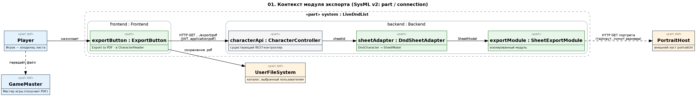
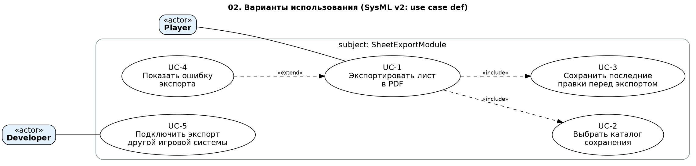
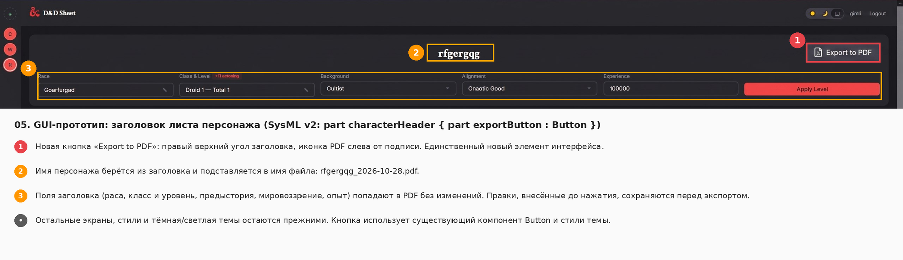
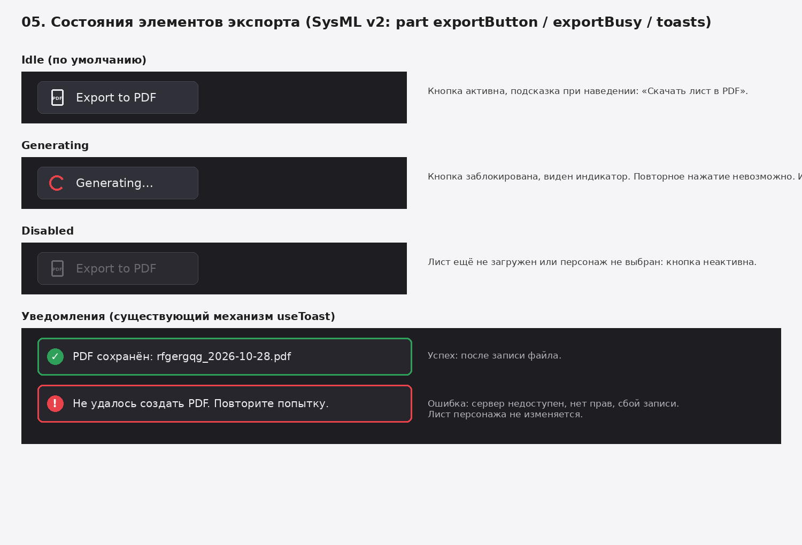
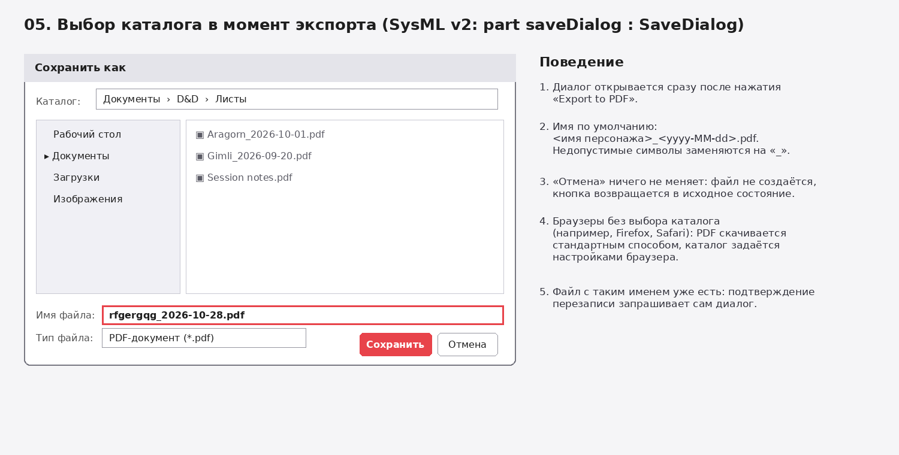
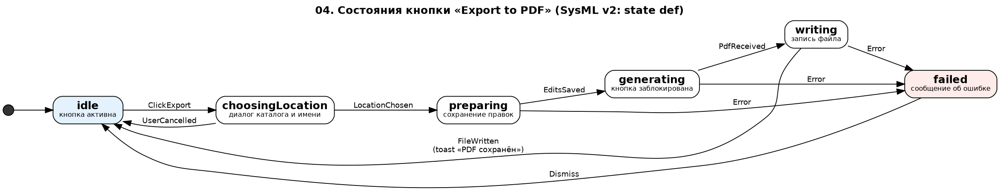
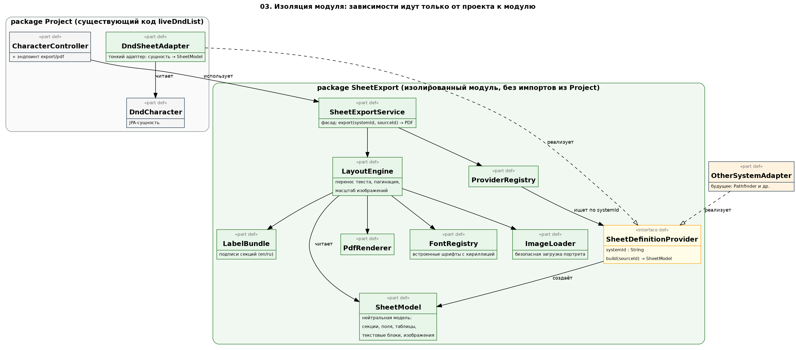
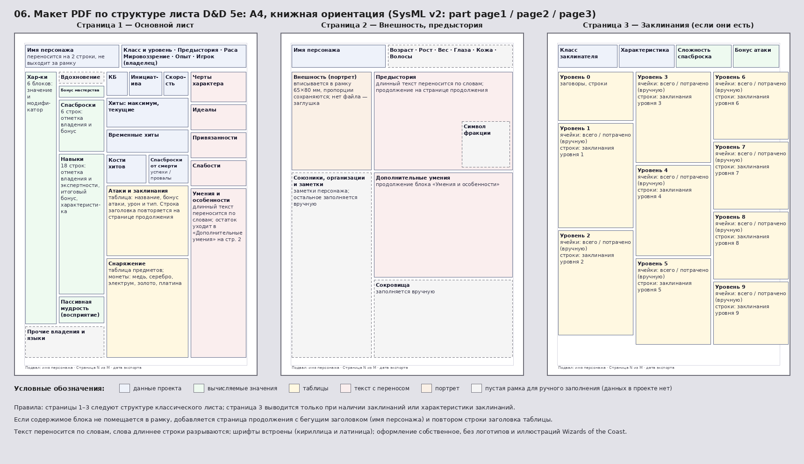

# Спецификация требований к ПО

Для модуля «Генератор отчётов листов персонажей» (Sheet Export) проекта Live D&D List

Версия 0.1

Подготовил(а) [ФИО студента, группа]

БГУИР, кафедра электронных вычислительных машин

28.10.2026

## Оглавление

<!-- TOC -->
* [1. Введение](#1-introduction)
  * [1.1 Назначение документа](#11-document-purpose)
  * [1.2 Область применения продукта](#12-product-scope)
  * [1.3 Определения, акронимы и сокращения](#13-definitions-acronyms-and-abbreviations)
  * [1.4 Ссылки](#14-references)
  * [1.5 Обзор документа](#15-document-overview)
* [2. Обзор продукта](#2-product-overview)
  * [2.1 Перспектива продукта](#21-product-perspective)
  * [2.2 Функции продукта](#22-product-functions)
  * [2.3 Ограничения продукта](#23-product-constraints)
  * [2.4 Характеристики пользователей](#24-user-characteristics)
  * [2.5 Допущения и зависимости](#25-assumptions-and-dependencies)
  * [2.6 Распределение требований](#26-apportioning-of-requirements)
* [3. Требования](#3-requirements)
  * [3.1 Внешние интерфейсы](#31-external-interfaces)
    * [3.1.1 Пользовательские интерфейсы](#311-user-interfaces)
    * [3.1.2 Аппаратные интерфейсы](#312-hardware-interfaces)
    * [3.1.3 Программные интерфейсы](#313-software-interfaces)
  * [3.2 Функциональные требования](#32-functional)
  * [3.3 Качество обслуживания](#33-quality-of-service)
    * [3.3.1 Производительность](#331-performance)
    * [3.3.2 Безопасность](#332-security)
    * [3.3.3 Надёжность](#333-reliability)
    * [3.3.4 Доступность](#334-availability)
    * [3.3.5 Наблюдаемость](#335-observability)
  * [3.4 Соответствие стандартам](#34-compliance)
  * [3.5 Проектирование и реализация](#35-design-and-implementation)
    * [3.5.1 Установка](#351-installation)
    * [3.5.2 Сборка и поставка](#352-build-and-delivery)
    * [3.5.3 Распределение](#353-distribution)
    * [3.5.4 Сопровождаемость](#354-maintainability)
    * [3.5.5 Повторное использование](#355-reusability)
    * [3.5.6 Переносимость](#356-portability)
    * [3.5.7 Стоимость](#357-cost)
    * [3.5.8 Сроки](#358-deadline)
    * [3.5.9 Доказательство концепции](#359-proof-of-concept)
    * [3.5.10 Управление изменениями](#3510-change-management)
  * [3.6 ИИ/МО](#36-aiml)
* [4. Верификация](#4-verification)
* [5. Приложения](#5-appendixes)
<!-- TOC -->

## История изменений

| Name | Date | Reason For Changes | Version |
|------|------|--------------------|---------|
| [ФИО студента] | 28.10.2026 | Первая редакция по бизнес-требованиям Заказчика | 0.1 |
|      |      |                    |         |

## 1. Введение {#1-introduction}

Документ описывает требования к модулю экспорта листа персонажа в PDF, который добавляется в существующее веб-приложение Live D&D List (backend: Java 21, Spring Boot; frontend: React/TypeScript). Он написан для Заказчика, разработчика, тестировщика и преподавателя. Бизнес-цели и границы продукта приведены в разделе 1.2, ограничения и пользователи в разделе 2, проверяемые требования в разделе 3.

### 1.1 Назначение документа {#11-document-purpose}

SRS определяет, **что** модуль должен делать, а не **как** он будет реализован. Заказчик использует его, чтобы подтвердить, что требования отражают его потребности. Разработчик берёт из него требования к проектированию и реализации, тестировщик строит по нему приёмочные тесты (раздел 4). Связанные артефакты: исходный код проекта, `README.md` и `CONTRIBUTING.md` репозитория, графические модели в каталоге `diagrams/`.

### 1.2 Область применения продукта {#12-product-scope}

**Продукт:** модуль «Sheet Export» (генератор отчётов листов персонажей), версия 0.1, поставляется как часть Live D&D List.

**Назначение.** Модуль создаёт PDF-файл с полным листом персонажа и позволяет пользователю сохранить его в каталог по своему выбору. Экспорт запускается кнопкой в заголовке листа персонажа. Первой поддерживается система D&D 5e (данные проекта), а архитектура должна позволять добавлять листы других игровых систем.

**Бизнес-цели (источник: Заказчик):**

| ID | Бизнес-цель | Измеримый результат |
|----|-------------|---------------------|
| BO-1 | Игрок получает офлайн-копию листа для игры за столом и печати | PDF создаётся одним нажатием кнопки и одним выбором каталога, за время не более 3 секунд для типичного персонажа |
| BO-2 | Игрок передаёт лист мастеру игры, у которого нет доступа к приложению | Файл читается в любом стандартном PDF-просмотрщике без искажений |
| BO-3 | Проект получает возможность поддерживать другие игровые системы | Для новой системы нужно добавить один класс-адаптер без изменения кода модуля |
| BO-4 | Модуль не ухудшает работу существующего проекта | Проект запускается и все существующие тесты проходят после интеграции |

**Входит в область:** кнопка экспорта в заголовке листа, endpoint создания PDF, нейтральная модель описания листа, макет и отрисовка PDF, адаптер D&D 5e, сохранение файла в выбранный каталог.

**Не входит в область:** импорт листов из PDF, редактирование листа внутри PDF (заполняемые формы), печать, отправка по почте, пакетный экспорт нескольких персонажей, хранение сгенерированных PDF на сервере, конкретные адаптеры других игровых систем (только возможность их добавить).

### 1.3 Определения, акронимы и сокращения {#13-definitions-acronyms-and-abbreviations}

| Term | Definition |
|------|------------|
| D&D 5e | Dungeons & Dragons, пятая редакция — настольная ролевая игра; в проекте используется набор правил SRD 2014 |
| DM / Мастер игры | Ведущий игры; получает листы персонажей от игроков |
| API | Application Programming Interface — набор определений и протоколов для интеграции ПО |
| Адаптер | Класс проекта, преобразующий данные игровой системы в нейтральную модель листа |
| Глиф | Начертание символа в шрифте |
| JWT | JSON Web Token — токен авторизации, используемый в проекте |
| Лист персонажа | Набор данных персонажа: характеристики, навыки, бой, снаряжение, заклинания, описания |
| Нейтральная модель листа (SheetModel) | Описание листа в терминах секций, полей, таблиц, текстовых блоков и изображений, не привязанное к игровой системе |
| Портрет | Изображение персонажа, заданное ссылкой `portraitUrl` |
| Провайдер листа | Точка расширения модуля: компонент, строящий нейтральную модель листа для одной игровой системы |
| SRS | Software Requirements Specification — документ, описывающий назначение, требования и характер ПО |
| SSRF | Server-Side Request Forgery — атака, при которой сервер заставляют обращаться к внутренним адресам |
| SysML v2 | Systems Modeling Language версии 2 — язык моделирования, используемый для графической части документа |
| TBD | To Be Determined — значение ещё не согласовано с Заказчиком |
| UI | User Interface — визуальная часть приложения |

### 1.4 Ссылки {#14-references}

| № | Источник | Тип | Расположение |
|---|----------|-----|--------------|
| 1 | Источники и виды требований, ЖЦРПО Ч1 (СЭО БГУИР) | Справочная | `Источники_и_виды_требований.html` |
| 2 | Репозиторий Live D&D List (README, CONTRIBUTING, исходный код) | Нормативная | https://github.com/Margit-The-Fell-Omen/liveDndList |
| 3 | ISO 32000-1:2008 (PDF 1.7) | Нормативная | ISO |
| 4 | OMG Systems Modeling Language (SysML) v2 | Справочная | https://www.omg.org/sysml/sysmlv2/ |
| 5 | SIL Open Font License 1.1 | Справочная | https://openfontlicense.org |
| 6 | Графические модели SysML v2 (исходники `.sysml` и PNG) | Нормативная | `diagrams/` |
| 7 | Пустой официальный лист персонажа D&D 5e (3 страницы) — образец структуры страниц | Справочная (только структура блоков, графика не воспроизводится) | `D_D_Char_Empty.pdf` |

### 1.5 Обзор документа {#15-document-overview}

Раздел 2 даёт контекст: место модуля в проекте, функции, ограничения, пользователи, допущения и распределение требований по итерациям. Раздел 3 содержит требования с уникальными идентификаторами `REQ-[AREA]-[NNN]`; ключевое слово «должен» означает обязательное требование, «следует» означает рекомендацию. Раздел 4 связывает каждое требование со способом проверки. Раздел 5 содержит открытые вопросы к Заказчику и список графических моделей. Каждое изменение документа фиксируется в истории изменений.

---

## 2. Обзор продукта {#2-product-overview}

### 2.1 Перспектива продукта {#21-product-perspective}

Модуль встраивается в действующую систему Live D&D List: Spring Boot REST API (`/api/v1/**`, JWT-авторизация), PostgreSQL, Redis и React-интерфейс. Новый продукт не заменяет существующие функции. Он добавляет один endpoint, один адаптер данных и одну кнопку интерфейса. Владелец проекта — автор репозитория, поставка идёт через pull-request по правилам `CONTRIBUTING.md`.

*Рисунок 1 — контекст модуля (SysML v2: `diagrams/01-context.sysml`).*

Границы владения: данные персонажа принадлежат проекту (модуль только читает их через адаптер), портрет находится на внешнем хосте, файл после скачивания принадлежит пользователю.

### 2.2 Функции продукта {#22-product-functions}

1. Запуск экспорта кнопкой в заголовке листа персонажа.
2. Выбор пользователем каталога и имени файла при экспорте.
3. Создание PDF с полным содержимым листа в структуре классического листа D&D 5e (3 страницы): идентификация, характеристики, спасброски, навыки, боевые показатели, хиты, снаряжение, валюта, описательные блоки, портрет, заклинания по уровням.
4. Корректное форматирование при любых данных: перенос текста, пагинация, кириллица, масштабирование изображений.
5. Информирование пользователя о ходе и результате экспорта.
6. Нейтральная модель листа и точка расширения для других игровых систем.

Варианты использования показаны на рисунке 2.

*Рисунок 2 — варианты использования (SysML v2: `diagrams/02-use-cases.sysml`).*

### 2.3 Ограничения продукта {#23-product-constraints}

| ID | Ограничение | Тип |
|----|-------------|-----|
| CON-1 | Модуль должен быть реализован на Java 21 внутри backend проекта (Spring Boot 4.0.x) | Внешнее, обязательное (Заказчик) |
| CON-2 | Модуль должен запускаться в составе проекта без падений (`docker compose up --build`) | Внешнее, обязательное (Заказчик) |
| CON-3 | Модуль должен быть изолирован от бизнес-логики проекта и готов к расширению | Внешнее, обязательное (Заказчик) |
| CON-4 | Лицензии используемых библиотек и шрифтов должны быть совместимы с публичной лицензией проекта (UNLICENSE) | Внешнее, обязательное |
| CON-5 | Код должен соответствовать `checkstyle.xml` проекта и правилам ветвления/коммитов из `CONTRIBUTING.md` | Организационное, обязательное |
| CON-6 | Веб-интерфейс не позволяет приложению записывать файл в произвольный каталог без участия пользователя; выбор каталога возможен только через диалог браузера | Внешнее (технологическое), обязательное |
| CON-7 | Схема базы данных не должна меняться | Внутреннее, предпочтительное |

Конкретная библиотека генерации PDF в этом документе не фиксируется и выбирается при проектировании с учётом CON-4.

### 2.4 Характеристики пользователей {#24-user-characteristics}

| Класс | Описание | Частота | Особенности |
|-------|----------|---------|-------------|
| Игрок | Владелец листа; создаёт и ведёт персонажа в приложении, экспортирует его перед игрой | Раз за сессию или реже | Не технический пользователь; работает с ПК и мобильным браузером; имена и описания часто на русском |
| Мастер игры | Получает PDF от игрока, в приложении не работает | По мере получения файлов | Читает и печатает PDF в стандартном просмотрщике |
| Разработчик | Поддерживает проект, добавляет игровые системы | Редко | Знает Java/Spring; нужна понятная точка расширения и документация |

Локализация: данные пользователей могут быть на кириллице и латинице; язык интерфейса сейчас английский (см. OQ-4).

### 2.5 Допущения и зависимости {#25-assumptions-and-dependencies}

| ID | Допущение / зависимость | Влияние, если неверно |
|----|-------------------------|-----------------------|
| AS-1 | Пользователь использует актуальный Chromium-браузер (Chrome, Edge), где доступен диалог выбора файла | В Firefox и Safari файл скачивается стандартным способом, каталог определяется настройками браузера (см. OQ-1) |
| AS-2 | Структура `CharacterResponse` и связанных сущностей проекта остаётся стабильной | Адаптер D&D нужно обновлять при каждом изменении модели данных |
| AS-3 | Портреты доступны по публичным http/https-ссылкам | Вместо портрета выводится заглушка (REQ-REL-001) |
| AS-4 | Сервер имеет доступ к исходящему HTTP только для загрузки портретов | Без доступа портреты не загрузятся, экспорт продолжится без них |

### 2.6 Распределение требований {#26-apportioning-of-requirements}

Трассируемость требований Заказчика (источник: бизнес-интервью):

| № | Требование Заказчика | Требования SRS |
|---|----------------------|----------------|
| C-1 | Модуль интегрирован в проект и запускается без падений | REQ-INT-001, REQ-INT-002, REQ-INT-003, REQ-REL-002, REQ-REL-004 |
| C-2 | Экспорт листа в PDF кнопкой в заголовке листа | REQ-INT-005 … REQ-INT-009, REQ-FUNC-001, REQ-FUNC-002, REQ-FUNC-008 … REQ-FUNC-013, REQ-FUNC-021 |
| C-3 | PDF сохраняется в каталог, выбранный пользователем в момент экспорта | REQ-FUNC-003, REQ-FUNC-004, REQ-FUNC-005, REQ-FUNC-006, REQ-FUNC-007 |
| C-4 | PDF правильно отформатирован при любых данных | REQ-FUNC-014 … REQ-FUNC-020, REQ-FUNC-022, REQ-FUNC-023, REQ-REL-001, REQ-REL-002, REQ-PERF-002 |
| C-5 | Модуль изолирован и готов к расширению для других систем | REQ-REUSE-001 … REQ-REUSE-004, REQ-MAINT-002 |

Распределение по итерациям:

| Итерация | Состав | Требования |
|----------|--------|------------|
| 1 (доказательство концепции) | PDF с кириллицей, портретом и пагинацией на тестовых данных | REQ-POC-001 |
| 2 (ядро) | Endpoint, адаптер D&D, макет PDF, безопасность, надёжность | REQ-FUNC-009 … REQ-FUNC-020, REQ-FUNC-022, REQ-INT-004, REQ-INT-010, REQ-SEC-*, REQ-REL-*, REQ-REUSE-* |
| 3 (интерфейс) | Кнопка, диалог выбора каталога, состояния и уведомления | REQ-INT-005 … REQ-INT-009, REQ-FUNC-001 … REQ-FUNC-008, REQ-FUNC-021 |
| 4 (качество) | Производительность, наблюдаемость, документация, тесты | REQ-PERF-*, REQ-OBS-*, REQ-MAINT-* |

Отложено: адаптеры других игровых систем, локализация подписей PDF (см. OQ-4), экспорт публичных листов не-владельцем (OQ-5).

---

## 3. Требования {#3-requirements}

Каждое требование содержит поля: **ID**, **Statement**, **Rationale**, **Acceptance Criteria**, **Verification Method** (Test, Analysis, Inspection, Demonstration). Источник по умолчанию — Заказчик; ссылки вида C-N указывают на таблицу в разделе 2.6.

### 3.1 Внешние интерфейсы {#31-external-interfaces}

#### 3.1.1 Пользовательские интерфейсы {#311-user-interfaces}

Макеты: `diagrams/05-ui-header.png`, `05-ui-states.png`, `05-ui-save-dialog.png`; исходник модели: `diagrams/05-ui-mockups.sysml`.

*Рисунок 3 — заголовок листа персонажа с кнопкой «Export to PDF».*

*Рисунок 4 — состояния кнопки и уведомления.*

*Рисунок 5 — выбор каталога и имени файла.*

**REQ-INT-005 — Положение кнопки**
- **Statement:** Заголовок листа персонажа должен содержать кнопку с подписью «Export to PDF» и иконкой PDF в правом верхнем углу заголовка.
- **Rationale:** Заказчик требует запуск экспорта из заголовка листа (C-2).
- **Acceptance Criteria:** Кнопка видна на странице листа выбранного персонажа без прокрутки при ширине окна от 360 px; расположена в правом верхнем углу заголовка, как на рисунке 3.
- **Verification Method:** Demonstration
- **More Information:** `diagrams/05-ui-header.png`.

**REQ-INT-006 — Единый стиль**
- **Statement:** Кнопка экспорта должна использовать существующий компонент `Button` и поддерживать светлую и тёмную темы проекта.
- **Rationale:** Единообразие интерфейса и отсутствие дублирования стилей.
- **Acceptance Criteria:** В обеих темах кнопка визуально соответствует остальным кнопкам; контраст текста и фона не менее 4.5:1.
- **Verification Method:** Inspection
- **More Information:** WCAG 2.1 AA, критерий 1.4.3.

**REQ-INT-007 — Состояния кнопки**
- **Statement:** Кнопка должна иметь состояния: «Export to PDF» (активна), «Generating…» с индикатором (заблокирована на время экспорта), неактивна (персонаж не загружен).
- **Rationale:** Пользователь должен видеть, что процесс идёт, и не запускать его повторно.
- **Acceptance Criteria:** Во время экспорта кнопка заблокирована и показывает индикатор; повторное нажатие не создаёт второй запрос.
- **Verification Method:** Test
- **More Information:** `diagrams/05-ui-states.png`, `diagrams/04-export-flow.png`.

**REQ-INT-008 — Доступность кнопки**
- **Statement:** Кнопка должна быть доступна с клавиатуры (Tab, Enter, Space) и иметь доступное имя для экранных дикторов.
- **Rationale:** Доступность интерфейса.
- **Acceptance Criteria:** Кнопка получает фокус клавишей Tab, активируется Enter и Space; у элемента задано доступное имя «Export to PDF».
- **Verification Method:** Inspection

#### 3.1.2 Аппаратные интерфейсы {#312-hardware-interfaces}

Аппаратных интерфейсов нет. Модуль не взаимодействует с физическими устройствами; сохранение файла выполняется средствами браузера и операционной системы пользователя.

#### 3.1.3 Программные интерфейсы {#313-software-interfaces}

**REQ-INT-004 — REST-интерфейс экспорта**
- **Statement:** Backend должен предоставлять `GET /api/v1/characters/{id}/export/pdf`, возвращающий `application/pdf` с заголовком `Content-Disposition: attachment` и именем файла по REQ-FUNC-005.
- **Rationale:** Единый способ получить PDF из интерфейса; маршрут следует соглашениям существующего `CharacterController`.
- **Acceptance Criteria:** При запросе существующего персонажа владельцем ответ имеет статус 200, `Content-Type: application/pdf`, тело начинается с `%PDF-`. Для несуществующего `id` — статус 404 в формате ошибок проекта.
- **Verification Method:** Test

**REQ-INT-009 — Авторизация запроса**
- **Statement:** Запрос экспорта должен использовать JWT-авторизацию проекта, включая обновление токена по refresh-токену.
- **Rationale:** Пользователь не должен повторно входить в систему из-за экспорта.
- **Acceptance Criteria:** При истёкшем access-токене и действующем refresh-токене экспорт завершается успешно без повторного входа.
- **Verification Method:** Test

**REQ-INT-010 — Загрузка портрета**
- **Statement:** Модуль должен получать изображение портрета по HTTP GET по ссылке `portraitUrl` персонажа.
- **Rationale:** Портрет хранится по ссылке на внешнем хосте.
- **Acceptance Criteria:** Для доступного изображения PNG или JPEG оно выводится в PDF; обработка недоступных ссылок описана в REQ-REL-001.
- **Verification Method:** Test

### 3.2 Функциональные требования {#32-functional}

Диаграмма состояний процесса экспорта:

*Рисунок 6 — процесс экспорта (SysML v2: `diagrams/04-export-flow.sysml`).*

**REQ-FUNC-001 — Запуск экспорта**
- **Statement:** По нажатию кнопки «Export to PDF» система должна начать экспорт листа текущего открытого персонажа.
- **Rationale:** Основной сценарий пользователя (C-2).
- **Acceptance Criteria:** После нажатия кнопки у персонажа, открытого на экране, начинается экспорт; данные другого персонажа в файл не попадают.
- **Verification Method:** Test

**REQ-FUNC-002 — Результат экспорта**
- **Statement:** Результатом экспорта должен быть один PDF-файл с листом одного персонажа.
- **Rationale:** Файл передаётся мастеру или печатается.
- **Acceptance Criteria:** Файл открывается в Adobe Acrobat Reader, Chrome, Firefox (PDF.js) и системном просмотрщике без сообщений об ошибках.
- **Verification Method:** Demonstration

**REQ-FUNC-003 — Выбор каталога**
- **Statement:** Сразу после нажатия кнопки система должна показать пользователю диалог выбора каталога и имени файла.
- **Rationale:** Файл должен сохраняться в каталог, выбранный в момент экспорта (C-3).
- **Acceptance Criteria:** В Chrome и Edge после нажатия кнопки открывается диалог «Сохранить как» с предложенным именем файла (рисунок 5).
- **Verification Method:** Demonstration
- **More Information:** Для браузеров без диалога см. REQ-FUNC-007.

**REQ-FUNC-004 — Сохранение в выбранный каталог**
- **Statement:** Система должна записать PDF в каталог и под именем, которые пользователь указал в диалоге.
- **Rationale:** C-3.
- **Acceptance Criteria:** После подтверждения диалога файл существует по выбранному пути, размер больше 0 байт, содержимое совпадает с ответом сервера.
- **Verification Method:** Demonstration

**REQ-FUNC-005 — Имя файла по умолчанию**
- **Statement:** Предлагаемое имя файла должно иметь вид `<имя персонажа>_<yyyy-MM-dd>.pdf`, где символы `\ / : * ? " < > |` и управляющие символы заменены на `_`, а имя персонажа усечено до 100 символов.
- **Rationale:** Имя должно быть допустимым в Windows, Linux и macOS.
- **Acceptance Criteria:** Для имени `ushki` на 28.10.2026 предлагается `ushki_2026-10-28.pdf`; для имени `A/B:C` — `A_B_C_2026-10-28.pdf`; для пустого имени — `character_2026-10-28.pdf`.
- **Verification Method:** Test

**REQ-FUNC-006 — Отмена выбора**
- **Statement:** Если пользователь закрыл диалог без сохранения, система не должна создавать файл и должна вернуть кнопку в активное состояние.
- **Rationale:** Отказ не должен приводить к ошибкам или побочным эффектам.
- **Acceptance Criteria:** После отмены файл не создан, ошибка не показана, кнопка активна, данные персонажа не изменены.
- **Verification Method:** Test

**REQ-FUNC-007 — Браузеры без диалога выбора**
- **Statement:** В браузерах, не поддерживающих программный диалог выбора файла, система должна скачать PDF стандартным механизмом браузера с именем по REQ-FUNC-005.
- **Rationale:** Функция остаётся доступной всем пользователям (ограничение CON-6).
- **Acceptance Criteria:** В Firefox и Safari после нажатия кнопки браузер скачивает файл, ошибка не показана.
- **Verification Method:** Demonstration
- **More Information:** Решение требует подтверждения Заказчика (OQ-1).

**REQ-FUNC-008 — Актуальность данных**
- **Statement:** PDF должен содержать данные листа, сохранённые на момент нажатия кнопки, включая правки, внесённые менее чем за 500 мс до нажатия.
- **Rationale:** Интерфейс отправляет правки с задержкой 500 мс; без этого в PDF попали бы устаревшие данные.
- **Acceptance Criteria:** Изменить имя персонажа и нажать «Export to PDF» не позднее чем через 200 мс; в PDF указано новое имя.
- **Verification Method:** Test

**REQ-FUNC-009 — Идентификация персонажа**
- **Statement:** PDF должен содержать имя, расу, классы с уровнями, суммарный уровень, предысторию, мировоззрение и очки опыта персонажа.
- **Rationale:** Это заголовок любого листа персонажа.
- **Acceptance Criteria:** Все перечисленные значения совпадают с отображаемыми на экране для тестового персонажа.
- **Verification Method:** Test

**REQ-FUNC-010 — Характеристики, спасброски, навыки**
- **Statement:** PDF должен содержать шесть характеристик со значением и модификатором, шесть спасбросков с отметкой владения и 18 навыков с итоговым бонусом и отметками владения и экспертности, а также бонус мастерства и пассивную мудрость (восприятие).
- **Rationale:** Базовые игровые показатели, необходимые за столом.
- **Acceptance Criteria:** Для тестового персонажа все 6 + 6 + 18 значений и отметки совпадают с экраном; пассивная мудрость равна 10 плюс бонус навыка «Восприятие».
- **Verification Method:** Test

**REQ-FUNC-011 — Боевые показатели**
- **Statement:** PDF должен содержать класс брони, инициативу, скорость, бонус мастерства, кости хитов, текущие, максимальные и временные хиты, число успехов и провалов спасбросков от смерти.
- **Rationale:** Показатели, используемые в бою.
- **Acceptance Criteria:** Все значения совпадают с экраном для тестового персонажа.
- **Verification Method:** Test

**REQ-FUNC-012 — Снаряжение и валюта**
- **Statement:** PDF должен содержать таблицу снаряжения (название, количество, вес, тип, признаки «надето» и «настроено», урон и его тип, свойства, описание) и количество монет пяти видов.
- **Rationale:** Игрок использует список вещей и денег во время игры.
- **Acceptance Criteria:** Число строк таблицы равно числу предметов персонажа; значения монет совпадают с экраном.
- **Verification Method:** Test

**REQ-FUNC-013 — Заклинания**
- **Statement:** PDF должен содержать известные заклинания, сгруппированные по уровням от 0 до 9 на странице заклинаний (название, школа, время накладывания, дистанция, компоненты, длительность, признаки концентрации и ритуала, описание и эффект на высших уровнях), а также класс заклинателя, характеристику заклинаний, сложность спасброска и бонус атаки заклинанием.
- **Rationale:** Игрок использует печатный список заклинаний за столом.
- **Acceptance Criteria:** Число заклинаний в PDF равно числу заклинаний персонажа; каждое стоит в блоке своего уровня; описания выведены полностью; сложность спасброска равна 8 + бонус мастерства + модификатор характеристики заклинаний; бонус атаки равен бонусу мастерства + модификатору.
- **Verification Method:** Test

**REQ-FUNC-014 — Текстовые блоки**
- **Statement:** PDF должен содержать полностью, без обрезания, тексты полей «умения и особенности», «предыстория», «черты характера», «идеалы», «привязанности», «слабости» и «заметки».
- **Rationale:** Заказчик требует корректный вывод при любых данных (C-4).
- **Acceptance Criteria:** Текст поля из 20 000 символов извлекается из PDF целиком и совпадает с исходным с точностью до переносов строк.
- **Verification Method:** Test

**REQ-FUNC-015 — Формат и состав страниц**
- **Statement:** PDF должен состоять из страниц A4 книжной ориентации с полями не менее 10 мм и содержать по структуре классического листа D&D 5e: страницу 1 (имя и идентификация, характеристики, спасброски, навыки, бой, хиты, атаки, снаряжение, черты характера, умения), страницу 2 (внешность и портрет, предыстория, союзники и заметки, дополнительные умения, сокровища) и страницу 3 (заклинания); страница 3 должна выводиться только если у персонажа есть заклинания или задана характеристика заклинаний.
- **Rationale:** Игроки привыкли к структуре официального листа; такой лист удобно использовать и печатать (C-2, C-4).
- **Acceptance Criteria:** Размер каждой страницы 210 × 297 мм (допуск 1 мм); блоки страниц 1–3 расположены и называются как на рисунке 8; ни один элемент не выходит за область полей; у персонажа без заклинаний в файле 2 основные страницы, с заклинаниями — 3.
- **Verification Method:** Test
- **More Information:** Макет: `diagrams/06-pdf-layout.png`, структура образца — `D_D_Char_Empty.pdf`.

**REQ-FUNC-016 — Перенос текста**
- **Statement:** Текст в PDF должен переноситься по словам внутри границ своего блока; слово длиннее ширины блока должно разрываться.
- **Rationale:** Текст не должен выходить за границы страницы (C-4).
- **Acceptance Criteria:** Для значений «строка из 300 символов без пробелов» и «имя персонажа из 200 символов» границы всех текстовых элементов лежат внутри рамок своих блоков и области полей страницы.
- **Verification Method:** Test

**REQ-FUNC-017 — Пагинация**
- **Statement:** Если содержимое блока не помещается в его рамку, система должна продолжить его на странице продолжения того же раздела с бегущим заголовком (имя персонажа).
- **Rationale:** Данные не должны теряться из-за нехватки места.
- **Acceptance Criteria:** Для персонажа со 100 заклинаниями и 100 предметами все строки присутствуют в PDF; строки таблиц не разрываются между страницами; строка заголовка таблицы повторяется на каждой странице продолжения; текст «Умения и особенности» длиннее рамки продолжается в блоке «Дополнительные умения», а затем на странице продолжения.
- **Verification Method:** Test

**REQ-FUNC-018 — Кириллица и символы**
- **Statement:** PDF должен корректно отображать кириллицу, латиницу, цифры и знаки пунктуации за счёт шрифтов, встроенных в файл.
- **Rationale:** Данные пользователей часто на русском языке (C-4).
- **Acceptance Criteria:** Текст тестового персонажа «Бродяга Ёжик-Щёголь: Ъъ Ыы Ээ, №1» извлекается из PDF без искажений и отображается во всех просмотрщиках из REQ-FUNC-002.
- **Verification Method:** Test

**REQ-FUNC-019 — Неподдерживаемые символы**
- **Statement:** Символ, отсутствующий в шрифтах, должен выводиться как символ замены.
- **Rationale:** Эмодзи и редкие символы не должны приводить к ошибке или пропаже соседнего текста.
- **Acceptance Criteria:** Для имени «Гном 🧙 Ёж» экспорт завершается успехом, остальные символы выведены корректно.
- **Verification Method:** Test

**REQ-FUNC-020 — Масштабирование портрета**
- **Statement:** Портрет должен масштабироваться так, чтобы целиком помещаться в рамку «Внешность» размером 65 × 80 мм на странице 2 с сохранением пропорций и без искажений.
- **Rationale:** Изображения могут быть любого размера и формата (C-4).
- **Acceptance Criteria:** Для изображений 1×1, 100×1000, 1000×100 и 5000×5000 пикселей изображение целиком в рамке, отношение сторон отличается от исходного не более чем на 1%.
- **Verification Method:** Test

**REQ-FUNC-021 — Сообщения пользователю**
- **Statement:** После записи файла система должна показать уведомление «PDF сохранён» с именем файла; при ошибке уведомление «Не удалось создать PDF. Повторите попытку.»
- **Rationale:** Пользователь должен знать результат операции.
- **Acceptance Criteria:** Уведомление об успехе появляется после записи файла, об ошибке — при остановке сервера во время экспорта; лист персонажа в обоих случаях остаётся без изменений.
- **Verification Method:** Test
- **More Information:** `diagrams/05-ui-states.png`.

**REQ-FUNC-022 — Пустые значения**
- **Statement:** Незаполненное поле персонажа должно выводиться в PDF как «—».
- **Rationale:** Новый персонаж содержит пустые поля, это не должно приводить к ошибкам.
- **Acceptance Criteria:** Для персонажа с пустыми описаниями, без снаряжения, заклинаний и портрета экспорт завершается успехом, пустые поля содержат «—».
- **Verification Method:** Test

**REQ-FUNC-023 — Блоки без данных**
- **Statement:** Блоки листа, для которых в данных проекта нет значений (вдохновение, прочие владения и языки, возраст, рост, вес, глаза, кожа, волосы, символ фракции, сокровища, ячейки заклинаний), должны выводиться пустыми рамками для заполнения вручную.
- **Rationale:** Лист сохраняет привычную структуру, а игрок может дописать недостающее от руки после печати.
- **Acceptance Criteria:** В PDF любого персонажа перечисленные блоки присутствуют, пустые и отмечены подписью; в них не выводятся значения «—» и «0».
- **Verification Method:** Test
- **More Information:** Заметки персонажа выводятся в блоке «Союзники, организации и заметки» (OQ-7).

### 3.3 Качество обслуживания {#33-quality-of-service}

#### 3.3.1 Производительность {#331-performance}

**REQ-PERF-001 — Время экспорта типичного листа**
- **Statement:** Для типичного персонажа (не более 20 предметов, 30 заклинаний, текстовые поля до 2 000 символов, портрет до 2 МБ) сервер должен отвечать на запрос экспорта за время не более 3 секунд для 95% запросов.
- **Rationale:** BO-1: экспорт не должен заставлять пользователя ждать.
- **Acceptance Criteria:** При 20 последовательных запусках в `docker compose` окружении проекта (портрет на локальном хосте) не менее 19 завершились за 3 секунды или быстрее.
- **Verification Method:** Test

**REQ-PERF-002 — Время экспорта предельного листа**
- **Statement:** Для персонажа с 100 предметами, 100 заклинаниями и текстовыми полями по 100 000 символов сервер должен отвечать не более чем за 15 секунд.
- **Rationale:** C-4: корректная работа при любых данных, в том числе объёмных.
- **Acceptance Criteria:** Запрос завершается за 15 секунд или быстрее, файл корректен по REQ-FUNC-014 … REQ-FUNC-020.
- **Verification Method:** Test
- **More Information:** Предельные значения подлежат согласованию (OQ-2).

**REQ-PERF-003 — Размер файла**
- **Statement:** Размер PDF типичного персонажа не должен превышать 2 МБ, предельного — 20 МБ.
- **Rationale:** Файл отправляется мастеру по сети.
- **Acceptance Criteria:** Размеры файлов тестовых персонажей не превышают указанных значений.
- **Verification Method:** Test

**REQ-PERF-004 — Параллельные запросы**
- **Statement:** Система должна обрабатывать 5 одновременных запросов экспорта без ошибок, 95% запросов должны завершаться не более чем за 10 секунд.
- **Rationale:** Экспорт не должен останавливать работу других пользователей.
- **Acceptance Criteria:** При 5 параллельных запросах типичного персонажа все завершились статусом 200; остальные эндпоинты проекта отвечают во время экспорта.
- **Verification Method:** Test

#### 3.3.2 Безопасность {#332-security}

**REQ-SEC-001 — Доступ только владельцу**
- **Statement:** Система должна разрешать экспорт листа только его владельцу.
- **Rationale:** Данные персонажа принадлежат пользователю.
- **Acceptance Criteria:** Запрос без токена возвращает 401; запрос чужого пользователя возвращает ответ, принятый в проекте для чужих персонажей (403 или 404); PDF не создаётся.
- **Verification Method:** Test
- **More Information:** Экспорт публичных листов не владельцем — OQ-5.

**REQ-SEC-002 — Защита от SSRF при загрузке портрета**
- **Statement:** Модуль должен загружать портрет только по схемам `http` и `https` и не должен обращаться к адресам loopback, частных сетей, link-local и метаданных облака.
- **Rationale:** `portraitUrl` задаёт пользователь, сервер не должен становиться прокси во внутреннюю сеть.
- **Acceptance Criteria:** Для ссылок `http://127.0.0.1/x`, `http://10.0.0.5/x`, `http://169.254.169.254/x`, `file:///etc/passwd` запрос к адресу не отправляется, экспорт завершается успехом с заглушкой вместо портрета.
- **Verification Method:** Test

**REQ-SEC-003 — Ограничение загрузки портрета**
- **Statement:** Загрузка портрета должна иметь таймаут не более 5 секунд, максимальный размер 5 МБ и не более 3 перенаправлений.
- **Rationale:** Защита от зависания и исчерпания памяти.
- **Acceptance Criteria:** Для медленного хоста, файла 10 МБ и цепочки из 5 перенаправлений экспорт завершается без портрета не позднее чем через 6 с после начала загрузки.
- **Verification Method:** Test

**REQ-SEC-004 — Текст как данные**
- **Statement:** Содержимое полей персонажа должно выводиться в PDF как обычный текст и не должно интерпретироваться как разметка или команды.
- **Rationale:** Защита от инъекций через пользовательские данные.
- **Acceptance Criteria:** Поля со значениями `<b>x</b>`, `{{7*7}}`, `%PDF-`, `\0` выводятся буквально; экспорт успешен.
- **Verification Method:** Test

**REQ-SEC-005 — Конфиденциальность в журналах**
- **Statement:** Журналы модуля не должны содержать тексты полей персонажа и ссылку на портрет.
- **Rationale:** Приватность данных пользователей.
- **Acceptance Criteria:** После тестового экспорта в журналах нет строк с именем, предысторией и `portraitUrl` персонажа.
- **Verification Method:** Inspection

#### 3.3.3 Надёжность {#333-reliability}

**REQ-REL-001 — Устойчивость к сбоям портрета**
- **Statement:** Если портрет отсутствует, недоступен, превышает лимиты или не является PNG/JPEG, модуль должен вывести заглушку и завершить экспорт успешно.
- **Rationale:** Сбой внешнего ресурса не должен лишать пользователя листа.
- **Acceptance Criteria:** Для ссылок с кодами 404 и 500, недоступного хоста, текстового файла вместо изображения экспорт завершается кодом 200 и PDF содержит заглушку.
- **Verification Method:** Test

**REQ-REL-002 — Устойчивость к любым данным**
- **Statement:** Для любых значений полей персонажа, допустимых в БД проекта, экспорт должен завершаться без необработанных исключений.
- **Rationale:** C-1 и C-4: модуль не должен падать.
- **Acceptance Criteria:** 1 000 тестовых персонажей со случайными данными (пустые значения, экстремальная длина, управляющие символы, эмодзи, кириллица) экспортируются без необработанных исключений; результат валиден по REQ-FUNC-015, REQ-FUNC-016.
- **Verification Method:** Test

**REQ-REL-003 — Единый формат ошибок**
- **Statement:** При невозможности создать PDF сервер должен вернуть ошибку в формате, принятом в проекте (`ApiResponse`), с соответствующим HTTP-статусом.
- **Rationale:** Интерфейс обрабатывает ошибки единообразно.
- **Acceptance Criteria:** При принудительной ошибке генерации в тесте возвращается статус 5xx с телом в формате проекта; частично созданный PDF не отдаётся.
- **Verification Method:** Test

**REQ-REL-004 — Изоляция сбоев**
- **Statement:** Ошибка экспорта не должна влиять на работу остальных функций приложения.
- **Rationale:** BO-4.
- **Acceptance Criteria:** После 10 подряд запросов, завершившихся ошибкой, остальные эндпоинты проекта отвечают штатно, память процесса не растёт между запросами более чем на 10%.
- **Verification Method:** Test

#### 3.3.4 Доступность {#334-availability}

Отдельных требований к доступности нет: экспорт доступен, пока доступно приложение (SLA проекта не определён). Модуль не вводит собственных окон обслуживания.

#### 3.3.5 Наблюдаемость {#335-observability}

**REQ-OBS-001 — Метрики экспорта**
- **Statement:** Модуль должен публиковать метрики длительности экспорта и числа успешных и неуспешных экспортов через Micrometer/Prometheus проекта.
- **Rationale:** Проект уже собирает метрики; экспорт требует контроля времени и ошибок.
- **Acceptance Criteria:** На `/actuator/prometheus` после экспорта видны метрика длительности и счётчики результата `success` / `failure`.
- **Verification Method:** Test

**REQ-OBS-002 — Журнал экспорта**
- **Statement:** Модуль должен записывать в журнал событие завершения экспорта с идентификатором персонажа, длительностью, числом страниц и размером файла.
- **Rationale:** Диагностика проблем у пользователей.
- **Acceptance Criteria:** После экспорта в журнале присутствует одна запись с указанными полями (без данных по REQ-SEC-005).
- **Verification Method:** Inspection

### 3.4 Соответствие стандартам {#34-compliance}

**REQ-COMP-001 — Формат PDF**
- **Statement:** Создаваемый файл должен соответствовать PDF версии 1.4 или выше (ISO 32000-1), с заполненными метаданными Title (имя персонажа) и Creator (название приложения).
- **Rationale:** Совместимость с просмотрщиками и печатью.
- **Acceptance Criteria:** Проверка валидатором структуры PDF не показывает ошибок; в свойствах документа указаны Title и Creator.
- **Verification Method:** Analysis

**REQ-COMP-002 — Лицензии зависимостей**
- **Statement:** Все добавляемые библиотеки и шрифты должны иметь лицензии, допускающие использование в проекте под UNLICENSE и встраивание шрифтов в PDF; список лицензий должен быть в документации модуля.
- **Rationale:** CON-4. Часть библиотек генерации PDF распространяется под AGPL и несовместима с задачей.
- **Acceptance Criteria:** Для каждой новой зависимости в списке указаны название, версия и лицензия; нет зависимостей под AGPL/GPL без исключений.
- **Verification Method:** Inspection

**REQ-COMP-003 — Правила проекта**
- **Statement:** Код модуля должен проходить проверку checkstyle проекта без новых нарушений, а работа должна вестись в ветке `{issue-id}-{описание}` с коммитами по Conventional Commits.
- **Rationale:** CON-5.
- **Acceptance Criteria:** Проверка checkstyle без новых предупреждений; имена веток и коммитов соответствуют `CONTRIBUTING.md`.
- **Verification Method:** Inspection

**REQ-COMP-004 — Графика и товарные знаки**
- **Statement:** Оформление PDF должно быть собственным и не должно содержать логотипов, иллюстраций и элементов оформления официального листа Wizards of the Coast.
- **Rationale:** Образец структуры разрешён к копированию только для личного использования; приложение распространяется публично.
- **Acceptance Criteria:** В PDF и ресурсах модуля нет изображений и шрифтов из `D_D_Char_Empty.pdf`; осмотр подтверждает отсутствие логотипа D&D.
- **Verification Method:** Inspection

### 3.5 Проектирование и реализация {#35-design-and-implementation}

#### 3.5.1 Установка {#351-installation}

**REQ-INT-001 — Запуск проекта с модулем**
- **Statement:** Проект с интегрированным модулем должен запускаться командой `docker compose up --build` без ручных шагов и без ошибок в журнале запуска.
- **Rationale:** C-1.
- **Acceptance Criteria:** После запуска backend отвечает на `/actuator/health` статусом `UP`, в журнале запуска нет записей уровня ERROR, связанных с модулем.
- **Verification Method:** Demonstration

**REQ-INT-002 — Существующие тесты**
- **Statement:** После интеграции модуля все существующие автоматические тесты проекта должны проходить.
- **Rationale:** C-1, BO-4.
- **Acceptance Criteria:** `./mvnw test` завершается успехом; число пройденных существующих тестов не уменьшилось.
- **Verification Method:** Test

**REQ-INT-003 — Обратная совместимость**
- **Statement:** Интеграция модуля не должна изменять существующие API-контракты и схему базы данных.
- **Rationale:** Существующий frontend и данные должны продолжать работать.
- **Acceptance Criteria:** Набор существующих эндпоинтов и их ответов не изменился; новые миграции Flyway отсутствуют.
- **Verification Method:** Inspection

#### 3.5.2 Сборка и поставка {#352-build-and-delivery}

Модуль должен собираться в рамках существующей сборки Maven и Docker-образа (см. REQ-INT-001). Отдельных требований к поставке нет.

#### 3.5.3 Распределение {#353-distribution}

Распределённых компонентов нет: модуль работает в одном процессе backend, сгенерированные файлы на сервере не хранятся.

#### 3.5.4 Сопровождаемость {#354-maintainability}

**REQ-MAINT-001 — Покрытие тестами**
- **Statement:** Автоматические тесты должны покрывать не менее 80% строк кода модуля по отчёту JaCoCo.
- **Rationale:** Защита от регрессий при добавлении систем.
- **Acceptance Criteria:** Отчёт JaCoCo показывает покрытие модуля не ниже 80%.
- **Verification Method:** Analysis

**REQ-MAINT-002 — Документация модуля**
- **Statement:** Модуль должен иметь документацию с описанием архитектуры и пошаговой инструкцией добавления новой игровой системы.
- **Rationale:** C-5: расширение должно быть возможно без изучения внутренностей модуля.
- **Acceptance Criteria:** Разработчик, не писавший модуль, по инструкции добавляет тестовый провайдер, не изменяя код ядра.
- **Verification Method:** Demonstration

#### 3.5.5 Повторное использование {#355-reusability}

Архитектура изоляции показана на рисунке 7.

*Рисунок 7 — изоляция модуля (SysML v2: `diagrams/03-module-architecture.sysml`).*

**REQ-REUSE-001 — Изоляция от проекта**
- **Statement:** Код модуля не должен ссылаться на классы сущностей, DTO, репозиториев и сервисов проекта; зависимости должны идти только от проекта к модулю.
- **Rationale:** C-5.
- **Acceptance Criteria:** Автоматическая проверка зависимостей (тест архитектуры) не находит импортов из пакетов проекта в пакете модуля.
- **Verification Method:** Test

**REQ-REUSE-002 — Нейтральная модель листа**
- **Statement:** Ядро модуля должно описывать лист через нейтральную модель (секции, группы полей, таблицы, текстовые блоки, изображения), не содержащую терминов конкретной игровой системы.
- **Rationale:** Одна и та же отрисовка должна подходить листам разных систем.
- **Acceptance Criteria:** В коде ядра нет терминов D&D (например, «спасбросок», «заклинание»); тестовый лист вымышленной системы отрисовывается ядром без изменений.
- **Verification Method:** Inspection

**REQ-REUSE-003 — Подключение новой системы**
- **Statement:** Подключение новой игровой системы должно требовать только добавления одного класса-провайдера, реализующего интерфейс модуля.
- **Rationale:** BO-3.
- **Acceptance Criteria:** Тестовый провайдер «Test System» добавлен одним классом; запрос экспорта для неё возвращает корректный PDF; файлы ядра не изменены.
- **Verification Method:** Test

**REQ-REUSE-004 — Подписи вне кода**
- **Statement:** Подписи секций и полей PDF должны храниться во внешних ресурсах, а не в коде отрисовки.
- **Rationale:** Подготовка к локализации (OQ-4).
- **Acceptance Criteria:** Изменение подписи выполняется правкой ресурсного файла без изменения кода.
- **Verification Method:** Inspection

#### 3.5.6 Переносимость {#356-portability}

**REQ-PORT-001 — Одинаковый результат на разных ОС**
- **Statement:** PDF должен отрисовываться одинаково на Linux (Docker), Windows и macOS, используя только встроенные в приложение шрифты.
- **Rationale:** Разработка идёт на разных ОС, а запуск в контейнере.
- **Acceptance Criteria:** Один и тот же тестовый персонаж, экспортированный в Docker и на Windows, даёт PDF с одинаковым числом страниц и текстом.
- **Verification Method:** Test

#### 3.5.7 Стоимость {#357-cost}

Дополнительные платные сервисы и лицензии использовать нельзя. Все зависимости должны быть бесплатными (REQ-COMP-002).

#### 3.5.8 Сроки {#358-deadline}

Сроки определяются графиком лабораторных работ курса; предварительное распределение по итерациям приведено в разделе 2.6. Конкретные даты — TBD (согласовать с преподавателем).

#### 3.5.9 Доказательство концепции {#359-proof-of-concept}

**REQ-POC-001 — Прототип генерации PDF**
- **Statement:** До полной реализации должен быть создан прототип, формирующий PDF с кириллицей, портретом и текстом, не помещающимся на одну страницу.
- **Rationale:** Проверить выбранную библиотеку по главным рискам: шрифты, перенос, пагинация, масштабирование.
- **Acceptance Criteria:** Прототип создаёт PDF для тестового набора данных; выполняются критерии REQ-FUNC-016, 017, 018, 020.
- **Verification Method:** Demonstration

#### 3.5.10 Управление изменениями {#3510-change-management}

Требования версионируются: изменение требования увеличивает суффикс `-[VER]` его ID и фиксируется в истории изменений. Замечания Заказчика и преподавателя оформляются как pull-request в репозитории; принятые и отклонённые замечания фиксируются с обоснованием в описании pull-request. Изменения макета PDF и состава полей не должны менять публичный интерфейс REQ-INT-004.

### 3.6 ИИ/МО {#36-aiml}

Не применимо: модуль не содержит компонентов машинного обучения. Подразделы 3.6.1–3.6.6 не заполняются.

---

## 4. Верификация {#4-verification}

Тестовые данные: набор тестовых персонажей (`typical`, `extreme`, `empty`, `cyrillic`, `fuzz-1000`) и набор портретов (разные размеры, форматы и сбои сети). Окружение: `docker compose` проекта, Chrome/Edge и Firefox последних версий.

| Requirement ID | Verification Method | Test/Artifact Link | Status | Evidence |
|----------------|---------------------|--------------------|--------|----------|
| REQ-INT-001 | Demonstration | tests/integration/startup.md | Planned | |
| REQ-INT-002 | Test | `./mvnw test` | Planned | |
| REQ-INT-003 | Inspection | tests/review/api-compat.md | Planned | |
| REQ-INT-004 | Test | tests/api/ExportEndpointTest | Planned | |
| REQ-INT-005 | Demonstration | tests/ui/button-position.md | Planned | |
| REQ-INT-006 | Inspection | tests/ui/theme-contrast.md | Planned | |
| REQ-INT-007 | Test | tests/ui/button-states | Planned | |
| REQ-INT-008 | Inspection | tests/ui/a11y.md | Planned | |
| REQ-INT-009 | Test | tests/api/ExportAuthRefreshTest | Planned | |
| REQ-INT-010 | Test | tests/module/PortraitLoaderTest | Planned | |
| REQ-FUNC-001 | Test | tests/ui/export-trigger | Planned | |
| REQ-FUNC-002 | Demonstration | tests/manual/viewers.md | Planned | |
| REQ-FUNC-003 | Demonstration | tests/manual/save-dialog.md | Planned | |
| REQ-FUNC-004 | Demonstration | tests/manual/save-dialog.md | Planned | |
| REQ-FUNC-005 | Test | tests/module/FileNameTest | Planned | |
| REQ-FUNC-006 | Test | tests/ui/cancel | Planned | |
| REQ-FUNC-007 | Demonstration | tests/manual/firefox-safari.md | Planned | |
| REQ-FUNC-008 | Test | tests/ui/flush-edits | Planned | |
| REQ-FUNC-009 … 013 | Test | tests/module/ContentCoverageTest | Planned | |
| REQ-FUNC-014 | Test | tests/module/LongTextTest | Planned | |
| REQ-FUNC-015 | Test | tests/module/PageGeometryTest | Planned | |
| REQ-FUNC-016 | Test | tests/module/WrapTest | Planned | |
| REQ-FUNC-017 | Test | tests/module/PaginationTest | Planned | |
| REQ-FUNC-018 | Test | tests/module/CyrillicTest | Planned | |
| REQ-FUNC-019 | Test | tests/module/GlyphFallbackTest | Planned | |
| REQ-FUNC-020 | Test | tests/module/ImageScalingTest | Planned | |
| REQ-FUNC-021 | Test | tests/ui/toasts | Planned | |
| REQ-FUNC-022 | Test | tests/module/EmptyCharacterTest | Planned | |
| REQ-FUNC-023 | Test | tests/module/HandFillBlocksTest | Planned | |
| REQ-PERF-001 … 004 | Test | tests/perf/export-load.jmx | Planned | |
| REQ-SEC-001 | Test | tests/api/ExportAccessTest | Planned | |
| REQ-SEC-002, 003 | Test | tests/module/PortraitSecurityTest | Planned | |
| REQ-SEC-004 | Test | tests/module/InjectionTextTest | Planned | |
| REQ-SEC-005 | Inspection | tests/review/logs.md | Planned | |
| REQ-REL-001 | Test | tests/module/PortraitFailureTest | Planned | |
| REQ-REL-002 | Test | tests/module/FuzzTest | Planned | |
| REQ-REL-003 | Test | tests/api/ErrorFormatTest | Planned | |
| REQ-REL-004 | Test | tests/perf/failure-isolation | Planned | |
| REQ-OBS-001 | Test | tests/api/MetricsTest | Planned | |
| REQ-OBS-002 | Inspection | tests/review/logs.md | Planned | |
| REQ-COMP-001 | Analysis | tests/module/PdfValidation | Planned | |
| REQ-COMP-002 | Inspection | docs/licenses.md | Planned | |
| REQ-COMP-003 | Inspection | CI: checkstyle | Planned | |
| REQ-COMP-004 | Inspection | tests/review/no-wotc-assets.md | Planned | |
| REQ-MAINT-001 | Analysis | JaCoCo report | Planned | |
| REQ-MAINT-002 | Demonstration | docs/adding-a-system.md | Planned | |
| REQ-REUSE-001 | Test | tests/arch/IsolationTest | Planned | |
| REQ-REUSE-002 | Inspection | tests/review/neutral-core.md | Planned | |
| REQ-REUSE-003 | Test | tests/module/SecondSystemTest | Planned | |
| REQ-REUSE-004 | Inspection | tests/review/labels.md | Planned | |
| REQ-PORT-001 | Test | tests/module/CrossOsTest | Planned | |
| REQ-POC-001 | Demonstration | poc/pdf-prototype | Planned | |

---

## 5. Приложения {#5-appendixes}

### Приложение A. Открытые вопросы к Заказчику (TBD)

| ID | Вопрос | Предлагаемое решение по умолчанию | Затронутые требования |
|----|--------|-----------------------------------|-----------------------|
| OQ-1 | Выбор каталога технически возможен только в Chromium-браузерах. Для Firefox и Safari допустимо обычное скачивание? | Да, по REQ-FUNC-007 | REQ-FUNC-003, REQ-FUNC-007 |
| OQ-2 | Нужны ли пределы на объём данных (100 000 символов в поле, 100 страниц)? | Принять указанные пределы, при превышении показывать понятную ошибку | REQ-PERF-002, REQ-PERF-003 |
| OQ-3 | В интерфейсе описания выводятся как Markdown. Сохранять ли форматирование в PDF? | Нет, выводить как обычный текст | REQ-FUNC-013, REQ-FUNC-014 |
| OQ-4 | На каком языке подписи в PDF (поля, секции)? | Английский (как в интерфейсе), с возможностью добавить русский через ресурсы | REQ-REUSE-004 |
| OQ-5 | Можно ли экспортировать публичный лист (`isPublic`) не владельцу? | Нет, только владелец | REQ-SEC-001 |
| OQ-6 | Какие форматы портретов поддерживать, кроме PNG и JPEG (WebP, GIF)? | Только PNG и JPEG, остальное — заглушка | REQ-REL-001, REQ-INT-010 |

| OQ-7 | В проекте нет данных о союзниках и организациях. Где выводить «заметки»? | В блоке «Союзники, организации и заметки» на странице 2 | REQ-FUNC-014, REQ-FUNC-023 |

### Приложение B. Графические модели SysML v2

Все диаграммы описаны в текстовой нотации SysML v2 (файлы `.sysml`), PNG-файлы подготовлены на основе этих моделей; макеты интерфейса (рисунки 3–5) построены на скриншоте текущего интерфейса проекта.

| Рисунок | Назначение | PNG | Исходная модель |
|---------|------------|-----|-----------------|
| 1 | Контекст модуля | `diagrams/01-context.png` | `diagrams/01-context.sysml` |
| 2 | Варианты использования | `diagrams/02-use-cases.png` | `diagrams/02-use-cases.sysml` |
| 3 | Заголовок листа с кнопкой | `diagrams/05-ui-header.png` | `diagrams/05-ui-mockups.sysml` |
| 4 | Состояния кнопки и уведомления | `diagrams/05-ui-states.png` | `diagrams/05-ui-mockups.sysml` |
| 5 | Диалог выбора каталога | `diagrams/05-ui-save-dialog.png` | `diagrams/05-ui-mockups.sysml` |
| 6 | Состояния процесса экспорта | `diagrams/04-export-flow.png` | `diagrams/04-export-flow.sysml` |
| 7 | Архитектура и изоляция модуля | `diagrams/03-module-architecture.png` | `diagrams/03-module-architecture.sysml` |
| 8 | Макет страниц PDF по структуре листа D&D 5e | `diagrams/06-pdf-layout.png` | `diagrams/06-pdf-layout.sysml` |

*Рисунок 8 — макет страниц PDF (структура листа D&D 5e, A4).*
