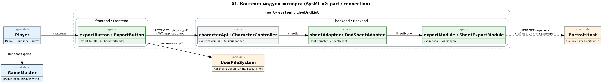
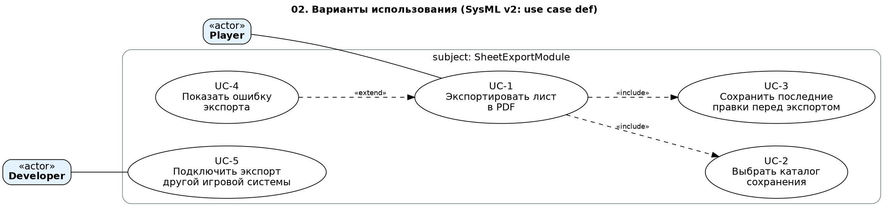
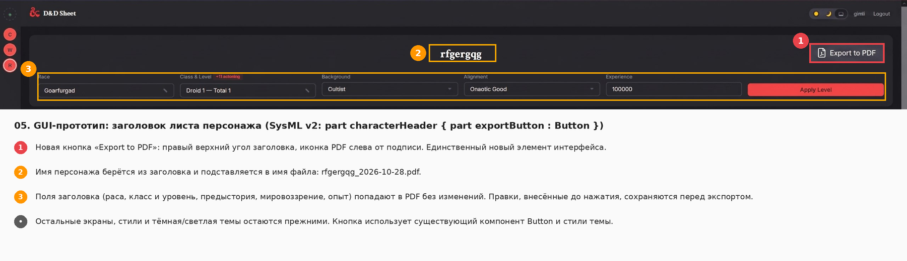
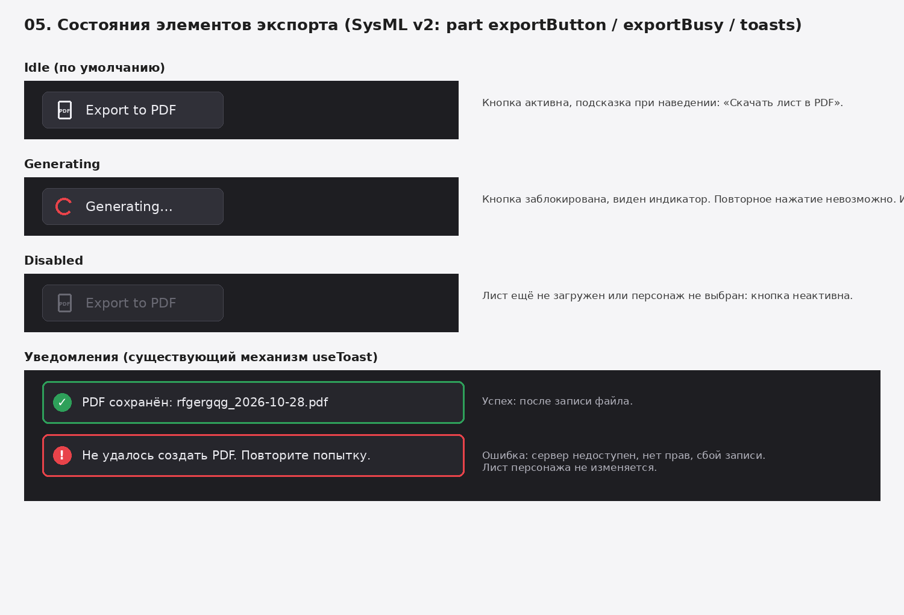
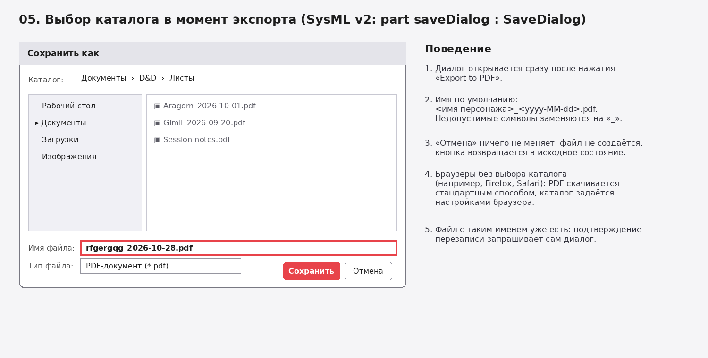
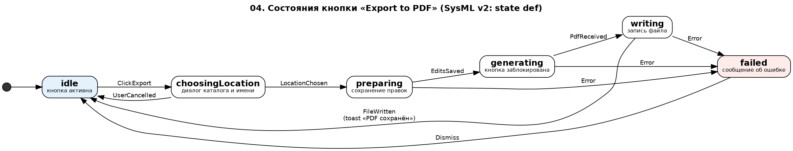
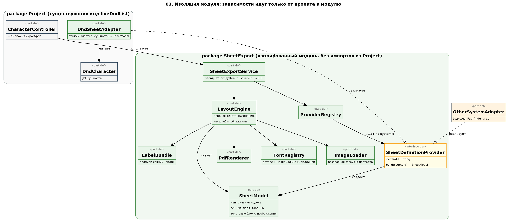
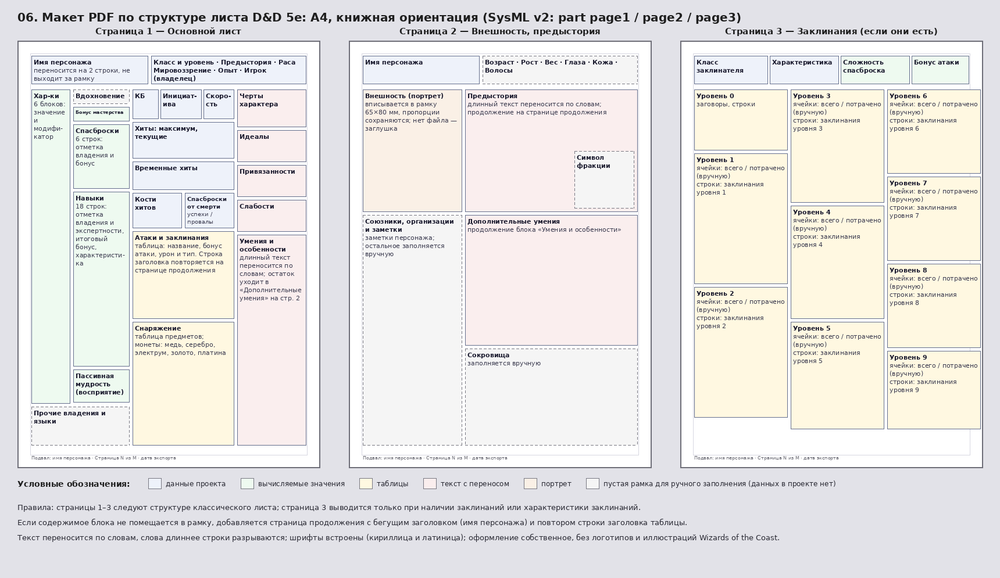

# Спецификация требований к ПО

Для модуля «Генератор отчётов листов персонажей» (Sheet Export) проекта Live D&D List

Версия 0.2

Подготовил(а) А.П. Якуш

БГУИР, кафедра электронных вычислительных машин

15.11.2026

## Оглавление

<!-- TOC -->
* [1. Введение](#1-introduction)
  * [1.1 Назначение документа](#11-document-purpose)
  * [1.2 Область применения продукта](#12-product-scope)
  * [1.3 Определения, акронимы и сокращения](#13-definitions-acronyms-and-abbreviations)
  * [1.4 Ссылки](#14-references)
  * [1.5 Обзор документа](#15-document-overview)
* [2. Обзор продукта](#2-product-overview)
  * [2.1 Перспектива продукта](#21-product-perspective)
  * [2.2 Функции продукта](#22-product-functions)
  * [2.3 Ограничения продукта](#23-product-constraints)
  * [2.4 Характеристики пользователей](#24-user-characteristics)
  * [2.5 Допущения и зависимости](#25-assumptions-and-dependencies)
  * [2.6 Распределение требований](#26-apportioning-of-requirements)
* [3. Требования](#3-requirements)
  * [3.1 Внешние интерфейсы](#31-external-interfaces)
    * [3.1.1 Пользовательские интерфейсы](#311-user-interfaces)
    * [3.1.2 Аппаратные интерфейсы](#312-hardware-interfaces)
    * [3.1.3 Программные интерфейсы](#313-software-interfaces)
  * [3.2 Функциональные требования](#32-functional)
  * [3.3 Качество обслуживания](#33-quality-of-service)
    * [3.3.1 Производительность](#331-performance)
    * [3.3.2 Безопасность](#332-security)
    * [3.3.3 Надёжность](#333-reliability)
    * [3.3.4 Доступность](#334-availability)
    * [3.3.5 Наблюдаемость](#335-observability)
  * [3.4 Соответствие стандартам](#34-compliance)
  * [3.5 Проектирование и реализация](#35-design-and-implementation)
    * [3.5.1 Установка](#351-installation)
    * [3.5.2 Сборка и поставка](#352-build-and-delivery)
    * [3.5.3 Распределение](#353-distribution)
    * [3.5.4 Сопровождаемость](#354-maintainability)
    * [3.5.5 Повторное использование](#355-reusability)
    * [3.5.6 Переносимость](#356-portability)
    * [3.5.7 Стоимость](#357-cost)
    * [3.5.8 Сроки](#358-deadline)
    * [3.5.9 Доказательство концепции](#359-proof-of-concept)
    * [3.5.10 Управление изменениями](#3510-change-management)
  * [3.6 ИИ/МО](#36-aiml)
* [4. Верификация](#4-verification)
* [5. Приложения](#5-appendixes)
<!-- TOC -->

## История изменений

| Name | Date | Reason For Changes | Version |
|------|------|--------------------|---------|
| А.П. Якуш | 28.10.2026 | Первая редакция по бизнес-требованиям Заказчика | 0.1 |
| А.П. Якуш | 15.11.2026 | Согласование требований с архитектурой локального сервиса генерации PDF на Typst; уточнение интерфейсов, развёртывания, безопасности и тестирования | 0.2 |

---

## 1. Введение {#1-introduction}

Документ описывает требования к модулю экспорта листа персонажа в PDF, который добавляется в существующее веб-приложение Live D&D List (backend: Java 21, Spring Boot; frontend: React/TypeScript). Он написан для Заказчика, разработчика, тестировщика и преподавателя. Бизнес-цели и границы продукта приведены в разделе 1.2, ограничения и пользователи в разделе 2, проверяемые требования в разделе 3.

### 1.1 Назначение документа {#11-document-purpose}

SRS определяет, **что** модуль должен делать, а не **как** он будет реализован. Заказчик использует его, чтобы подтвердить, что требования отражают его потребности. Разработчик берёт из него требования к проектированию и реализации, тестировщик строит по нему приёмочные тесты (раздел 4). Связанные артефакты: исходный код проекта, `README.md` и `CONTRIBUTING.md` репозитория, SDD модуля, ADR и графические модели в каталоге `diagrams/`.

### 1.2 Область применения продукта {#12-product-scope}

**Продукт:** модуль «Sheet Export» (генератор отчётов листов персонажей), версия 0.1, поставляется как часть Live D&D List. Настоящая редакция SRS — версия 0.2.

**Назначение.** Модуль создаёт PDF-файл с полным листом персонажа и позволяет пользователю сохранить его в каталог по своему выбору. Экспорт запускается кнопкой в заголовке листа персонажа. Первой поддерживается система D&D 5e (данные проекта), а архитектура должна позволять добавлять листы других игровых систем.

**Бизнес-цели (источник: Заказчик):**

| ID | Бизнес-цель | Измеримый результат |
|----|-------------|---------------------|
| BO-1 | Игрок получает офлайн-копию листа для игры за столом и печати | PDF создаётся одним нажатием кнопки и одним выбором каталога, за время не более 3 с для типичного персонажа |
| BO-2 | Игрок передаёт лист мастеру игры, у которого нет доступа к приложению | Файл читается в любом стандартном PDF-просмотрщике без искажений |
| BO-3 | Проект получает возможность поддерживать другие игровые системы | Для новой системы нужно добавить провайдер данных и соответствующий набор шаблонов/ресурсов без изменения общего ядра экспорта |
| BO-4 | Модуль не ухудшает работу существующего проекта | Проект запускается и все существующие тесты проходят после интеграции |

**Входит в область:** кнопка экспорта в заголовке листа, публичный endpoint экспорта, нейтральная модель листа, адаптер D&D 5e, локальный сервис генерации PDF, шаблоны и ресурсы документа, сохранение файла в выбранный каталог.

**Не входит в область:** импорт листов из PDF, редактирование листа внутри PDF (заполняемые формы), печать, отправка по почте, пакетный экспорт нескольких персонажей, постоянное хранение сгенерированных PDF на сервере, облачные сервисы генерации документов, конкретные адаптеры других игровых систем (предусмотрена возможность их добавить).

### 1.3 Определения, акронимы и сокращения {#13-definitions-acronyms-and-abbreviations}

| Term | Definition |
|------|------------|
| D&D 5e | Dungeons & Dragons, пятая редакция — настольная ролевая игра; в проекте используется набор правил SRD 2014 |
| DM / Мастер игры | Ведущий игры; получает листы персонажей от игроков |
| API | Application Programming Interface — набор определений и протоколов для интеграции ПО |
| Адаптер | Класс проекта, преобразующий данные игровой системы в нейтральную модель листа |
| Глиф | Начертание символа в шрифте |
| JWT | JSON Web Token — токен авторизации, используемый в проекте |
| Лист персонажа | Набор данных персонажа: характеристики, навыки, бой, снаряжение, заклинания, описания |
| Нейтральная модель листа (SheetModel) | Описание листа в терминах секций, полей, таблиц, текстовых блоков и изображений, не привязанное к игровой системе |
| Пагинация | Разбиение содержимого на страницы |
| Портрет | Изображение персонажа, заданное ссылкой `portraitUrl` |
| Renderer / сервис генерации | Локальный сервис, формирующий PDF по структурированным данным и заранее определённому шаблону |
| Typst | Язык разметки и компилятор документов, используемые выбранной реализацией Renderer (подробности в SDD) |
| Провайдер листа | Точка расширения модуля: компонент, строящий нейтральную модель листа для одной игровой системы |
| SRS | Software Requirements Specification — документ, описывающий назначение, требования и характер ПО |
| SSRF | Server-Side Request Forgery — атака, при которой сервер заставляют обращаться к внутренним адресам |
| SysML v2 | Systems Modeling Language версии 2 — язык моделирования, используемый для графической части документа |
| TBD | To Be Determined — значение ещё не согласовано с Заказчиком |
| UI | User Interface — визуальная часть приложения |

### 1.4 Ссылки {#14-references}

| № | Источник | Тип | Расположение |
|---|----------|-----|--------------|
| 1 | Лабораторная работа №3 «Разработка и документирование бизнес-требований», БГУИР | Нормативная | `Лабораторная_работа_3.pdf` |
| 2 | Источники и виды требований, ЖЦРПО Ч1 (СЭО БГУИР) | Справочная | `Источники_и_виды_требований.html` |
| 3 | Репозиторий Live D&D List (README, CONTRIBUTING, исходный код) | Нормативная для ограничений существующего проекта | https://github.com/Margit-The-Fell-Omen/liveDndList |
| 4 | SDD модуля Sheet Export и ADR-0001 … ADR-0006 | Связанная проектная документация; не заменяет требования SRS | `sdd/sdd.md`, `adr/` |
| 5 | ISO 32000-1:2008 (PDF 1.7) | Нормативная | ISO |
| 6 | OMG Systems Modeling Language (SysML) v2 | Справочная | https://www.omg.org/sysml/sysmlv2/ |
| 7 | WCAG 2.1, уровень AA | Справочная | https://www.w3.org/TR/WCAG21/ |
| 8 | SIL Open Font License 1.1 | Справочная | https://openfontlicense.org |
| 9 | Графические модели SysML v2 (исходники `.sysml` и PNG) | Нормативная часть документа | `diagrams/` |
| 10 | Пустой официальный лист персонажа D&D 5e (3 страницы) — образец структуры страниц | Справочная (только структура блоков, графика не воспроизводится) | `D_D_Char_Empty.pdf` |

### 1.5 Обзор документа {#15-document-overview}

Раздел 2 даёт контекст: место модуля в проекте, функции, ограничения, пользователи, допущения и распределение требований по итерациям. Раздел 3 содержит требования с уникальными идентификаторами `REQ-[AREA]-[NNN]`; ключевое слово «должен» означает обязательное требование, «следует» означает рекомендацию. Раздел 4 связывает каждое требование со способом проверки. Раздел 5 содержит открытые вопросы к Заказчику и список графических моделей. Архитектура и конкретная реализация локального Renderer описаны в SDD и ADR. Каждое изменение документа фиксируется в истории изменений.

---

## 2. Обзор продукта {#2-product-overview}

### 2.1 Перспектива продукта {#21-product-perspective}

Модуль встраивается в действующую систему Live D&D List: Spring Boot REST API (`/api/v1/**`, JWT-авторизация), PostgreSQL, Redis и React-интерфейс. Он добавляет публичный endpoint экспорта, адаптер данных D&D 5e, кнопку интерфейса и внутренний локальный сервис генерации PDF, развёртываемый вместе с проектом через Docker Compose. Сервис генерации не предоставляет публичный endpoint и доступен backend только по внутренней сети. Владелец проекта — автор репозитория, поставка идёт через pull-request по правилам `CONTRIBUTING.md`.

*Рисунок 1 — контекст модуля (SysML v2: `diagrams/01-context.sysml`).*

Границы владения: данные персонажа принадлежат проекту (модуль только читает их через адаптер), портрет находится на внешнем хосте, файл после скачивания принадлежит пользователю.

### 2.2 Функции продукта {#22-product-functions}

1. Запуск экспорта кнопкой в заголовке листа персонажа.
2. Выбор пользователем каталога и имени файла при экспорте.
3. Создание PDF с полным содержимым листа в структуре основных страниц классического листа D&D 5e: две основные страницы всегда и дополнительная основная страница заклинаний при наличии заклинаний или характеристики заклинаний; при переполнении блоков допускаются отдельные страницы продолжения по REQ-FUNC-017.
4. Корректное форматирование при любых данных: перенос текста, пагинация, кириллица, масштабирование изображений.
5. Информирование пользователя о ходе и результате экспорта.
6. Нейтральная модель листа и точка расширения для других игровых систем.
7. Передача структурированных данных во внутренний сервис генерации и получение готового PDF.

Варианты использования показаны на рисунке 2.

*Рисунок 2 — варианты использования (SysML v2: `diagrams/02-use-cases.sysml`).*

### 2.3 Ограничения продукта {#23-product-constraints}

| ID | Ограничение | Тип |
|----|-------------|-----|
| CON-1 | Java-компонент интеграции экспорта должен быть реализован на Java 21 внутри backend проекта (Spring Boot 4.0.x); вспомогательный локальный сервис генерации может иметь отдельный runtime | Внешнее, обязательное (Заказчик) |
| CON-2 | Модуль должен запускаться в составе проекта без падений (`docker compose up --build`) | Внешнее, обязательное (Заказчик) |
| CON-3 | Модуль должен быть изолирован от бизнес-логики проекта и готов к расширению | Внешнее, обязательное (Заказчик) |
| CON-4 | Лицензии используемых библиотек и шрифтов должны быть совместимы с публичной лицензией проекта (UNLICENSE) | Внешнее, обязательное |
| CON-5 | Код должен соответствовать `checkstyle.xml` проекта и правилам ветвления/коммитов из `CONTRIBUTING.md` | Организационное, обязательное |
| CON-6 | Веб-интерфейс не позволяет приложению записывать файл в произвольный каталог без участия пользователя; выбор каталога возможен только через диалог браузера | Внешнее (технологическое), обязательное |
| CON-7 | Схема базы данных не должна меняться | Внутреннее, предпочтительное |
| CON-8 | Сервис генерации PDF должен развёртываться локально вместе с приложением через Docker Compose; использование облачного API для генерации не допускается | Внешнее, обязательное |

SRS не предписывает язык и фреймворк внутреннего сервиса генерации; его программный контракт, ограничения доступа и критерии проверки определены в разделе 3.1.3. Конкретная реализация описывается в SDD и ADR.

### 2.4 Характеристики пользователей {#24-user-characteristics}

| Класс | Описание | Частота | Особенности |
|-------|----------|---------|-------------|
| Игрок | Владелец листа; создаёт и ведёт персонажа в приложении, экспортирует его перед игрой | Раз за сессию или реже | Не технический пользователь; работает с ПК и мобильным браузером; имена и описания часто на русском |
| Мастер игры | Получает PDF от игрока, в приложении не работает | По мере получения файлов | Читает и печатает PDF в стандартном просмотрщике |
| Разработчик | Поддерживает проект, добавляет игровые системы | Редко | Знает Java/Spring; нужна понятная точка расширения и документация |

Локализация: данные пользователей могут быть на кириллице и латинице; язык интерфейса сейчас английский (см. OQ-4).

### 2.5 Допущения и зависимости {#25-assumptions-and-dependencies}

| ID | Допущение / зависимость | Влияние, если неверно |
|----|-------------------------|-----------------------|
| AS-1 | Пользователь использует актуальный Chromium-браузер (Chrome, Edge), где доступен диалог выбора файла | В Firefox и Safari файл скачивается стандартным способом, каталог определяется настройками браузера (см. OQ-1) |
| AS-2 | Структура `CharacterResponse` и связанных сущностей проекта остаётся стабильной | Адаптер D&D нужно обновлять при каждом изменении модели данных |
| AS-3 | Портреты доступны по публичным http/https-ссылкам | Вместо портрета выводится заглушка (REQ-REL-001) |
| AS-4 | Сервер имеет доступ к исходящему HTTP только для загрузки портретов | Без доступа портреты не загрузятся, экспорт продолжится без них |
| AS-5 | Преподаватель в роли Заказчика может изменить требования в любой момент занятия | Требования версионируются, изменения фиксируются в истории |
| AS-6 | Данные из таблиц SRD (заклинания, расы, классы) уже загружены в БД проекта | Названия и описания в PDF берутся из БД, дополнительных внешних запросов не требуется |
| AS-7 | Локальный сервис генерации запускается в составе Docker Compose и использует поставляемые вместе с ним шаблоны и ресурсы | При недоступности сервиса экспорт завершается контролируемой ошибкой по REQ-REL-003 |

### 2.6 Распределение требований {#26-apportioning-of-requirements}

Трассируемость требований Заказчика (источник: бизнес-интервью):

| № | Требование Заказчика | Требования SRS |
|---|----------------------|----------------|
| C-1 | Модуль интегрирован в проект и запускается без падений | REQ-INT-001, REQ-INT-002, REQ-INT-003, REQ-INT-011, REQ-REL-002, REQ-REL-003, REQ-REL-004 |
| C-2 | Экспорт листа в PDF кнопкой в заголовке листа | REQ-INT-005 … REQ-INT-009, REQ-FUNC-001, REQ-FUNC-002, REQ-FUNC-008 … REQ-FUNC-013, REQ-FUNC-021 |
| C-3 | PDF сохраняется в каталог, выбранный пользователем в момент экспорта | REQ-FUNC-003, REQ-FUNC-004, REQ-FUNC-005, REQ-FUNC-006, REQ-FUNC-007 |
| C-4 | PDF правильно отформатирован при любых данных | REQ-FUNC-014 … REQ-FUNC-020, REQ-FUNC-022, REQ-FUNC-023, REQ-REL-001, REQ-REL-002, REQ-PERF-002 |
| C-5 | Модуль изолирован и готов к расширению для других систем | REQ-REUSE-001 … REQ-REUSE-004, REQ-MAINT-002, REQ-SEC-006 |

Распределение по итерациям:

| Итерация | Состав | Требования |
|----------|--------|------------|
| 1 (доказательство концепции) | PDF с кириллицей, портретом и пагинацией на тестовых данных | REQ-POC-001 |
| 2 (ядро) | Endpoint, адаптер D&D, шаблоны PDF, локальный Renderer, безопасность, надёжность | REQ-FUNC-009 … REQ-FUNC-020, REQ-FUNC-022, REQ-INT-004, REQ-INT-010, REQ-INT-011, REQ-SEC-*, REQ-REL-*, REQ-REUSE-* |
| 3 (интерфейс) | Кнопка, диалог выбора каталога, состояния и уведомления | REQ-INT-005 … REQ-INT-009, REQ-FUNC-001 … REQ-FUNC-008, REQ-FUNC-021 |
| 4 (качество) | Производительность, наблюдаемость, документация, тесты | REQ-PERF-*, REQ-OBS-*, REQ-MAINT-* |

Отложено: адаптеры других игровых систем, локализация подписей PDF (см. OQ-4), экспорт публичных листов не-владельцем (OQ-5).

---

## 3. Требования {#3-requirements}

Каждое требование содержит поля: **ID**, **Statement**, **Rationale**, **Acceptance Criteria**, **Verification Method** (Test, Analysis, Inspection, Demonstration). Источник по умолчанию — Заказчик; ссылки вида C-N указывают на таблицу в разделе 2.6.

### 3.1 Внешние интерфейсы {#31-external-interfaces}

#### 3.1.1 Пользовательские интерфейсы {#311-user-interfaces}

Макеты: `diagrams/05-ui-header.png`, `05-ui-states.png`, `05-ui-save-dialog.png`; исходник модели: `diagrams/05-ui-mockups.sysml`.

*Рисунок 3 — заголовок листа персонажа с кнопкой «Export to PDF».*

*Рисунок 4 — состояния кнопки и уведомления.*

*Рисунок 5 — выбор каталога и имени файла.*

**REQ-INT-005 — Положение кнопки**
- **Statement:** Заголовок листа персонажа должен содержать кнопку с подписью «Export to PDF» и иконкой PDF в правом верхнем углу заголовка.
- **Rationale:** Заказчик требует запуск экспорта из заголовка листа (C-2).
- **Acceptance Criteria:** Кнопка видна на странице листа выбранного персонажа без прокрутки при ширине окна от 360 px; расположена в правом верхнем углу заголовка, как на рисунке 3.
- **Verification Method:** Demonstration
- **More Information:** `diagrams/05-ui-header.png`.

**REQ-INT-006 — Единый стиль**
- **Statement:** Кнопка экспорта должна использовать существующий компонент `Button` и поддерживать светлую и тёмную темы проекта.
- **Rationale:** Единообразие интерфейса и отсутствие дублирования стилей.
- **Acceptance Criteria:** В обеих темах кнопка визуально соответствует остальным кнопкам; контраст текста и фона не менее 4.5:1.
- **Verification Method:** Inspection
- **More Information:** WCAG 2.1 AA, критерий 1.4.3.

**REQ-INT-007 — Состояния кнопки**
- **Statement:** Кнопка должна иметь состояния: «Export to PDF» (активна), «Generating…» с индикатором (заблокирована на время экспорта), неактивна (персонаж не загружен).
- **Rationale:** Пользователь должен видеть, что процесс идёт, и не запускать его повторно.
- **Acceptance Criteria:** Во время экспорта кнопка заблокирована и показывает индикатор; повторное нажатие не создаёт второй запрос.
- **Verification Method:** Test
- **More Information:** `diagrams/05-ui-states.png`, `diagrams/04-export-flow.png`.

**REQ-INT-008 — Доступность кнопки**
- **Statement:** Кнопка должна быть доступна с клавиатуры (Tab, Enter, Space) и иметь доступное имя для экранных дикторов.
- **Rationale:** Доступность интерфейса.
- **Acceptance Criteria:** Кнопка получает фокус клавишей Tab, активируется Enter и Space; у элемента задано доступное имя «Export to PDF».
- **Verification Method:** Inspection

#### 3.1.2 Аппаратные интерфейсы {#312-hardware-interfaces}

Аппаратных интерфейсов нет. Модуль не взаимодействует с физическими устройствами; сохранение файла выполняется средствами браузера и операционной системы пользователя.

#### 3.1.3 Программные интерфейсы {#313-software-interfaces}

Система взаимодействует с существующим REST API Live D&D List и внутренним локальным сервисом генерации PDF. Внутренний интерфейс недоступен из пользовательской сети и используется только backend-компонентом экспорта.

**REQ-INT-004 — REST-интерфейс экспорта**
- **Statement:** Backend должен предоставлять `GET /api/v1/characters/{id}/export/pdf`, возвращающий `application/pdf` с заголовком `Content-Disposition: attachment` и именем файла по REQ-FUNC-005.
- **Rationale:** Единый способ получить PDF из интерфейса; маршрут следует соглашениям существующего `CharacterController`.
- **Acceptance Criteria:** При запросе существующего персонажа владельцем ответ имеет статус 200, `Content-Type: application/pdf`, тело начинается с `%PDF-`. Для несуществующего `id` — статус 404 в формате ошибок проекта.
- **Verification Method:** Test

**REQ-INT-009 — Авторизация запроса**
- **Statement:** Запрос экспорта должен использовать JWT-авторизацию проекта, включая обновление токена по refresh-токену.
- **Rationale:** Пользователь не должен повторно входить в систему из-за экспорта.
- **Acceptance Criteria:** При истёкшем access-токене и действующем refresh-токене экспорт завершается успешно без повторного входа.
- **Verification Method:** Test

**REQ-INT-010 — Загрузка портрета**
- **Statement:** Backend-компонент экспорта должен получать изображение портрета по HTTP GET по ссылке `portraitUrl` персонажа.
- **Rationale:** Портрет хранится по ссылке на внешнем хосте; Renderer не должен самостоятельно обращаться к пользовательским URL.
- **Acceptance Criteria:** Для доступного изображения PNG или JPEG оно выводится в PDF; в запрос Renderer передаются только проверенные бинарные данные изображения либо признак отсутствия портрета; `portraitUrl` в Renderer не передаётся. Обработка недоступных ссылок описана в REQ-REL-001.
- **Verification Method:** Test

**REQ-INT-011 — Внутренний интерфейс сервиса генерации PDF**
- **Statement:** Backend должен взаимодействовать с локальным сервисом генерации PDF через версионированный внутренний HTTP API. Запрос должен содержать структурированные данные документа и идентификатор разрешённого шаблона; при необходимости допускается передача проверенных бинарных ресурсов. Сервис должен возвращать готовый PDF только после успешной компиляции.
- **Rationale:** Отделение формирования PDF от бизнес-логики Live D&D List и единая точка интеграции с движком документов.
- **Acceptance Criteria:** Backend отправляет запрос на внутренний маршрут `POST /internal/v1/render`; успешный ответ имеет `Content-Type: application/pdf`, тело начинается с `%PDF-`. Неизвестный идентификатор шаблона, некорректный манифест или превышение лимита запроса отклоняются. Запрос без корректной внутренней авторизации отклоняется. Порт сервиса не опубликован на host и доступен только из внутренней сети приложения. При ошибке сервис не возвращает частичный PDF.
- **Verification Method:** Test
- **More Information:** Контракт и коды ошибок уточняются в SDD DV-IFC-01; реализация не должна принимать произвольный исходный код шаблона или пользовательский файловый путь.

### 3.2 Функциональные требования {#32-functional}

Диаграмма состояний процесса экспорта:

*Рисунок 6 — процесс экспорта (SysML v2: `diagrams/04-export-flow.sysml`).*

**REQ-FUNC-001 — Запуск экспорта**
- **Statement:** По нажатию кнопки «Export to PDF» система должна начать экспорт листа текущего открытого персонажа.
- **Rationale:** Основной сценарий пользователя (C-2).
- **Acceptance Criteria:** После нажатия кнопки у персонажа, открытого на экране, начинается экспорт; данные другого персонажа в файл не попадают.
- **Verification Method:** Test

**REQ-FUNC-002 — Результат экспорта**
- **Statement:** Результатом экспорта должен быть один PDF-файл с листом одного персонажа.
- **Rationale:** Файл передаётся мастеру или печатается.
- **Acceptance Criteria:** Файл открывается в Adobe Acrobat Reader, Chrome, Firefox (PDF.js) и системном просмотрщике без сообщений об ошибках.
- **Verification Method:** Demonstration

**REQ-FUNC-003 — Выбор каталога**
- **Statement:** Сразу после нажатия кнопки система должна показать пользователю диалог выбора каталога и имени файла.
- **Rationale:** Файл должен сохраняться в каталог, выбранный в момент экспорта (C-3).
- **Acceptance Criteria:** В Chrome и Edge после нажатия кнопки открывается диалог «Сохранить как» с предложенным именем файла (рисунок 5).
- **Verification Method:** Demonstration
- **More Information:** Для браузеров без диалога см. REQ-FUNC-007.

**REQ-FUNC-004 — Сохранение в выбранный каталог**
- **Statement:** Система должна записать PDF в каталог и под именем, которые пользователь указал в диалоге.
- **Rationale:** C-3.
- **Acceptance Criteria:** После подтверждения диалога файл существует по выбранному пути, размер больше 0 байт, содержимое совпадает с ответом сервера.
- **Verification Method:** Demonstration

**REQ-FUNC-005 — Имя файла по умолчанию**
- **Statement:** Предлагаемое имя файла должно иметь вид `<имя персонажа>_<yyyy-MM-dd>.pdf`, где символы `\ / : * ? " < > |` и управляющие символы заменены на `_`, а имя персонажа усечено до 100 символов.
- **Rationale:** Имя должно быть допустимым в Windows, Linux и macOS.
- **Acceptance Criteria:** Для имени `rfgergqg` на 28.10.2026 предлагается `rfgergqg_2026-10-28.pdf`; для имени `A/B:C` — `A_B_C_2026-10-28.pdf`; для пустого имени — `character_2026-10-28.pdf`.
- **Verification Method:** Test

**REQ-FUNC-006 — Отмена выбора**
- **Statement:** Если пользователь закрыл диалог без сохранения, система не должна создавать файл и должна вернуть кнопку в активное состояние.
- **Rationale:** Отказ не должен приводить к ошибкам или побочным эффектам.
- **Acceptance Criteria:** После отмены файл не создан, ошибка не показана, кнопка активна, данные персонажа не изменены.
- **Verification Method:** Test

**REQ-FUNC-007 — Браузеры без диалога выбора**
- **Statement:** В браузерах, не поддерживающих программный диалог выбора файла, система должна скачать PDF стандартным механизмом браузера с именем по REQ-FUNC-005.
- **Rationale:** Функция остаётся доступной всем пользователям (ограничение CON-6).
- **Acceptance Criteria:** В Firefox и Safari после нажатия кнопки браузер скачивает файл, ошибка не показана.
- **Verification Method:** Demonstration
- **More Information:** Решение требует подтверждения Заказчика (OQ-1).

**REQ-FUNC-008 — Актуальность данных**
- **Statement:** PDF должен содержать данные листа, сохранённые на момент нажатия кнопки, включая правки, внесённые менее чем за 500 мс до нажатия.
- **Rationale:** Интерфейс отправляет правки с задержкой 500 мс; без этого в PDF попали бы устаревшие данные.
- **Acceptance Criteria:** Изменить имя персонажа и нажать «Export to PDF» не позднее чем через 200 мс; в PDF указано новое имя.
- **Verification Method:** Test

**REQ-FUNC-009 — Идентификация персонажа**
- **Statement:** PDF должен содержать имя, расу, классы с уровнями, суммарный уровень, предысторию, мировоззрение и очки опыта персонажа.
- **Rationale:** Это заголовок любого листа персонажа.
- **Acceptance Criteria:** Все перечисленные значения совпадают с отображаемыми на экране для тестового персонажа.
- **Verification Method:** Test

**REQ-FUNC-010 — Характеристики, спасброски, навыки**
- **Statement:** PDF должен содержать шесть характеристик со значением и модификатором, шесть спасбросков с отметкой владения и 18 навыков с итоговым бонусом и отметками владения и экспертности, а также бонус мастерства и пассивную мудрость (восприятие).
- **Rationale:** Базовые игровые показатели, необходимые за столом.
- **Acceptance Criteria:** Для тестового персонажа все 6 + 6 + 18 значений и отметки совпадают с экраном; пассивная мудрость равна 10 плюс бонус навыка «Восприятие».
- **Verification Method:** Test

**REQ-FUNC-011 — Боевые показатели**
- **Statement:** PDF должен содержать класс брони, инициативу, скорость, бонус мастерства, кости хитов, текущие, максимальные и временные хиты, число успехов и провалов спасбросков от смерти.
- **Rationale:** Показатели, используемые в бою.
- **Acceptance Criteria:** Все значения совпадают с экраном для тестового персонажа.
- **Verification Method:** Test

**REQ-FUNC-012 — Снаряжение и валюта**
- **Statement:** PDF должен содержать таблицу снаряжения (название, количество, вес, тип, признаки «надето» и «настроено», урон и его тип, свойства, описание) и количество монет пяти видов.
- **Rationale:** Игрок использует список вещей и денег во время игры.
- **Acceptance Criteria:** Число строк таблицы равно числу предметов персонажа; значения монет совпадают с экраном.
- **Verification Method:** Test

**REQ-FUNC-013 — Заклинания**
- **Statement:** PDF должен содержать известные заклинания, сгруппированные по уровням от 0 до 9 на странице заклинаний (название, школа, время накладывания, дистанция, компоненты, длительность, признаки концентрации и ритуала, описание и эффект на высших уровнях), а также класс заклинателя, характеристику заклинаний, сложность спасброска и бонус атаки заклинанием.
- **Rationale:** Игрок использует печатный список заклинаний за столом.
- **Acceptance Criteria:** Число заклинаний в PDF равно числу заклинаний персонажа; каждое стоит в блоке своего уровня; описания выведены полностью; сложность спасброска равна 8 + бонус мастерства + модификатор характеристики заклинаний; бонус атаки равен бонусу мастерства + модификатору.
- **Verification Method:** Test

**REQ-FUNC-014 — Текстовые блоки**
- **Statement:** PDF должен содержать полностью, без обрезания, тексты полей «умения и особенности», «предыстория», «черты характера», «идеалы», «привязанности», «слабости» и «заметки».
- **Rationale:** Заказчик требует корректный вывод при любых данных (C-4).
- **Acceptance Criteria:** Текст поля из 20 000 символов извлекается из PDF целиком и совпадает с исходным с точностью до переносов строк.
- **Verification Method:** Test

**REQ-FUNC-015 — Формат и состав основных страниц**
- **Statement:** Основные страницы PDF должны иметь формат A4 книжной ориентации с полями не менее 10 мм и следовать структуре листа D&D 5e: основная страница 1 (имя и идентификация, характеристики, спасброски, навыки, бой, хиты, атаки, снаряжение, черты характера, умения); основная страница 2 (внешность и портрет, предыстория, союзники и заметки, дополнительные умения, сокровища); основная страница 3 (заклинания), которая формируется только если у персонажа есть заклинания или задана характеристика заклинаний. Дополнительные страницы продолжения разрешены только по правилам REQ-FUNC-017.
- **Rationale:** Игроки привыкли к структуре классического листа; такой документ удобно использовать и печатать (C-2, C-4).
- **Acceptance Criteria:** Размер каждой страницы, включая страницы продолжения, составляет 210 × 297 мм (допуск 1 мм); блоки основных страниц 1–3 расположены и называются как на рисунке 8; ни один элемент не выходит за область полей. Основные страницы 1 и 2 присутствуют всегда; основная страница 3 присутствует только при наличии заклинаний или заданной характеристики заклинаний. Дополнительные страницы продолжения размещаются после всех основных страниц в порядке исходной основной страницы, затем в порядке блоков в макете.
- **Verification Method:** Test
- **More Information:** Макет основных страниц: `diagrams/06-pdf-layout.png`; правила дополнительных страниц — REQ-FUNC-017; структура образца — `D_D_Char_Empty.pdf`.

**REQ-FUNC-016 — Перенос текста**
- **Statement:** Текст в PDF должен переноситься по словам внутри границ своего блока; слово длиннее ширины блока должно разрываться.
- **Rationale:** Текст не должен выходить за границы страницы (C-4).
- **Acceptance Criteria:** Для значений «строка из 300 символов без пробелов» и «имя персонажа из 200 символов» границы всех текстовых элементов лежат внутри рамок своих блоков и области полей страницы.
- **Verification Method:** Test

**REQ-FUNC-017 — Пагинация и страницы продолжения**
- **Statement:** Если содержимое блока не помещается в предназначенную для него рамку или дополнительную рамку макета, система должна продолжить вывод на дополнительной странице продолжения соответствующего раздела. Страницы продолжения должны иметь формат A4, бегущий заголовок с именем персонажа и нумерацию в общем порядке PDF.
- **Rationale:** Данные не должны теряться или обрезаться из-за нехватки места; основные страницы должны сохранять согласованный макет.
- **Acceptance Criteria:** Для персонажа со 100 заклинаниями и 100 предметами все строки и описания присутствуют в PDF; строки таблиц не разрываются между страницами; заголовок таблицы повторяется на каждой странице продолжения. Текст «Умения и особенности», не поместившийся в исходную рамку, сначала продолжается в блоке «Дополнительные умения» на основной странице 2, а оставшаяся часть — на отдельной странице продолжения. Все основные страницы формируются первыми; страницы продолжения добавляются после них в порядке исходной основной страницы и порядка блоков в макете.
- **Verification Method:** Test
- **More Information:** Общее число страниц может превышать число основных страниц, заданное REQ-FUNC-015. Предел общего числа страниц согласуется по OQ-2.

**REQ-FUNC-018 — Кириллица и символы**
- **Statement:** PDF должен корректно отображать кириллицу, латиницу, цифры и знаки пунктуации за счёт шрифтов, встроенных в файл.
- **Rationale:** Данные пользователей часто на русском языке (C-4).
- **Acceptance Criteria:** Текст тестового персонажа «Бродяга Ёжик-Щёголь: Ъъ Ыы Ээ, №1» извлекается из PDF без искажений и отображается во всех просмотрщиках из REQ-FUNC-002.
- **Verification Method:** Test

**REQ-FUNC-019 — Неподдерживаемые символы**
- **Statement:** Символ, отсутствующий в шрифтах, должен выводиться как символ замены.
- **Rationale:** Эмодзи и редкие символы не должны приводить к ошибке или пропаже соседнего текста.
- **Acceptance Criteria:** Для имени «Гном 🧙 Ёж» экспорт завершается успехом, остальные символы выведены корректно.
- **Verification Method:** Test

**REQ-FUNC-020 — Масштабирование портрета**
- **Statement:** Портрет должен масштабироваться так, чтобы целиком помещаться в рамку «Внешность» размером 65 × 80 мм на странице 2 с сохранением пропорций и без искажений.
- **Rationale:** Изображения могут быть любого размера и формата (C-4).
- **Acceptance Criteria:** Для изображений 1×1, 100×1000, 1000×100 и 5000×5000 пикселей изображение целиком в рамке, отношение сторон отличается от исходного не более чем на 1%.
- **Verification Method:** Test

**REQ-FUNC-021 — Сообщения пользователю**
- **Statement:** После записи файла система должна показать уведомление «PDF сохранён» с именем файла; при ошибке уведомление «Не удалось создать PDF. Повторите попытку.»
- **Rationale:** Пользователь должен знать результат операции.
- **Acceptance Criteria:** Уведомление об успехе появляется после записи файла, об ошибке — при остановке сервера во время экспорта; лист персонажа в обоих случаях остаётся без изменений.
- **Verification Method:** Test
- **More Information:** `diagrams/05-ui-states.png`.

**REQ-FUNC-022 — Пустые значения**
- **Statement:** Незанятое поле персонажа, для которого не предусмотрена отдельная пустая рамка для ручного заполнения по REQ-FUNC-023, должно выводиться в PDF как «—».
- **Rationale:** Новый персонаж может содержать незаполненные данные; это не должно приводить к ошибкам или неоднозначному отображению.
- **Acceptance Criteria:** Для персонажа с пустыми описаниями, без снаряжения, заклинаний и портрета экспорт завершается успешно; обычные незаполненные поля содержат «—», а блоки для ручного заполнения из REQ-FUNC-023 остаются пустыми.
- **Verification Method:** Test

**REQ-FUNC-023 — Блоки без данных для ручного заполнения**
- **Statement:** Блоки, данные для которых отсутствуют в модели проекта и которые предназначены для заполнения после печати (вдохновение, прочие владения и языки, возраст, рост, вес, глаза, кожа, волосы, символ фракции и сокровища), должны выводиться как пустые подписанные рамки. Ячейки заклинаний должны выводиться пустыми рамками на основной странице заклинаний, если она сформирована по REQ-FUNC-015.
- **Rationale:** Лист сохраняет привычную структуру, а игрок может дописать недостающие сведения от руки после печати.
- **Acceptance Criteria:** Перечисленные не связанные с заклинаниями рамки присутствуют на соответствующих основных страницах любого персонажа и остаются пустыми; рамки ячеек заклинаний присутствуют только на основной странице заклинаний, если эта страница сформирована. Ни в одной из этих рамок не выводятся «—» или «0».
- **Verification Method:** Test
- **More Information:** Заметки персонажа выводятся в блоке «Союзники, организации и заметки» (OQ-7); наличие страницы заклинаний определяется REQ-FUNC-015.

### 3.3 Качество обслуживания {#33-quality-of-service}

#### 3.3.1 Производительность {#331-performance}

**REQ-PERF-001 — Время экспорта типичного листа**
- **Statement:** Для типичного персонажа (не более 20 предметов, 30 заклинаний, текстовые поля до 2 000 символов, портрет до 2 МБ) сервер должен отвечать на запрос экспорта за время не более 3 с для 95% запросов.
- **Rationale:** BO-1: экспорт не должен заставлять пользователя ждать.
- **Acceptance Criteria:** При 20 последовательных запусках в `docker compose` окружении проекта (портрет на локальном хосте) не менее 19 завершились за 3 с или быстрее.
- **Verification Method:** Test

**REQ-PERF-002 — Время экспорта предельного листа**
- **Statement:** Для персонажа с 100 предметами, 100 заклинаниями и текстовыми полями по 100 000 символов сервер должен отвечать не более чем за 15 с.
- **Rationale:** C-4: корректная работа при любых данных, в том числе объёмных.
- **Acceptance Criteria:** Запрос завершается за 15 с или быстрее, файл корректен по REQ-FUNC-014 … REQ-FUNC-020.
- **Verification Method:** Test
- **More Information:** Предельные значения подлежат согласованию (OQ-2).

**REQ-PERF-003 — Размер файла**
- **Statement:** Размер PDF типичного персонажа не должен превышать 2 МБ, предельного — 20 МБ.
- **Rationale:** Файл отправляется мастеру по сети.
- **Acceptance Criteria:** Размеры файлов тестовых персонажей не превышают указанных значений.
- **Verification Method:** Test

**REQ-PERF-004 — Параллельные запросы**
- **Statement:** Система должна обрабатывать 5 одновременных запросов экспорта без ошибок, 95% запросов должны завершаться не более чем за 10 с.
- **Rationale:** Экспорт не должен останавливать работу других пользователей.
- **Acceptance Criteria:** При пяти параллельных запросах типичного персонажа все пять завершаются статусом 200 и каждый запрос завершается не более чем за 10 с (для этой выборки это соответствует 100% результатов); остальные эндпоинты проекта продолжают отвечать во время экспорта.
- **Verification Method:** Test

#### 3.3.2 Безопасность {#332-security}

**REQ-SEC-001 — Доступ только владельцу**
- **Statement:** Система должна разрешать экспорт листа только его владельцу.
- **Rationale:** Данные персонажа принадлежат пользователю.
- **Acceptance Criteria:** Запрос без токена возвращает 401; запрос чужого пользователя возвращает ответ, принятый в проекте для чужих персонажей (403 или 404); PDF не создаётся.
- **Verification Method:** Test
- **More Information:** Экспорт публичных листов не владельцем — OQ-5.

**REQ-SEC-002 — Защита от SSRF при загрузке портрета**
- **Statement:** Модуль должен загружать портрет только по схемам `http` и `https` и не должен обращаться к адресам loopback, частных сетей, link-local и метаданных облака.
- **Rationale:** `portraitUrl` задаёт пользователь, сервер не должен становиться прокси во внутреннюю сеть.
- **Acceptance Criteria:** Для ссылок `http://127.0.0.1/x`, `http://10.0.0.5/x`, `http://169.254.169.254/x`, `file:///etc/passwd` запрос к адресу не отправляется, экспорт завершается успехом с заглушкой вместо портрета.
- **Verification Method:** Test

**REQ-SEC-003 — Ограничение загрузки портрета**
- **Statement:** Загрузка портрета должна иметь таймаут не более 5 с, максимальный размер 5 МБ и не более 3 перенаправлений.
- **Rationale:** Защита от зависания и исчерпания памяти.
- **Acceptance Criteria:** Для медленного хоста, файла 10 МБ и цепочки из 5 перенаправлений экспорт завершается без портрета не позднее чем через 6 с после начала загрузки.
- **Verification Method:** Test

**REQ-SEC-004 — Текст как данные**
- **Statement:** Содержимое полей персонажа должно выводиться в PDF как обычный текст и не должно интерпретироваться как разметка или команды.
- **Rationale:** Защита от инъекций через пользовательские данные.
- **Acceptance Criteria:** Поля со значениями `<b>x</b>`, `{{7*7}}`, `%PDF-`, `\0` выводятся буквально; экспорт успешен.
- **Verification Method:** Test

**REQ-SEC-005 — Конфиденциальность в журналах**
- **Statement:** Журналы backend и сервиса генерации не должны содержать тексты полей персонажа, бинарные данные портрета, ссылку на портрет или внутренний токен.
- **Rationale:** Приватность данных пользователей и защита внутренних учётных данных.
- **Acceptance Criteria:** После тестового экспорта в журналах обоих компонентов отсутствуют строки с именем, предысторией, `portraitUrl`, содержимым манифеста и значением внутреннего токена; допускаются технические идентификаторы задания и коды ошибок.
- **Verification Method:** Inspection

**REQ-SEC-006 — Ограничение возможностей сервиса генерации**
- **Statement:** Сервис генерации должен принимать только структурированные данные и идентификаторы шаблонов из разрешённого списка. Он не должен принимать или исполнять произвольный исходный код Typst, пользовательские файловые пути или сетевые адреса. Доступ к файлам задания должен быть ограничен его рабочим каталогом, а исходящие сетевые соединения сервиса должны быть запрещены.
- **Rationale:** Защита от внедрения кода, чтения посторонних файлов и использования сервиса для доступа к внутренним или внешним сетевым ресурсам.
- **Acceptance Criteria:** Запросы с неизвестным `templateId`, попытками path traversal, полем с Typst-кодом вместо данных или произвольным URL отклоняются; соседнее задание и файлы за пределами рабочего каталога недоступны; проверка сетевой конфигурации подтверждает отсутствие внешнего сетевого доступа у Renderer.
- **Verification Method:** Test

#### 3.3.3 Надёжность {#333-reliability}

**REQ-REL-001 — Устойчивость к сбоям портрета**
- **Statement:** Если портрет отсутствует, недоступен, превышает лимиты или не является PNG/JPEG, модуль должен вывести заглушку и завершить экспорт успешно.
- **Rationale:** Сбой внешнего ресурса не должен лишать пользователя листа.
- **Acceptance Criteria:** Для ссылок с кодами 404 и 500, недоступного хоста, текстового файла вместо изображения экспорт завершается кодом 200 и PDF содержит заглушку.
- **Verification Method:** Test

**REQ-REL-002 — Устойчивость к любым данным**
- **Statement:** Для любых значений полей персонажа, допустимых в БД проекта, экспорт должен завершаться без необработанных исключений.
- **Rationale:** C-1 и C-4: модуль не должен падать.
- **Acceptance Criteria:** 1 000 тестовых персонажей со случайными данными (пустые значения, экстремальная длина, управляющие символы, эмодзи, кириллица) экспортируются без необработанных исключений; результат валиден по REQ-FUNC-015, REQ-FUNC-016.
- **Verification Method:** Test

**REQ-REL-003 — Единый формат ошибок**
- **Statement:** При невозможности создать PDF, включая недоступность сервиса генерации, таймаут внутреннего запроса, ошибку компиляции или некорректный ответ Renderer, backend должен вернуть ошибку в формате проекта (`ApiResponse`) с соответствующим HTTP-статусом.
- **Rationale:** Интерфейс обрабатывает ошибки единообразно независимо от того, на каком компоненте произошёл сбой.
- **Acceptance Criteria:** При принудительной ошибке генерации возвращается статус 5xx, при временной недоступности или занятости Renderer — соответствующий 503, при превышении таймаута — 504; тело соответствует формату проекта; частичный PDF не отдаётся; временные файлы задания удаляются.
- **Verification Method:** Test

**REQ-REL-004 — Изоляция сбоев**
- **Statement:** Ошибка экспорта не должна влиять на работу остальных функций приложения.
- **Rationale:** BO-4.
- **Acceptance Criteria:** После 10 подряд запросов, завершившихся ошибкой генерации, остальные эндпоинты проекта отвечают штатно; после завершения очистки временных заданий удерживаемое потребление памяти backend и Renderer не превышает исходное значение более чем на 10% при одинаковой нагрузке и прогретом окружении.
- **Verification Method:** Test

#### 3.3.4 Доступность {#334-availability}

Отдельных требований к доступности нет: экспорт доступен, пока доступно приложение (SLA проекта не определён). Модуль не вводит собственных окон обслуживания.

#### 3.3.5 Наблюдаемость {#335-observability}

**REQ-OBS-001 — Метрики экспорта**
- **Statement:** Backend-компонент экспорта должен публиковать через Micrometer/Prometheus проекта длительность полной операции экспорта, включая внутренний вызов Typst Renderer, и счётчики успешных и неуспешных операций.
- **Rationale:** Проект уже собирает метрики; экспорт требует контроля времени и ошибок.
- **Acceptance Criteria:** На `/actuator/prometheus` после экспорта видны метрика длительности полной операции и счётчики результата `success` / `failure`; время внутренней компиляции входит в длительность экспорта и не заменяет её отдельным серверным временем.
- **Verification Method:** Test

**REQ-OBS-002 — Журнал экспорта**
- **Statement:** Backend-компонент должен записывать в журнал одно структурированное событие успешного завершения экспорта с идентификатором персонажа, полной длительностью операции, числом страниц и размером PDF. Ошибки Renderer журналируются отдельно по техническому идентификатору запроса и коду ошибки.
- **Rationale:** Диагностика проблем у пользователей.
- **Acceptance Criteria:** После экспорта в журнале присутствует одна запись с указанными полями (без данных по REQ-SEC-005).
- **Verification Method:** Inspection

### 3.4 Соответствие стандартам {#34-compliance}

**REQ-COMP-001 — Формат PDF**
- **Statement:** Создаваемый файл должен соответствовать PDF версии 1.4 или выше (ISO 32000-1), с заполненными метаданными Title (имя персонажа) и Creator (название приложения).
- **Rationale:** Совместимость с просмотрщиками и печатью, идентификация приложения, сформировавшего документ.
- **Acceptance Criteria:** Проверка валидатором структуры PDF не показывает ошибок; версия PDF не ниже 1.4; в Document Information и соответствующих XMP-метаданных указаны Title с именем персонажа и Creator/CreatorTool с названием Live D&D List / Sheet Export.
- **Verification Method:** Analysis

**REQ-COMP-002 — Лицензии зависимостей**
- **Statement:** Все добавляемые библиотеки, компилятор, HTTP-адаптер и шрифты должны иметь лицензии, допускающие использование в публичном проекте и распространение в составе Docker-образов; список лицензий должен быть в документации.
- **Rationale:** CON-4. Состав решения включает Java- и Python-зависимости, Typst Compiler и шрифты.
- **Acceptance Criteria:** Для каждой новой зависимости и ресурса указаны название, версия и лицензия; условия распространения выполнены; нет зависимостей под AGPL/GPL без отдельно согласованного исключения.
- **Verification Method:** Inspection

**REQ-COMP-003 — Правила проекта**
- **Statement:** Код модуля должен проходить проверку checkstyle проекта без новых нарушений, а работа должна вестись в ветке `{issue-id}-{описание}` с коммитами по Conventional Commits.
- **Rationale:** CON-5.
- **Acceptance Criteria:** Проверка checkstyle без новых предупреждений; имена веток и коммитов соответствуют `CONTRIBUTING.md`.
- **Verification Method:** Inspection

**REQ-COMP-004 — Графика и товарные знаки**
- **Statement:** Оформление PDF должно быть собственным и не должно содержать логотипов, иллюстраций и элементов оформления официального листа Wizards of the Coast.
- **Rationale:** Образец структуры разрешён к копированию только для личного использования; приложение распространяется публично.
- **Acceptance Criteria:** В PDF и ресурсах модуля нет изображений и шрифтов из `D_D_Char_Empty.pdf`; осмотр подтверждает отсутствие логотипа D&D.
- **Verification Method:** Inspection

### 3.5 Проектирование и реализация {#35-design-and-implementation}

#### 3.5.1 Установка {#351-installation}

**REQ-INT-001 — Запуск проекта с модулем**
- **Statement:** Проект с интегрированным модулем и локальным сервисом генерации должен запускаться командой `docker compose up --build` без ручных шагов.
- **Rationale:** C-1 и CON-8.
- **Acceptance Criteria:** Backend отвечает на `/actuator/health` статусом `UP`; сервис генерации проходит внутреннюю проверку готовности; backend может выполнить контрольный запрос к Renderer; в журналах нет ошибок запуска, связанных с экспортом.
- **Verification Method:** Demonstration

**REQ-INT-002 — Существующие и новые тесты**
- **Statement:** После интеграции экспорта должны проходить существующие тесты проекта и новые автоматические проверки Java-компонента, HTTP-адаптера Renderer и Typst-шаблонов.
- **Rationale:** C-1, BO-4.
- **Acceptance Criteria:** `./mvnw test` завершается успехом; тесты Renderer завершаются успехом; каждый шаблон текущего релиза компилируется на согласованных тестовых данных; интеграционный тест Docker Compose подтверждает успешный полный цикл экспорта. Число пройденных существующих тестов не уменьшается.
- **Verification Method:** Test

**REQ-INT-003 — Обратная совместимость**
- **Statement:** Интеграция модуля не должна изменять существующие API-контракты и схему базы данных.
- **Rationale:** Существующий frontend и данные должны продолжать работать.
- **Acceptance Criteria:** Набор существующих эндпоинтов и их ответов не изменился; новые миграции Flyway отсутствуют.
- **Verification Method:** Inspection

#### 3.5.2 Сборка и поставка {#352-build-and-delivery}

Java-компонент должен собираться в рамках существующей сборки Maven. Локальный сервис генерации должен собираться в отдельный Docker-образ и запускаться в том же Docker Compose окружении (см. REQ-INT-001 и REQ-INT-011). Шаблоны и необходимые ресурсы поставляются вместе с образом сервиса либо подключаются как read-only ресурсы фиксированной версии.

#### 3.5.3 Распределение {#353-distribution}

Решение состоит из backend-компонента и локального сервиса генерации PDF, взаимодействующих по внутреннему HTTP API. Сервис генерации не публикуется во внешнюю сеть и доступен только backend через внутреннюю сеть Docker Compose. Сгенерированные PDF не хранятся постоянно на сервере; временные файлы задания удаляются после успешной компиляции или ошибки.

#### 3.5.4 Сопровождаемость {#354-maintainability}

**REQ-MAINT-001 — Покрытие тестами**
- **Statement:** Java-код модуля экспорта должен иметь покрытие не менее 80% строк по отчёту JaCoCo. Для HTTP-адаптера Renderer и Typst-шаблонов должны существовать отдельные автоматические модульные, контрактные и компиляционные тесты.
- **Rationale:** Защита от регрессий во всех частях решения; JaCoCo измеряет только Java-код.
- **Acceptance Criteria:** Отчёт JaCoCo показывает покрытие Java-модуля не ниже 80%; Python-адаптер покрыт тестами маршрутов, валидации, таймаутов и очистки; каждый используемый шаблон компилируется на типичном, пустом, кириллическом и предельном наборах данных. Единый процент покрытия для Java, Python и Typst не требуется.
- **Verification Method:** Analysis

**REQ-MAINT-002 — Документация модуля**
- **Statement:** Модуль должен иметь документацию с описанием архитектуры и пошаговой инструкцией добавления новой игровой системы.
- **Rationale:** C-5: расширение должно быть возможно без изучения внутренностей модуля.
- **Acceptance Criteria:** Разработчик, не писавший модуль, по инструкции добавляет тестовый провайдер, не изменяя код ядра.
- **Verification Method:** Demonstration

#### 3.5.5 Повторное использование {#355-reusability}

Архитектура изоляции показана на рисунке 7.

*Рисунок 7 — изоляция модуля (SysML v2: `diagrams/03-module-architecture.sysml`).*

**REQ-REUSE-001 — Изоляция от проекта**
- **Statement:** Код модуля не должен ссылаться на классы сущностей, DTO, репозиториев и сервисов проекта; зависимости должны идти только от проекта к модулю.
- **Rationale:** C-5.
- **Acceptance Criteria:** Автоматическая проверка зависимостей (тест архитектуры) не находит импортов из пакетов проекта в пакете модуля.
- **Verification Method:** Test

**REQ-REUSE-002 — Нейтральная модель листа**
- **Statement:** Ядро модуля должно описывать лист через нейтральную модель (секции, группы полей, таблицы, текстовые блоки, изображения), не содержащую терминов конкретной игровой системы.
- **Rationale:** Одна и та же отрисовка должна подходить листам разных систем.
- **Acceptance Criteria:** В коде ядра нет терминов D&D (например, «спасбросок», «заклинание»); тестовый лист вымышленной системы отрисовывается ядром без изменений.
- **Verification Method:** Inspection

**REQ-REUSE-003 — Подключение новой системы**
- **Statement:** Подключение новой игровой системы должно требовать добавления провайдера `SheetDefinitionProvider` и соответствующего набора шаблонов/ресурсов документа без изменения общего Java-ядра и общего механизма Renderer.
- **Rationale:** BO-3.
- **Acceptance Criteria:** Тестовая система подключена новым провайдером и собственным Typst-шаблоном; запрос экспорта для неё возвращает корректный PDF; общий Java-код, HTTP-контракт Renderer и шаблоны существующих систем не изменены.
- **Verification Method:** Test

**REQ-REUSE-004 — Подписи вне кода**
- **Statement:** Подписи секций и полей PDF должны храниться во внешних ресурсах, а не в коде отрисовки.
- **Rationale:** Подготовка к локализации (OQ-4).
- **Acceptance Criteria:** Изменение подписи выполняется правкой ресурсного файла без изменения кода.
- **Verification Method:** Inspection

#### 3.5.6 Переносимость {#356-portability}

**REQ-PORT-001 — Одинаковый результат на разных ОС**
- **Statement:** Один и тот же зафиксированный образ сервиса генерации, набор шаблонов и шрифтов должны обеспечивать одинаковое содержимое и структуру PDF независимо от хостовой ОС, на которой запускается Docker.
- **Rationale:** Генерация выполняется внутри контейнера; результат не должен зависеть от системных шрифтов и окружения хостовой ОС.
- **Acceptance Criteria:** Один и тот же image digest Renderer и одинаковый набор входных данных запускаются на Docker-хостах Linux, Windows и macOS; число страниц, извлечённый текст и геометрия страниц совпадают. Побайтовое совпадение файлов не требуется из-за служебных метаданных и временных отметок.
- **Verification Method:** Test

#### 3.5.7 Стоимость {#357-cost}

Дополнительные платные сервисы и лицензии использовать нельзя. Все зависимости должны быть бесплатными (REQ-COMP-002).

#### 3.5.8 Сроки {#358-deadline}

Сроки определяются графиком лабораторных работ курса; предварительное распределение по итерациям приведено в разделе 2.6. Конкретные даты — TBD (согласовать с преподавателем).

#### 3.5.9 Доказательство концепции {#359-proof-of-concept}

**REQ-POC-001 — Прототип сервиса генерации PDF**
- **Statement:** До полной реализации должен быть создан прототип локального сервиса, который принимает структурированные данные, компилирует Typst-шаблон и возвращает PDF с кириллицей, портретом, таблицами и текстом, требующим продолжения на другой странице.
- **Rationale:** Проверить выбранную технологию и интеграционный контракт по ключевым рискам: типографика, шаблоны, перенос, пагинация, масштабирование и время компиляции.
- **Acceptance Criteria:** Прототип запускается в Docker Compose; backend вызывает его по внутреннему HTTP API; PDF соответствует критериям REQ-FUNC-016, 017, 018, 020 и REQ-COMP-001.
- **Verification Method:** Demonstration

#### 3.5.10 Управление изменениями {#3510-change-management}

Требования версионируются: изменение требования увеличивает суффикс `-[VER]` его ID и фиксируется в истории изменений. Замечания Заказчика и преподавателя оформляются как pull-request в репозитории; принятые и отклонённые замечания фиксируются с обоснованием в описании pull-request. Изменения макета PDF и состава полей не должны менять публичный интерфейс REQ-INT-004. Изменения внутреннего контракта Renderer должны сохранять обратную совместимость в пределах версии `/internal/v1/` либо сопровождаться изменением версии API.

### 3.6 ИИ/МО {#36-aiml}

Не применимо: модуль не содержит компонентов машинного обучения. Подразделы 3.6.1–3.6.6 не заполняются.

---

## 4. Верификация {#4-verification}

Тестовые данные: набор тестовых персонажей (`typical`, `extreme`, `empty`, `cyrillic`, `fuzz-1000`) и набор портретов (разные размеры, форматы и сбои сети). Окружение: Docker Compose проекта с backend и Renderer, Chrome/Edge и Firefox последних версий. Проверки Renderer включают HTTP-контракт, allow-list шаблонов, компиляцию Typst, метаданные PDF, очистку временных файлов и сетевую изоляцию.

| Requirement ID | Verification Method | Test/Artifact Link | Status | Evidence |
|----------------|---------------------|--------------------|--------|----------|
| REQ-INT-001 | Demonstration | tests/integration/compose-startup-and-renderer-health.md | Planned | |
| REQ-INT-002 | Test | tests/integration/full-test-suite.md | Planned | |
| REQ-INT-003 | Inspection | tests/review/api-compat.md | Planned | |
| REQ-INT-004 | Test | tests/api/ExportEndpointTest | Planned | |
| REQ-INT-005 | Demonstration | tests/ui/button-position.md | Planned | |
| REQ-INT-006 | Inspection | tests/ui/theme-contrast.md | Planned | |
| REQ-INT-007 | Test | tests/ui/button-states | Planned | |
| REQ-INT-008 | Inspection | tests/ui/a11y.md | Planned | |
| REQ-INT-009 | Test | tests/api/ExportAuthRefreshTest | Planned | |
| REQ-INT-010 | Test | tests/module/PortraitLoaderTest | Planned | |
| REQ-INT-011 | Test | tests/renderer/RenderApiContractTest | Planned | |
| REQ-FUNC-001 | Test | tests/ui/export-trigger | Planned | |
| REQ-FUNC-002 | Demonstration | tests/manual/viewers.md | Planned | |
| REQ-FUNC-003 | Demonstration | tests/manual/save-dialog.md | Planned | |
| REQ-FUNC-004 | Demonstration | tests/manual/save-dialog.md | Planned | |
| REQ-FUNC-005 | Test | tests/module/FileNameTest | Planned | |
| REQ-FUNC-006 | Test | tests/ui/cancel | Planned | |
| REQ-FUNC-007 | Demonstration | tests/manual/firefox-safari.md | Planned | |
| REQ-FUNC-008 | Test | tests/ui/flush-edits | Planned | |
| REQ-FUNC-009 … 013 | Test | tests/module/ContentCoverageTest | Planned | |
| REQ-FUNC-014 | Test | tests/module/LongTextTest | Planned | |
| REQ-FUNC-015 | Test | tests/module/PageGeometryTest | Planned | |
| REQ-FUNC-016 | Test | tests/module/WrapTest | Planned | |
| REQ-FUNC-017 | Test | tests/module/PaginationTest | Planned | |
| REQ-FUNC-018 | Test | tests/module/CyrillicTest | Planned | |
| REQ-FUNC-019 | Test | tests/module/GlyphFallbackTest | Planned | |
| REQ-FUNC-020 | Test | tests/module/ImageScalingTest | Planned | |
| REQ-FUNC-021 | Test | tests/ui/toasts | Planned | |
| REQ-FUNC-022 | Test | tests/module/EmptyCharacterTest | Planned | |
| REQ-FUNC-023 | Test | tests/module/HandFillBlocksTest | Planned | |
| REQ-PERF-001 … 004 | Test | tests/perf/export-load.jmx | Planned | |
| REQ-SEC-001 | Test | tests/api/ExportAccessTest | Planned | |
| REQ-SEC-002, 003 | Test | tests/module/PortraitSecurityTest | Planned | |
| REQ-SEC-004 | Test | tests/module/InjectionTextTest | Planned | |
| REQ-SEC-005 | Inspection | tests/review/logs.md | Planned | |
| REQ-SEC-006 | Test | tests/renderer/TemplateSandboxTest | Planned | |
| REQ-REL-001 | Test | tests/module/PortraitFailureTest | Planned | |
| REQ-REL-002 | Test | tests/module/FuzzTest | Planned | |
| REQ-REL-003 | Test | tests/api/RendererFailureMappingTest | Planned | |
| REQ-REL-004 | Test | tests/perf/failure-isolation | Planned | |
| REQ-OBS-001 | Test | tests/api/MetricsTest | Planned | |
| REQ-OBS-002 | Inspection | tests/review/logs.md | Planned | |
| REQ-COMP-001 | Analysis | tests/module/PdfValidation | Planned | |
| REQ-COMP-002 | Inspection | docs/licenses.md | Planned | |
| REQ-COMP-003 | Inspection | CI: checkstyle | Planned | |
| REQ-COMP-004 | Inspection | tests/review/no-wotc-assets.md | Planned | |
| REQ-MAINT-001 | Analysis | JaCoCo + Renderer tests + Typst template compile suite | Planned | |
| REQ-MAINT-002 | Demonstration | docs/adding-a-system.md | Planned | |
| REQ-REUSE-001 | Test | tests/arch/IsolationTest | Planned | |
| REQ-REUSE-002 | Inspection | tests/review/neutral-core.md | Planned | |
| REQ-REUSE-003 | Test | tests/module/SecondSystemTest | Planned | |
| REQ-REUSE-004 | Inspection | tests/review/labels.md | Planned | |
| REQ-PORT-001 | Test | tests/renderer/container-reproducibility.md | Planned | |
| REQ-POC-001 | Demonstration | poc/typst-renderer | Planned | |

---

## 5. Приложения {#5-appendixes}

### Приложение A. Открытые вопросы к Заказчику (TBD)

| ID | Вопрос | Предлагаемое решение по умолчанию | Затронутые требования |
|----|--------|-----------------------------------|-----------------------|
| OQ-1 | Выбор каталога технически возможен только в Chromium-браузерах. Для Firefox и Safari допустимо обычное скачивание? | Да, по REQ-FUNC-007 | REQ-FUNC-003, REQ-FUNC-007 |
| OQ-2 | Нужны ли пределы на объём данных (100 000 символов в поле, 100 страниц)? | Принять указанные пределы, при превышении показывать понятную ошибку | REQ-PERF-002, REQ-PERF-003 |
| OQ-3 | В интерфейсе описания выводятся как Markdown. Сохранять ли форматирование в PDF? | Нет, выводить как обычный текст | REQ-FUNC-013, REQ-FUNC-014 |
| OQ-4 | На каком языке подписи в PDF (поля, секции)? | Английский (как в интерфейсе), с возможностью добавить русский через ресурсы | REQ-REUSE-004 |
| OQ-5 | Можно ли экспортировать публичный лист (`isPublic`) не владельцу? | Нет, только владелец | REQ-SEC-001 |
| OQ-6 | Какие форматы портретов поддерживать, кроме PNG и JPEG (WebP, GIF)? | Только PNG и JPEG, остальное — заглушка | REQ-REL-001, REQ-INT-010 |

| OQ-7 | В проекте нет данных о союзниках и организациях. Где выводить «заметки»? | В блоке «Союзники, организации и заметки» на странице 2 | REQ-FUNC-014, REQ-FUNC-023 |

### Приложение B. Графические модели SysML v2

Все диаграммы описаны в текстовой нотации SysML v2 (файлы `.sysml`), PNG-файлы подготовлены на основе этих моделей; макеты интерфейса (рисунки 3–5) построены на скриншоте текущего интерфейса проекта.

| Рисунок | Назначение | PNG | Исходная модель |
|---------|------------|-----|-----------------|
| 1 | Контекст модуля | `diagrams/01-context.png` | `diagrams/01-context.sysml` |
| 2 | Варианты использования | `diagrams/02-use-cases.png` | `diagrams/02-use-cases.sysml` |
| 3 | Заголовок листа с кнопкой | `diagrams/05-ui-header.png` | `diagrams/05-ui-mockups.sysml` |
| 4 | Состояния кнопки и уведомления | `diagrams/05-ui-states.png` | `diagrams/05-ui-mockups.sysml` |
| 5 | Диалог выбора каталога | `diagrams/05-ui-save-dialog.png` | `diagrams/05-ui-mockups.sysml` |
| 6 | Состояния процесса экспорта | `diagrams/04-export-flow.png` | `diagrams/04-export-flow.sysml` |
| 7 | Архитектура и изоляция модуля | `diagrams/03-module-architecture.png` | `diagrams/03-module-architecture.sysml` |
| 8 | Макет страниц PDF по структуре листа D&D 5e | `diagrams/06-pdf-layout.png` | `diagrams/06-pdf-layout.sysml` |

*Рисунок 8 — макет страниц PDF (структура листа D&D 5e, A4).*
