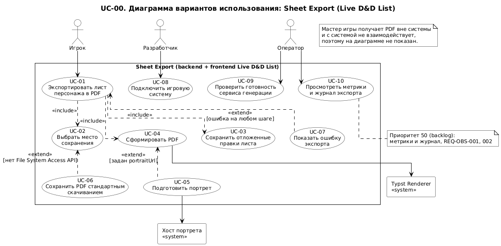

# Модель вариантов использования Sheet Export

Документ описывает актёров и прецеденты модуля **Sheet Export** проекта Live D&D List. Модель выведена из SRS v0.2 (`../srs/srs.md`) и SDD (`../sdd/sdd.md`); термины определены в [глоссарии](glossary.md), нефункциональные требования — в [дополнительных спецификациях](supplementary-spec.md).

## Диаграмма вариантов использования

Исходник: [`diagrams/uc-01-use-case.puml`](diagrams/uc-01-use-case.puml). Диаграмма `UC-00` — обзорная: она показывает всех актёров и все прецеденты, а не только `UC-01`.

Правила построения:

- актёры находятся вне границы системы, связи между актёрами не моделируются;
- каждый прецедент инициируется актёром или включается в другой прецедент; для внешней системы, которая только принимает запрос, стрелка идёт от прецедента к актёру;
- между прецедентами используются только `include` (обязательное общее поведение) и `extend` (необязательное расширение);
- люди показаны «человечками», внешние системы — прямоугольниками со стереотипом `<<system>>`.

## Актёры

| Актёр | Тип | Описание |
|-------|-----|----------|
| Игрок | Человек | Владелец листа персонажа; запускает экспорт, выбирает каталог и имя файла, получает PDF. |
| Разработчик | Человек | Разработчик проекта; подключает новую игровую систему через провайдер и комплект шаблонов, не меняя ядро модуля. |
| Оператор | Человек | Администратор развёртывания; проверяет готовность Typst Renderer, метрики и журналы экспорта. |
| Typst Renderer | Внешняя система | Локальный сервис генерации PDF; принимает манифест и портрет, компилирует шаблон и возвращает PDF. В нотации UML — прямоугольник `<<system>>`. |
| Хост портрета | Внешняя система | Внешний HTTP-хост, с которого backend загружает изображение портрета по `portraitUrl`. В нотации UML — прямоугольник `<<system>>`. |

Мастер игры не является актёром: он получает готовый PDF вне приложения и с системой не взаимодействует. Поэтому на диаграмме он не показан.

## Перечень прецедентов

| ID | Прецедент | Актёры | Связи | Требования SRS |
|----|-----------|--------|-------|----------------|
| UC-01 | Экспортировать лист персонажа в PDF | Игрок | include UC-02, UC-03, UC-04; extend UC-07 | REQ-FUNC-001 … 008, 021; REQ-INT-004, 009; REQ-SEC-001 |
| UC-02 | Выбрать место сохранения | Игрок | включается в UC-01; extend UC-06 | REQ-FUNC-003, 004, 006, 007 |
| UC-03 | Сохранить отложенные правки листа | Игрок (косвенно), Frontend | включается в UC-01 | REQ-FUNC-008 |
| UC-04 | Сформировать PDF | Typst Renderer, Backend | включается в UC-01; extend UC-05 | REQ-FUNC-009 … 020, 022, 023; REQ-INT-011; REQ-REL-002, 003; REQ-COMP-001 |
| UC-05 | Подготовить портрет | Хост портрета, Backend | extend UC-04 | REQ-INT-010; REQ-SEC-002, 003; REQ-REL-001; REQ-FUNC-020 |
| UC-06 | Сохранить PDF стандартным скачиванием | Игрок, Frontend | extend UC-02 | REQ-FUNC-007 |
| UC-07 | Показать ошибку экспорта | Игрок, Frontend | extend UC-01 | REQ-FUNC-021; REQ-REL-003; REQ-SEC-005 |
| UC-08 | Подключить игровую систему | Разработчик | — | REQ-REUSE-001 … 004; REQ-MAINT-002 |
| UC-09 | Проверить готовность сервиса генерации | Оператор | — | REQ-INT-001, REQ-INT-011 |
| UC-10 | Просмотреть метрики и журнал экспорта | Оператор | — | REQ-OBS-001, REQ-OBS-002; REQ-SEC-005 |

## Описание прецедентов

### UC-01 Экспортировать лист персонажа в PDF

- **Актёры**: Игрок.
- **Пояснение**: игрок нажимает кнопку «Export to PDF» в заголовке открытого листа и получает PDF-файл с полным листом персонажа, сохранённый в выбранное место.
- **Предусловия**: пользователь авторизован; лист персонажа открыт и загружен; персонаж принадлежит пользователю; кнопка экспорта находится в состоянии `idle`.
- **Основной поток**:
  1. Игрок нажимает «Export to PDF».
  2. Frontend проверяет состояние кнопки и доступность File System Access API.
  3. Если API доступен, выполняется UC-02: игрок выбирает каталог и имя файла.
  4. Frontend сохраняет отложенные правки листа (UC-03).
  5. Frontend отправляет `GET /api/v1/characters/{id}/export/pdf` с JWT и переходит в состояние `generating`.
  6. Backend проверяет токен и владельца персонажа, получает слот генерации и формирует PDF (UC-04).
  7. Backend возвращает `200 application/pdf` с `Content-Disposition` и `Cache-Control: no-store`.
  8. Frontend записывает PDF в выбранный файл или выполняет обычное скачивание (UC-06).
  9. Frontend показывает уведомление «PDF сохранён» и возвращает кнопку в состояние `idle`.
  10. Прецедент завершается.
- **Альтернативные потоки**:
  - A1 (диалог отменён): на шаге 3 игрок закрывает диалог — файл не создаётся, запрос на сервер не отправляется, кнопка возвращается в `idle`.
  - A2 (File System Access API недоступен): на шаге 2 выполняется UC-06, PDF скачивается стандартным способом; каталог определяется настройками браузера.
  - A3 (нет отложенных правок): шаг 4 не выполняет запросов, frontend сразу переходит к шагу 5.
- **Потоки ошибок**:
  - E1: JWT отсутствует или недействителен — backend возвращает `401`, PDF не создаётся, выполняется UC-07.
  - E2: персонаж не найден или принадлежит другому пользователю — backend возвращает `404`, выполняется UC-07.
  - E3: нет свободного слота генерации — backend возвращает `503`, выполняется UC-07.
  - E4: Renderer недоступен, превысил таймаут или вернул ошибку — backend возвращает `503`, `504` или `500` в формате `ApiResponse`, выполняется UC-07.
  - E5: не удалось записать файл на устройство — frontend вызывает `abort()` для открытой записи, показывает сообщение об ошибке, выполняется UC-07.
- **Постусловия**: при успехе PDF сохранён на устройстве игрока, лист персонажа не изменён, кнопка снова активна; при ошибке файл не создан или не дописан, частичный PDF отсутствует, кнопка возвращена в `idle`.

### UC-02 Выбрать место сохранения

- **Актёры**: Игрок.
- **Пояснение**: игрок выбирает каталог и имя файла через диалог браузера до начала генерации PDF.
- **Предусловия**: открыт лист персонажа; нажат «Export to PDF»; браузер поддерживает File System Access API; кнопка находится в состоянии `idle`.
- **Основной поток**:
  1. Frontend формирует предлагаемое имя `<имя персонажа>_<yyyy-MM-dd>.pdf` по REQ-FUNC-005.
  2. Frontend вызывает `showSaveFilePicker` непосредственно в обработчике клика.
  3. Игрок выбирает каталог и подтверждает имя файла.
  4. Frontend получает `FileSystemFileHandle` и продолжает UC-01.
- **Альтернативные потоки**:
  - A1 (отмена): игрок закрывает диалог — frontend получает `AbortError`, файл не создаётся, запрос на сервер не отправляется.
  - A2 (имя пустое или недопустимое): frontend подставляет `character` и заменяет запрещённые символы на `_`.
  - A3 (API отсутствует): выполняется UC-06.
- **Потоки ошибок**:
  - E1: браузер не выдал разрешение на запись — frontend показывает сообщение об ошибке, файл не создаётся, кнопка возвращается в `idle`.
- **Постусловия**: при успехе frontend хранит дескриптор файла для записи; при отмене или ошибке дескриптор отсутствует, состояние кнопки — `idle`.

### UC-03 Сохранить отложенные правки листа

- **Актёры**: Игрок (косвенно), Frontend.
- **Пояснение**: перед экспортом frontend отправляет на сервер изменения полей листа, которые ещё не были сохранены из-за задержки 500 мс.
- **Предусловия**: открыт лист персонажа; в интерфейсе есть несохранённые изменения; нажат «Export to PDF».
- **Основной поток**:
  1. Frontend отменяет таймер отложенного сохранения.
  2. Frontend отправляет `PUT /api/v1/characters/{id}` с последними изменениями.
  3. Backend сохраняет изменения и возвращает обновлённый лист.
  4. Frontend переходит к запросу экспорта.
- **Альтернативные потоки**:
  - A1 (нет отложенных изменений): шаги 1–3 пропускаются, сразу выполняется запрос экспорта.
  - A2 (пользователь изменил поле во время сохранения): frontend дожидается завершения текущего запроса и отправляет следующую порцию изменений.
- **Потоки ошибок**:
  - E1: сервер вернул `400` или `401` — экспорт не начинается, frontend показывает ошибку и возвращает кнопку в `idle`.
  - E2: сеть недоступна — экспорт не начинается, показывается сообщение об ошибке, несохранённые данные остаются в интерфейсе.
- **Постусловия**: при успехе данные персонажа на сервере актуальны, PDF формируется по последним значениям; при ошибке экспорт не выполняется, лист не теряет введённые данные.

### UC-04 Сформировать PDF

- **Актёры**: Typst Renderer, Backend.
- **Пояснение**: backend получает данные персонажа, строит нейтральную модель листа, передаёт её Renderer и возвращает готовый PDF.
- **Предусловия**: запрос прошёл авторизацию и проверку владельца; получен слот генерации; Renderer доступен по внутренней сети.
- **Основной поток**:
  1. Backend получает данные персонажа и связанные справочники.
  2. `DndSheetProvider` строит `SheetModel`, вычисляет производные значения (модификаторы, спасброски, пассивную мудрость, бонусы атаки).
  3. Если задан `portraitUrl`, выполняется UC-05; иначе используется заглушка.
  4. `TypstRendererClient` отправляет `POST /internal/v1/render` с манифестом, портретом и внутренним токеном.
  5. Renderer проверяет токен, `templateId` из allow-list, размер и тип вложения.
  6. Renderer создаёт уникальный рабочий каталог, копирует шаблон, записывает `data.json` и ресурсы.
  7. Renderer запускает `typst compile` с `--root`, `--font-path`, `--ignore-system-fonts` и таймаутом 12 с.
  8. Renderer устанавливает метаданные Title/Creator, проверяет `%PDF-`, версию и размер.
  9. Renderer возвращает `200 application/pdf` и удаляет рабочий каталог.
  10. Backend проверяет ответ, записывает метрики и событие журнала, возвращает PDF frontend.
- **Альтернативные потоки**:
  - A1 (портрет не задан): шаг 3 сразу использует заглушку.
  - A2 (портрет недоступен или небезопасен): UC-05 возвращает заглушку, экспорт продолжается.
  - A3 (нет заклинаний): основная страница заклинаний не формируется по REQ-FUNC-015.
  - A4 (данные не помещаются в блок): Typst создаёт страницы продолжения по REQ-FUNC-017.
- **Потоки ошибок**:
  - E1: Renderer отклонил манифест, `templateId` или размер — `400`, `401`, `413` или `422`; backend преобразует ответ в `ApiResponse`.
  - E2: нет свободного слота компиляции — Renderer возвращает `503`; backend возвращает `503`.
  - E3: компиляция превысила 12 с — Renderer останавливает процесс и возвращает `504`; backend возвращает `504`.
  - E4: ошибка компиляции или некорректный PDF — Renderer возвращает `500` без пользовательских данных; backend возвращает `500`; временный каталог удаляется.
  - E5: Renderer недоступен — backend возвращает `503`, частичный PDF не отдаётся.
- **Постусловия**: при успехе PDF полностью сформирован и передан backend; временные файлы удалены. При ошибке PDF не отдаётся, временные файлы удалены, ошибка имеет формат `ApiResponse`.

### UC-05 Подготовить портрет

- **Актёры**: Хост портрета, Backend.
- **Пояснение**: backend безопасно загружает изображение по `portraitUrl`, проверяет формат и размеры, масштабирует его для рамки листа или заменяет заглушкой.
- **Предусловия**: в данных персонажа задан `portraitUrl`; выполняется UC-04.
- **Основной поток**:
  1. `UrlGuard` проверяет схему `http`/`https` и порт 80/443.
  2. Клиент разрешает адрес и проверяет, что он не loopback, не частный, не link-local, не multicast и не адрес метаданных.
  3. Backend выполняет GET с таймаутом 5 с, лимитом 5 МБ и не более 3 перенаправлений; каждый адрес перенаправления проверяется заново.
  4. Backend определяет формат по сигнатуре (PNG/JPEG) и проверяет размер в пикселях (не более 25 млн).
  5. Backend масштабирует изображение до 1500 px по большей стороне и передаёт проверенные байты Renderer.
- **Альтернативные потоки**:
  - A1 (`portraitUrl` пуст): используется заглушка, UC-05 завершается.
  - A2 (изображение больше лимита): изображение уменьшается; если уменьшение невозможно, используется заглушка.
- **Потоки ошибок**:
  - E1: недопустимая схема, внутренний адрес или `file://` — запрос не отправляется, используется заглушка.
  - E2: таймаут, ошибка сети, код 404/500 — используется заглушка, экспорт продолжается.
  - E3: файл больше 5 МБ, не PNG/JPEG, превышен лимит пикселей — используется заглушка, экспорт продолжается.
- **Постусловия**: Renderer получает либо проверенные байты изображения, либо заглушку; экспорт не прерывается из-за портрета.

### UC-06 Сохранить PDF стандартным скачиванием

- **Актёры**: Игрок, Frontend.
- **Пояснение**: в браузерах без File System Access API PDF сохраняется через `<a download>`.
- **Предусловия**: File System Access API недоступен; выполняется UC-01 или UC-02.
- **Основной поток**:
  1. Frontend получает PDF как `Blob`.
  2. Frontend создаёт временную ссылку `<a download>` с безопасным именем файла.
  3. Браузер сохраняет файл в каталог, заданный настройками загрузки.
  4. Frontend показывает уведомление «PDF сохранён» и возвращает кнопку в `idle`.
- **Альтернативные потоки**:
  - A1 (браузер блокирует автоматическое скачивание): frontend показывает сообщение с просьбой разрешить скачивание; повторный запрос не создаётся.
- **Потоки ошибок**:
  - E1: браузер не поддерживает `Blob`/`download` — frontend показывает ошибку, PDF не сохраняется.
- **Постусловия**: PDF передан браузеру для сохранения; при успехе файл находится в каталоге загрузок.

### UC-07 Показать ошибку экспорта

- **Актёры**: Игрок, Frontend.
- **Пояснение**: при любой ошибке экспорта frontend не оставляет частичный файл и показывает понятное сообщение без технических деталей.
- **Предусловия**: выполняется UC-01; на любом шаге возникла ошибка.
- **Основной поток**:
  1. Frontend получает ошибку от backend, файловой системы или сети.
  2. Если запись в файл уже открыта, вызывается `abort()`.
  3. Frontend показывает уведомление «Не удалось создать PDF. Повторите попытку.».
  4. Кнопка возвращается в состояние `idle`; повторный экспорт возможен.
- **Альтернативные потоки**:
  - A1 (ошибка после успешной записи): уведомление об успехе не показывается, файл не считается созданным.
- **Потоки ошибок**:
  - E1: не удалось вызвать `abort()` — frontend всё равно возвращает кнопку в `idle` и показывает сообщение; временный файл не считается результатом экспорта.
- **Постусловия**: частичный PDF не остаётся; пользователь видит сообщение; лист персонажа не изменён; кнопка снова активна.

### UC-08 Подключить игровую систему

- **Актёры**: Разработчик.
- **Пояснение**: разработчик добавляет поддержку новой игровой системы, реализуя провайдер листа и комплект Typst-шаблонов без изменения общего Java-ядра и HTTP-контракта Renderer.
- **Предусловия**: известны структура данных новой системы и требования к её листу; ядро модуля и контракт Renderer зафиксированы.
- **Основной поток**:
  1. Разработчик создаёт реализацию `SheetDefinitionProvider` с уникальным `systemId`.
  2. Разработчик добавляет каталог шаблона в Renderer и регистрирует `templateId` в allow-list.
  3. Разработчик добавляет ресурсы подписей и при необходимости тестовые данные.
  4. Провайдер регистрируется как Spring-бин; модуль выбирает его по `systemId`.
  5. Разработчик добавляет тест `SecondSystemTest` и проверяет экспорт на тестовом листе.
- **Альтернативные потоки**:
  - A1 (система использует те же поля, что D&D): провайдер может переиспользовать общие структуры `SheetModel`, если это не нарушает нейтральность ядра.
  - A2 (нужны новые типы блоков): разработчик расширяет модель и шаблон, не добавляя термины конкретной системы в ядро без необходимости.
- **Потоки ошибок**:
  - E1: `systemId` или `templateId` не зарегистрирован — запрос экспорта отклоняется, ядро не изменяется.
  - E2: шаблон не компилируется — тест шаблона падает, система не считается подключённой.
- **Постусловия**: новая система доступна через провайдер и шаблон; общий Java-код и HTTP-контракт Renderer не изменены; тесты проходят.

### UC-09 Проверить готовность сервиса генерации

- **Актёры**: Оператор.
- **Пояснение**: оператор проверяет, что Typst Renderer запущен и готов принимать задания.
- **Предусловия**: Renderer развёрнут в Docker Compose; доступен из внутренней сети.
- **Основной поток**:
  1. Оператор запрашивает `GET /health/live`.
  2. Renderer отвечает `200`, если процесс жив.
  3. Оператор запрашивает `GET /health/ready`.
  4. Renderer проверяет наличие Typst CLI, каталога шаблонов и шрифтов и отвечает `200` при готовности.
- **Альтернативные потоки**:
  - A1 (live успешен, ready нет): оператор видит, что сервис жив, но не готов; проверяет шаблоны, шрифты и конфигурацию.
- **Потоки ошибок**:
  - E1: `/health/live` не отвечает — контейнер не запущен или сеть недоступна.
  - E2: `/health/ready` возвращает ошибку — отсутствует Typst CLI, шаблон или каталог шрифтов; экспорт временно недоступен.
- **Постусловия**: оператор знает состояние сервиса; при `ready` экспорт может выполняться, при ошибке — диагностирует причину.

### UC-10 Просмотреть метрики и журнал экспорта

- **Актёры**: Оператор.
- **Пояснение**: оператор наблюдает за успешными и неуспешными экспортами, длительностью операции и техническими ошибками Renderer.
- **Предусловия**: backend и Renderer запущены; включены Micrometer/Prometheus и журналирование.
- **Основной поток**:
  1. Оператор открывает `/actuator/prometheus`.
  2. Оператор видит метрику длительности полной операции экспорта и счётчики `success`/`failure`.
  3. Оператор открывает журнал backend и находит структурированное событие успешного экспорта: `characterId`, длительность, число страниц, размер PDF.
  4. При ошибке оператор находит запись Renderer по `requestId` и коду ошибки без пользовательских данных.
- **Альтернативные потоки**:
  - A1 (метрик нет): оператор проверяет, что модуль экспорта зарегистрировал Micrometer-метрики и включён actuator.
  - A2 (журнал пуст): оператор проверяет уровень логирования и наличие запросов.
- **Потоки ошибок**:
  - E1: в журналах обнаружены тексты полей персонажа, `portraitUrl`, манифест или внутренний токен — это нарушение REQ-SEC-005; экспорт не должен логировать эти данные.
- **Постусловия**: оператор получил метрики и техническую информацию для диагностики; персональные данные персонажа в журналах отсутствуют.

## Трассируемость

| Прецедент | Диаграмма активности | Диаграммы состояний | Диаграммы последовательности | Требования |
|-----------|----------------------|---------------------|------------------------------|------------|
| UC-01 | AD-01 | SM-01 (кнопка), SM-02 (задание Renderer) | SD-01, SD-02 | REQ-FUNC-001 … 008, 021; REQ-INT-004, 009; REQ-SEC-001 |
| UC-02 | AD-01 | SM-01 | SD-01 | REQ-FUNC-003, 004, 006, 007 |
| UC-03 | AD-01 | SM-01 | SD-01 | REQ-FUNC-008 |
| UC-04 | AD-01 | SM-02 | SD-01, SD-02 | REQ-FUNC-009 … 020, 022, 023; REQ-INT-011; REQ-REL-002, 003 |
| UC-05 | AD-01 | SM-02 | SD-01 | REQ-INT-010; REQ-SEC-002, 003; REQ-REL-001; REQ-FUNC-020 |
| UC-06 | AD-01 | SM-01 | SD-01 | REQ-FUNC-007 |
| UC-07 | AD-01 | SM-01 | SD-02 | REQ-FUNC-021; REQ-REL-003 |
| UC-08 | — | — | — | REQ-REUSE-001 … 004; REQ-MAINT-002 |
| UC-09 | — | — | — | REQ-INT-001, REQ-INT-011 |
| UC-10 | — | — | — | REQ-OBS-001, 002; REQ-SEC-005 |
